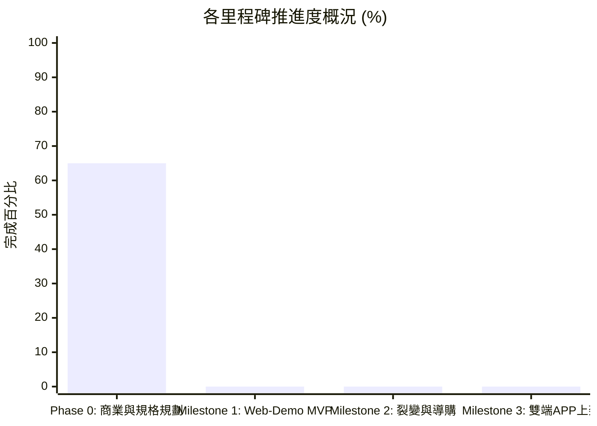

# FitMon 專案即時狀態與任務看板 (Project State & Kanban)

> **規則**：本檔案為專案的「即時黑板 (Single Source of Live Truth)」。每次對話啟動時 AI 必須讀取此檔以對齊狀態，每次討論產生決策或任務流轉時必須即時更新。

---

## 1. 專案元資料 (Metadata)

| 欄位 | 當前數值 | 說明 |
|---|---|---|
| **專案名稱** | FitMon (健身遊戲化像素 RPG) | 核心：雙模式、Local-First、Zero-PII |
| **目前階段** | **Phase 0：商業規劃、數值論證與知識庫深耕期** | ⚠️ **【凍結程式開發】** 暫不寫 Code |
| **當前版本** | `v0.1.0-planning` | 規格與知識庫奠基版本 |
| **最後更新時間** | `2026-11-01 18:31 (Asia/Taipei)` | 每次討論結束必須更新時間戳 |
| **最後 Git Commit** | `d83d310` (feat: 建立協作 SOP 與動態看板) | 與本地儲存庫保持同步 |
| **當前焦點 (Current Focus)** | 確立長期人機協作 SOP 與待辦事項狀態機 | 打造可持續對齊之溝通框架 |

---

## 2. 待辦事項動態看板 (Kanban Board)

### 🔴 進行中 (In Progress)
- [x] **TASK-001**：建立 Karpathy-style LLM-Wiki 知識庫目錄架構 (`wiki/`, `raw/`, `logs/`, `adr/`, `ops/`)
- [x] **TASK-002**：建立 AI 模型協同操作指南 (`AGENT.md`) 與 Git Monorepo 初始化
- [x] **TASK-003**：建立長期人機溝通 SOP、開局對齊握手協議與即時狀態看板 (`ops/collaboration_sop.md`)
- [ ] **NEXT-FOCUS**：進入待辦清單，選定第一個深入規劃議題（如 PLAN-001 商業變現導購或 PLAN-002 動作庫擴充）

### 🟡 待討論與規劃清單 (Backlog / To-Do)
- [ ] **PLAN-001 (P0)**：商業變現細節拆解——補劑聯盟導購外跳機制、品牌合作商務提案草案
- [ ] **PLAN-002 (P0)**：運動科學動作庫擴充——40+ 核心動作分類、神經加權倍率與安全防刷邊界微調
- [ ] **PLAN-003 (P1)**：像素角色體態演化數值線——從「新手學徒」到「重裝泰坦」的等級經驗值曲線設計
- [ ] **PLAN-004 (P1)**：Canvas 迷因工作室模版設計——IG Story 9:16 排版規格、經典自嘲梗文案庫
- [ ] **PLAN-005 (P2)**：Supabase 零個資認證架構驗證——Apple Private Relay 匿名登入之 UID 生成與測試流程

### 🟢 最近已完成 (Recently Done)
- [x] **DONE-20261101-01**：收錄原始 PRD 規格文件至 `raw/20261101_fitmon_prd_original.html`
- [x] **DONE-20261101-02**：提煉 8 大主題知識庫至 `wiki/*.md`
- [x] **DONE-20261101-03**：撰寫 ADR-0001 Web-First (React + Vite + Capacitor) 技術選型評估
- [x] **DONE-20261101-04**：以 TypeScript 實作核心運動科學公式與疲勞衰減引擎 (`packages/engine`)
- [x] **DONE-20261101-05**：在 `README.md` 與 `AGENT.md` 增設即時狀態看板

### ⏸️ 擱置 / 外部阻礙 (Blocked / On Hold)
- *暫無阻礙*

---

## 3. 階段里程碑完成度 (Milestone Tracker)

