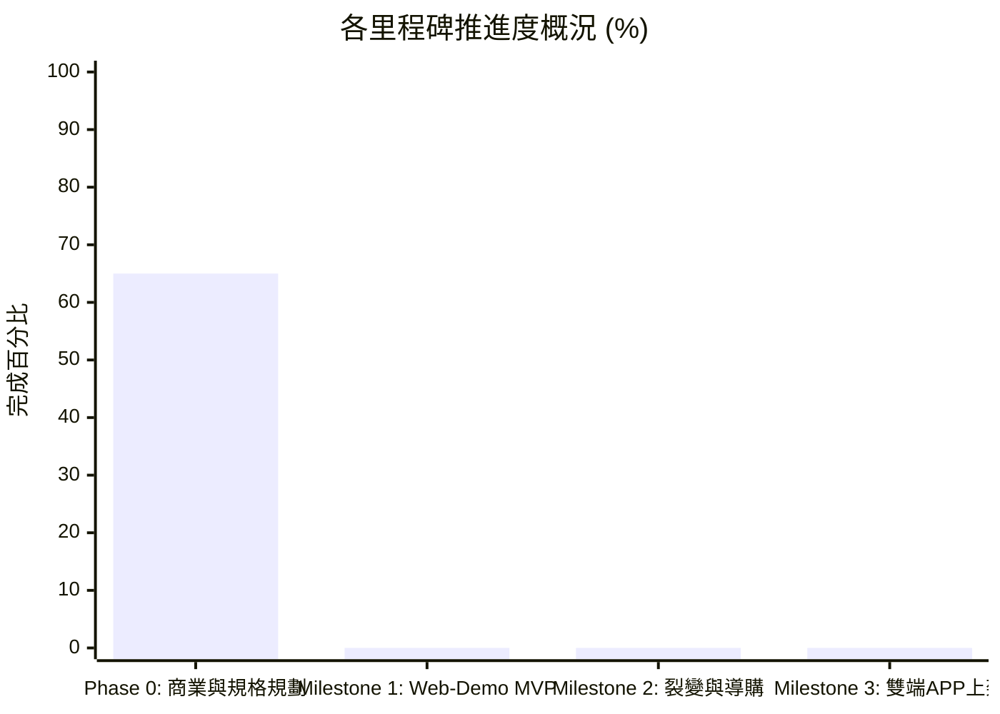

# FitMon 專案即時狀態與任務看板 (Project State & Kanban)

> **規則**：本檔案為專案的「即時黑板 (Single Source of Live Truth)」。每次對話啟動時 AI 必須讀取此檔以對齊狀態，每次討論產生決策或任務流轉時必須即時更新。

---

## 1. 專案元資料 (Metadata)

| 欄位 | 當前數值 | 說明 |
|---|---|---|
| **專案名稱** | FitMon (泛運動連續打卡社群 × 像素紙娃娃) | 核心：任務制、金幣打賞、好友圈、Meme 分享 |
| **目前階段** | **Phase 0：產品大方向對齊完成，進入規格重構期** | ⚠️ **【凍結程式開發】** 待 Schema 與原型定案 |
| **當前版本** | `v0.2.0-pivot-aligned` | 經 Grill-me 深度對齊後之產品新基準 |
| **最後更新時間** | `2026-11-01 18:57 (Asia/Taipei)` | 每次討論結束必須更新時間戳 |
| **最後 Git Commit** | `92b8444` (docs: 完成 Grill-me 戰略重構對齊) | 與本地儲存庫保持同步 |
| **當前焦點 (Current Focus)** | 完成 Grill-me 戰略重構對齊，展開新版 Schema 與任務規劃 | 以「好玩好用、朋友圈口碑」為核心驅動 |

---

## 2. 待辦事項動態看板 (Kanban Board)

### 🔴 進行中 (In Progress)
- [x] **TASK-004**：完成 `/grill-me` 深度對齊訪談，確認 8 大架構支柱（泛運動、任務制、金幣打賞、社群雙軌、像素紙娃娃、PWA）
- [ ] **NEXT-FOCUS**：依據新藍圖梳理 Supabase 資料庫綱要 (Schema) 與 PWA 原型規格 (PLAN-010)

### 🟡 待討論與規劃清單 (Backlog / To-Do)
- [ ] **PLAN-010 (P0)**：設計輕量社群與任務資料庫綱要 (`profiles`, `quests`, `workouts`, `posts`, `tips`, `friends`)
- [ ] **PLAN-011 (P0)**：定義 2D 像素紙娃娃組件規範（部位拆解、裝扮資產層級、Canvas 合成架構）
- [ ] **PLAN-012 (P1)**：規劃三層階梯任務數值（每日任務池、連續 Streak 倍率、里程碑成就清單與金幣給付率）
- [ ] **PLAN-013 (P1)**：動態成果卡片與 Meme 梗圖排版工坊設計（含自嘲文案庫與 IG 9:16 轉發規格）
- [ ] **PLAN-014 (P2)**：漸進式綁定機制與無感註冊實作細節（匿名 Local-First 轉 Supabase Auth 流程）

### 🟢 最近已完成 (Recently Done)
- [x] **DONE-20261101-06**：完成 Grill-me 戰略收斂訪談，產出 [`alignment_fitmon_v2_strategy.md`](file:///Users/yuchien/.gemini/antigravity-cli/brain/fe928b95-a5d1-439f-8ae3-9b7bc574f420/alignment_fitmon_v2_strategy.md)
- [x] **DONE-20261101-05**：在 `README.md` 與 `AGENT.md` 增設即時狀態看板
- [x] **DONE-20261101-04**：以 TypeScript 實作核心運動科學公式與疲勞衰減引擎 (`packages/engine`)
- [x] **DONE-20261101-03**：撰寫 ADR-0001 Web-First 技術選型評估
- [x] **DONE-20261101-02**：建立初始 8 大主題知識庫至 `wiki/*.md`
- [x] **DONE-20261101-01**：收錄原始 PRD 規格文件至 `raw/`

### ⏸️ 擱置 / 暫不考慮 (Parked / Post-MVP)
- **PARK-001**：外部補劑/品牌電商導購商務（俟社群人氣積累後再行考慮）
- **PARK-002**：複雜 RPG 怪物對戰與數值打怪數值（改採直觀任務與金幣制）

---

## 3. 階段里程碑完成度 (Milestone Tracker)

