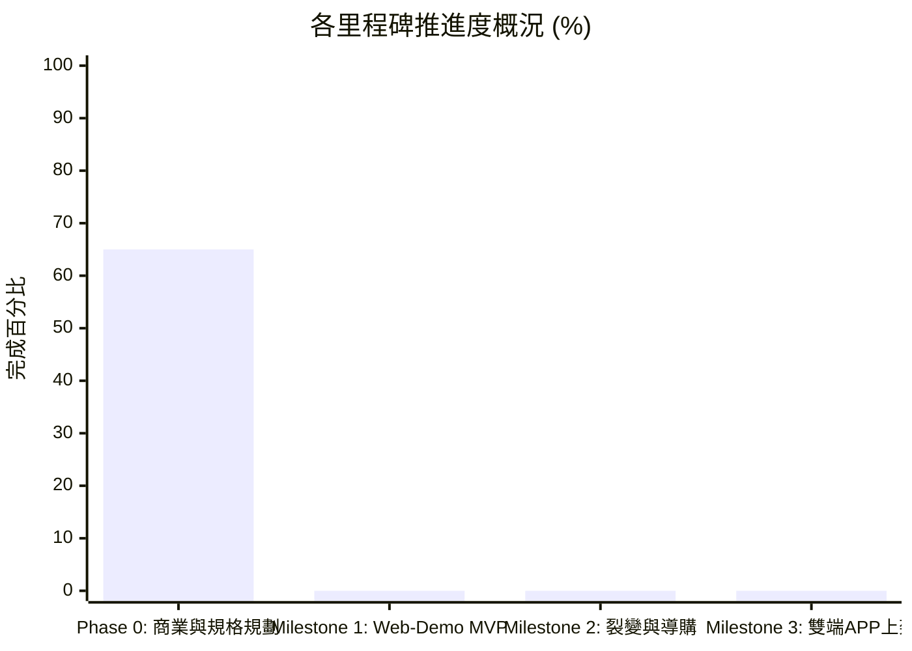

# FitMon 專案即時狀態與任務看板 (Project State & Kanban)

> **規則**：本檔案為專案的「即時黑板 (Single Source of Live Truth)」。每次對話啟動時 AI 必須讀取此檔以對齊狀態，每次討論產生決策或任務流轉時必須即時更新。

---

## 1. 專案元資料 (Metadata)

| 欄位 | 當前數值 | 說明 |
|---|---|---|
| **專案名稱** | FitMon (泛運動打卡社群 × 像素紙娃娃與運動科學) | 核心：雙軌紙娃娃、任務金幣、Meme 拍貼、開源科學動作庫 |
| **目前階段** | **Phase 1：MVP 核心實作期 (Execution Phase)** | 🚀 **【正式解除程式碼開發凍結】** |
| **當前版本** | `v1.6.0-analytics-facade-aligned` | 納入產品行為遙測與漏斗分析模組 (Facade Pattern) 定案版本 |
| **最後更新時間** | `2026-11-01 20:30 (Asia/Taipei)` | 每次討論結束必須更新時間戳 |
| **最後 Git Commit** | `857ef28` | 與本地儲存庫保持同步 |
| **當前焦點 (Current Focus)** | 21 大模組全數對齊收斂完畢，正式啟動 Sprint 1.1 前端工程初始化 | 像素示範 ＋ 本機健康圖表 ＋ 雲端防作弊金幣 ＋ 產品行為遙測 |

---

## 2. 待辦事項動態看板 (Kanban Board)

### 🔴 進行中 (In Progress)
- [ ] **SPRINT-1.1**：初始化 `apps/web-demo` 前端專案環境 (Vite + React + TypeScript + Tailwind + PixiJS + Zustand)
- [ ] **SPRINT-1.2**：實作 `PixiGameApp` 核心畫布容器（180x320 虛擬低解析度 + NEAREST 無損放大）
- [ ] **SPRINT-1.3**：建立初始預置像素圖集（Starter Spritesheet），渲染 32x32 角色與房間家具
- [ ] **SPRINT-1.4**：實作小人自主遊蕩 AI（漫遊器材、使用跑步機/深蹲架、頭頂情境對話氣泡輪播）

### 🟡 待討論與規劃清單 (Backlog / To-Do)
- [ ] **SPRINT-2**：頂部 HUD、課表模板庫、運動打卡雙模式與「VICTORY」街機金幣噴發結算
- [ ] **SPRINT-3**：雙軌換裝商城 (衣櫃+房間) 與 Meme 拍貼工坊 (雙指手勢、自嘲梗庫、右下貼邊宣傳浮水印)
- [ ] **SPRINT-4**：本機健康沙盒圖表 (IndexedDB 身高/體重/BMR/TDEE)、Supabase 雲端防作弊金幣與純像素社群牆
- [ ] **SPRINT-5**：線上小規模試玩部署 (Cloudflare/Vercel) 與 Capacitor 原生跨端相容驗證

### 🟢 最近已完成 (Recently Done)
- [x] **DONE-20261101-16**：確立產品行為遙測與漏斗分析模組（Facade Pattern 支援 PostHog/GA4，零生理個資埋點原則）(TASK-010)
- [x] **DONE-20261101-15**：確立本機健康沙盒 (Local Biometrics Sandbox) 與 Apple Health / Google Health Connect 串接原則；數據 100% 留存本地，雲端僅驗證防作弊資產 (TASK-009)
- [x] **DONE-20261101-14**：納入 `free-exercise-db` 開源動作庫、雙軌圖解與玩中學每日科普問答 (TASK-008)
- [x] **DONE-20261101-13**：確立 Zero-PII 內容安全防火牆（站內純像素零風控、站外本地合照）、補齊課表模板、行事曆、PR 追蹤、休息日保護與離線同步，全系統收斂為 18 大模組 (TASK-007)
- [x] **DONE-20261101-12**：完成 MVP 前端工程落地藍圖與 Sprint WBS 分解 ([`fitmon_mvp_engineering_plan_v1.md`](file:///Users/yuchien/.gemini/antigravity-cli/brain/fe928b95-a5d1-439f-8ae3-9b7bc574f420/fitmon_mvp_engineering_plan_v1.md))
- [x] **DONE-20261101-11**：完成像素迷因拍貼工坊技術規格書 ([`fitmon_meme_studio_spec.md`](file:///Users/yuchien/.gemini/antigravity-cli/brain/fe928b95-a5d1-439f-8ae3-9b7bc574f420/fitmon_meme_studio_spec.md))
- [x] **DONE-20261101-10**：完成 PixiJS 2D 像素遊戲渲染器規格書 ([`fitmon_pixijs_renderer_spec.md`](file:///Users/yuchien/.gemini/antigravity-cli/brain/fe928b95-a5d1-439f-8ae3-9b7bc574f420/fitmon_pixijs_renderer_spec.md))
- [x] **DONE-20261101-09**：完成 Supabase 遊戲驅動資料庫綱要與原子打賞 RPC 函數 ([`supabase/migrations/20261101_init_fitmon_game_schema.sql`](../supabase/migrations/20261101_init_fitmon_game_schema.sql))
- [x] **DONE-20261101-08**：擴充 GDD 雙軌紙娃娃系統（納入 6 大房間裝潢卡槽與好友串門參觀），更新 [`fitmon_game_design_document_v1.md`](file:///Users/yuchien/.gemini/antigravity-cli/brain/fe928b95-a5d1-439f-8ae3-9b7bc574f420/fitmon_game_design_document_v1.md)
- [x] **DONE-20261101-07**：完成 GDD 遊戲企劃設計書初版
- [x] **DONE-20261101-06**：完成 Grill-me 戰略收斂訪談
- [x] **DONE-20261101-05**：在 `README.md` 與 `AGENT.md` 增設即時狀態看板
- [x] **DONE-20261101-04**：以 TypeScript 實作核心運動科學公式與疲勞衰減引擎 (`packages/engine`)
- [x] **DONE-20261101-03**：撰寫 ADR-0001 Web-First 技術選型評估
- [x] **DONE-20261101-02**：建立初始 8 大主題知識庫至 `wiki/*.md`
- [x] **DONE-20261101-01**：收錄原始 PRD 規格文件至 `raw/`

### ⏸️ 擱置 / 暫不考慮 (Parked / Post-MVP)
- **PARK-001**：外部補劑/品牌電商導購商務（俟社群人氣積累後再行考慮）
- **PARK-002**：複雜 RPG 怪物對戰與數值打怪數值（改採直觀任務與金幣制）

---

## 3. 階段里程碑完成度 (Milestone Tracker)

