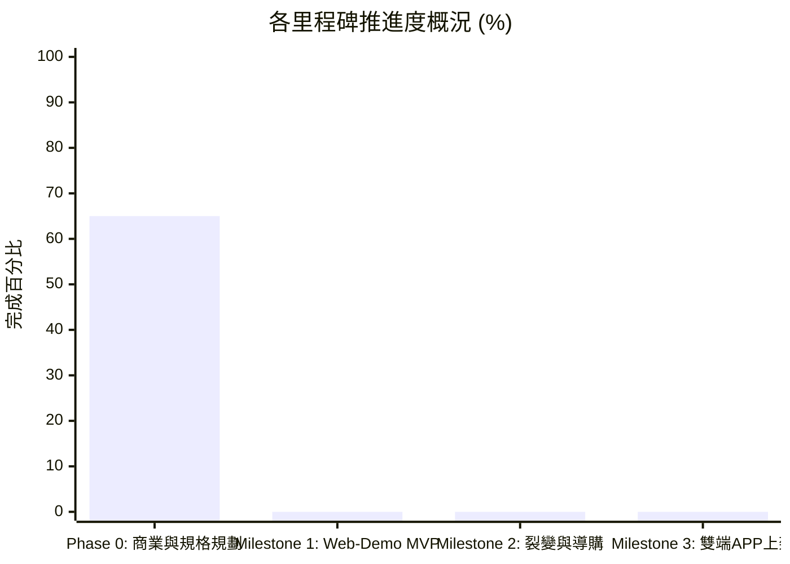

# FitMon 專案即時狀態與任務看板 (Project State & Kanban)

> **規則**：本檔案為專案的「即時黑板 (Single Source of Live Truth)」。每次對話啟動時 AI 必須讀取此檔以對齊狀態，每次討論產生決策或任務流轉時必須即時更新。

---

## 1. 專案元資料 (Metadata)

| 欄位 | 當前數值 | 說明 |
|---|---|---|
| **專案名稱** | FitMon (泛運動連續打卡社群 × 像素紙娃娃) | 核心：任務制、金幣打賞、好友圈、Meme 分享 |
| **目前階段** | **Phase 0：遊戲企劃 GDD 定案，進入技術實作準備期** | ⚠️ **【凍結程式開發】** 待 Schema 與 PixiJS 規格就緒 |
| **當前版本** | `v1.0.0-gdd-aligned` | 遊戲企劃設計書 GDD v1.0 定案版本 |
| **最後更新時間** | `2026-11-01 19:07 (Asia/Taipei)` | 每次討論結束必須更新時間戳 |
| **最後 Git Commit** | `320f540` | 與本地儲存庫保持同步 |
| **當前焦點 (Current Focus)** | GDD 遊戲企劃完成，依據遊戲要素精準映射 Supabase Schema 與 PixiJS 規格 | 遊戲驅動架構，拒絕盲目開表 |

---

## 2. 待辦事項動態看板 (Kanban Board)

### 🔴 進行中 (In Progress)
- [x] **TASK-005**：完成 GDD 遊戲企劃設計書 v1.0（主場景 Hub、32x32 紙娃娃、勝利反饋、百位數經濟、拍立得廣場、8-bit 音樂音效、創角 FTUE）
- [ ] **NEXT-FOCUS**：依據 GDD 精準映射 Supabase 輕量資料庫綱要與 PixiJS 圖層規格 (PLAN-010 / PLAN-011)

### 🟡 待討論與規劃清單 (Backlog / To-Do)
- [ ] **PLAN-010 (P0)**：依據 GDD 精準設計 Supabase 資料庫綱要 (`profiles`, `wardrobe_items`, `quests`, `workouts`, `posts`, `tips_and_gifts`)
- [ ] **PLAN-011 (P0)**：規劃 PixiJS 2D 像素遊戲畫布容器與 32x32 五層精靈渲染器 (Sprite Layering & Idle Animation)
- [ ] **PLAN-012 (P1)**：整合 Web Audio / Howler.js 8-bit BGM 與街機 SFX 模組（支援一鍵靜音與各狀態觸發）
- [ ] **PLAN-013 (P1)**：設計 Canvas 拍立得成果卡與 Meme 梗圖排版工坊（IG 9:16 轉發規格）
- [ ] **PLAN-014 (P2)**：漸進式帳號綁定流程（免註冊本地試玩 ➔ 觸發廣場社交時綁定 Supabase Auth）

### 🟢 最近已完成 (Recently Done)
- [x] **DONE-20261101-07**：完成 GDD 遊戲企劃設計書，產出 [`fitmon_game_design_document_v1.md`](file:///Users/yuchien/.gemini/antigravity-cli/brain/fe928b95-a5d1-439f-8ae3-9b7bc574f420/fitmon_game_design_document_v1.md)
- [x] **DONE-20261101-06**：完成 Grill-me 戰略收斂訪談，產出 [`alignment_fitmon_v2_strategy.md`](file:///Users/yuchien/.gemini/antigravity-cli/brain/fe928b95-a5d1-439f-8ae3-9b7bc574f420/alignment_fitmon_v2_strategy.md)
- [x] **DONE-20261101-05**：在 `README.md` 與 `AGENT.md` 增設即時狀態看板
- [x] **DONE-20261101-04**：以 TypeScript 實作核心運動科學公式與疲勞衰減引擎 (`packages/engine`)
- [x] **DONE-20261101-03**：撰寫 ADR-0001 Web-First 技術選型評估
- [x] **DONE-20261101-02**：建立初始 8 大主題知識庫至 `wiki/*.md`
- [x] **DONE-20261101-01**：收錄原始 PRD 規格文件至 `raw/`

### ⏸️ 擱置 / 暫不考慮 (Parked / Post-MVP)
- **PARK-001**：外部補劑/品牌電商導購商務（俟社群人氣積累後再行考慮）
- **PARK-002**：複雜 RPG 怪物對戰與數值打怪數值（改採直觀任務與金幣制）

---

## 3. 階段里程碑完成度 (Milestone Tracker)

