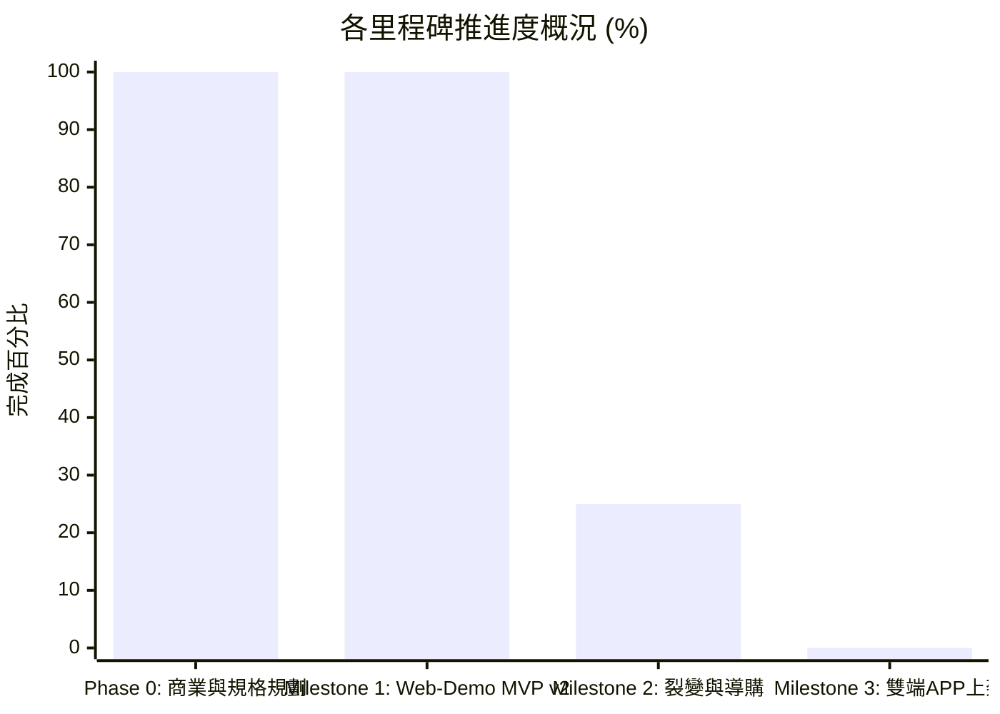

# FitMon 專案即時狀態與任務看板 (Project State & Kanban)

> **規則**：本檔案為專案的「即時黑板 (Single Source of Live Truth)」。每次對話啟動時 AI 必須讀取此檔以對齊狀態，每次討論產生決策或任務流轉時必須即時更新。

---

## 1. 專案元資料 (Metadata)

| 欄位 | 當前數值 | 說明 |
|---|---|---|
| **專案名稱** | FitMon (泛運動打卡社群 × 像素紙娃娃與運動科學) | 核心：雙軌紙娃娃、任務金幣、Meme 拍貼、開源科學動作庫 |
| **目前階段** | **Phase 1：Web Demo MVP v2 實機體驗驗收期 (All 18 Playtest Feedback Items Implemented)** | 🚀 **【已完成 V2-01 ~ V2-18 全部 18 項試玩反饋升級】** |
| **當前版本** | `v2.6.0-playtest-v2-complete` | 完整實作課表中心、跨 Tab 運動提醒、固定試穿商城購物車、雙人同框串門子、紙娃娃 5 部位與 3 自由家具/寵物槽、單日完整課表紀錄與數據趨勢圖 |
| **最後更新時間** | `2026-11-02 00:30 (Asia/Taipei)` | 每次討論結束必須更新時間戳 |
| **最後 Git Commit** | `de0048e` | 與本地儲存庫保持同步 |
| **當前焦點 (Current Focus)** | 驗收 `apps/web-demo` V2 全部 18 項修正成果（`http://localhost:5173`） |

---

## 2. 待辦事項動態看板 (Kanban Board)

### 🔴 進行中 (In Progress)
- [ ] **MVP-V2-PLAYTEST**：使用者實機體驗驗收 V2 升級版（18 項功能全數上線）

### 🟢 已完成：首輪 MVP 試玩反饋 18 項優化全數落地 (Playtest Feedback V2 Completed)

#### A. 運動打卡核心流程重構與數據體驗 (Workout Flow & Analytics)
- [x] **V2-15 [運動打卡核心流程重構：課表中心驅動]**：
  - **首屏為「課表管理中心」**：清楚分類 `[⭐ 我的最愛]`、`[📁 我的課表]`、`[🔗 引用他人]`、`[💡 官方推薦]`。
  - **建立/編輯課表流程**：支援分類（重訓/有氧/徒手）與關鍵字搜尋動作 ➔ 依序設定器材、目標組數、重量、次數、專屬組間休息秒數。
  - **3秒速記綁定個人課表**：針對已儲存課表，支援「一鍵 3 秒速記完成」或「微調今日實際重量/組數後快速打卡」。
  - **訓練專注模式與中途彈性**：執行課表時支援「中途替換器材/動作」以及「未完整做完課表也能提前照實結算」。
- [x] **V2-14 [動作視覺圖片 ＋ 鍵盤直輸重量次數 ＋ 完整組數明細]**：
  - 每個動作皆繪製專屬 48×48 點陣示意縮圖 (`ExerciseThumbnail.tsx`)，已完成組數列表清楚標示「動作圖示、動作名稱、重量/距離、次數、組間休息秒數」。
  - 重量 (kg/km) 與次數 (reps) 支援**直接點擊數字鍵盤輸入 (`<input type="number" />`)** 搭配 `±` 微調鈕。
- [x] **V2-01 [單日單次完整課表紀錄]**：每次健身儲存為單日單次獨立 `WorkoutSessionRecord`，於 `[👤 我的 -> 單日課表紀錄]` 點開 `SessionDetailModal` 可查看當日完整課表與每一組明細，並可另存為自訂課表。
- [x] **V2-02 [跨 Tab 運動進行中懸浮提醒]**：專注模式或組間休息期間切換至其他 Tab，頂部常駐「運動進行中 / 組間休息倒數」動態島懸浮條 (`TopHeader.tsx`)，並可一鍵返回 `[🏋️ 運動]`。
- [x] **V2-06 [泛運動多元支援 & 獨立組間休息]**：課表每個動作可設獨立休息秒數；並支援重訓器材、有氧耐力（跑步機、飛輪）與徒手核心（引體向上、棒式、流瑜珈）。
- [x] **V2-09 [數據控進階趨勢圖表]**：於 `[👤 我的 -> 數據趨勢圖]` 增設視覺化互動 SVG 折線圖與長條圖（單次訓練容量成長折線圖、三大項 PR 力量成長曲線、全身肌群組數分佈圖 + TDEE 計算機）。

#### B. 紙娃娃、商城試穿與自由房間佈置 (Paper-Doll, Shop & Room)
- [x] **V2-05 [商城頂部固定試穿 ＋ 實體點陣縮圖 ＋ 購物車]**：上半部試穿鏡 `sticky top-0` 固定不隨捲動消失；商品卡顯示裝備真實點陣圖案 (`ItemSpriteThumbnail.tsx`)；支援先試穿多件再加入購物車 (`cartItemIds`) 一次結帳並自動穿戴。
- [x] **V2-13 [紙娃娃分部位插槽介面]**：更換造型時明確切分 `[🧢 頭飾/髮型]`、`[😊 臉部/表情]`、`[👕 上衣]`、`[🩳 下身]`、`[🏋️ 手持裝備]` 5 大獨立部位分頁 (`WardrobeModal.tsx` & `ShopTab.tsx`)。
- [x] **V2-08 [自由房間擺設槽位 ＋ 獨立衣櫃/佈置功能]**：打破固定位置綁定特定器材限制（左側區 `slotLeft`、中央前景 `slotCenter`、右側區 `slotRight` 皆可自由放置深蹲架、街機、跑步機、啞鈴塔、植栽、任何寵物或選擇「收起/留空」），並提供獨立的 `WardrobeModal` 管理介面。
- [x] **V2-04 [寵物納入可選裝飾體系]**：赤柴、黑貓、機械壺鈴寵等皆納入房間自由擺設槽位，可自由選擇放置於左/中/右區、更換或收起不放。

#### C. 社群廣場三軌分流、雙人串門子與迷因工坊 (Social, Anti-Abuse & Meme Studio)
- [x] **V2-16 [社交動態三軌分流：公開 / 好友 / 我的貼文]**：`[💬 社交]` 頂部清楚分流 `[🌍 公開動態]`、`[👥 好友貼文]`、`[👤 我的貼文]`、`[📇 好友列表]`，每張貼文並附有顯眼歸屬標籤。
- [x] **V2-07 [好友列表、個人主頁 & 雙人同框串門子]**：新增好友列表與點擊查看特定玩家獨立個人版面 (`UserProfileModal.tsx`)；串門子時**「我的角色」也同時出現在對方房間畫布中並肩互動 (`👋 我來串門！`)**。
- [x] **V2-12 [打賞與送水每日防刷上限]**：限制每日總打賞/送水次數上限（5 次/日），且針對同一名使用者每日限送 2 次，介面即時顯示剩餘額度。
- [x] **V2-03 [迷因拍貼工坊：自由拖曳貼圖 ＋ 自訂表情動作]**：支援在拍貼畫布上用滑鼠/手指直接拖曳移動「迷因貼圖框」與「角色站位」，並可自由切換 4 種表情（自信笑、咬牙汗、耍帥酷、練腿哭）與 4 種動作姿勢（彎舉、深蹲、歡呼、漫步）。

#### D. 全域介面分層架構與音效細節 (UI Hierarchy, Audio & HUD)
- [x] **V2-18 [五大 Tab 名稱精簡定調]**：統一將底部 5 大導覽列名稱改為兩字極簡詞彙：**`[🏠 房間]`**、**`[🏋️ 運動]`**、**`[🛒 商城]`**、**`[💬 社交]`**、**`[👤 我的]`**。
- [x] **V2-17 [一級版面極簡化 × 二級點開詳細頁 (Drill-Down Views)]**：主畫面清爽不雜亂，點擊課表詳情、單日歷史訓練紀錄 (`SessionDetailModal`)、好友個人檔案 (`UserProfileModal`)、紙娃娃衣櫃 (`WardrobeModal`) 皆推入獨立二級視窗呈現完整細節。
- [x] **V2-10 [8-Bit 背景音樂 BGM 循環播放]**：內建 Web Audio API Chiptune 輕快 8-Bit 背景音樂自動循環序列器 (`SoundManager.ts`)，於房間右上角 `[🎵 BGM]` 與設定彈窗皆可獨立開關。
- [x] **V2-11 [頂部 Header 大數值防爆版保護]**：當金幣、連勝等數值過長時自動縮寫 (`formatCompact`: `12.5K` / `1.2M`)，並鎖定右上角 `[⚙️]` 為 `shrink-0` 絕不擠出畫面外。

#### E. 後續里程碑 (Future Milestones)
- [ ] **MILESTONE-2**：串接 Supabase 雲端資料庫與 OAuth 漸進式綁定
- [ ] **MILESTONE-3**：Capacitor 封裝 iOS / Android 雙端原生 App

### 🟢 最近已完成 (Recently Done)
- [x] **DONE-20261102-24**：全面完成首輪試玩反饋 18 項功能與架構升級 (`V2-01` ~ `V2-18`) 並通過 TypeScript 與 Vite 生產環境建置驗證 (TASK-019)
- [x] **DONE-20261101-23**：完成首輪 MVP 實機試玩體驗，收錄使用者 18 項關鍵產品與 UX 細節待辦事項至看板 (TASK-018)
- [x] **DONE-20261101-22**：升級《楓之谷》風格二頭身 Q 版精細點陣角色與房間 ＋ 砍除 70% 介面雜亂文字 (TASK-017)
- [x] **DONE-20261101-21**：完成 `apps/web-demo` 完整可玩 Web Demo MVP（涵蓋 Sprint 1~3）(TASK-016)
- [x] **DONE-20261101-20**：確立 5 大 Tab 導覽列（加入商城 Tab）、頂部常駐 Header [⚙️]、名人認證特展、體力值 (Stamina) 防刷與消耗型道具 IAP 商業閉環 (TASK-014)
- [x] **DONE-20261101-19**：通過重大架構決策 [`ADR-0002`](adr/0002-app-shell-with-embedded-pixel-canvas.md)：從全螢幕遊戲引擎轉向「現代 App 外殼 ＋ 局部嵌入像素畫布」架構，確立畫布休眠機制 (TASK-013)

### ⏸️ 擱置 / 暫不考慮 (Parked / Post-MVP)
- **PARK-001**：外部補劑/品牌電商導購商務（俟社群人氣積累後再行考慮）
- **PARK-002**：複雜 RPG 怪物對戰與數值打怪數值（改採直觀任務與金幣制）

---

## 3. 階段里程碑完成度 (Milestone Tracker)

