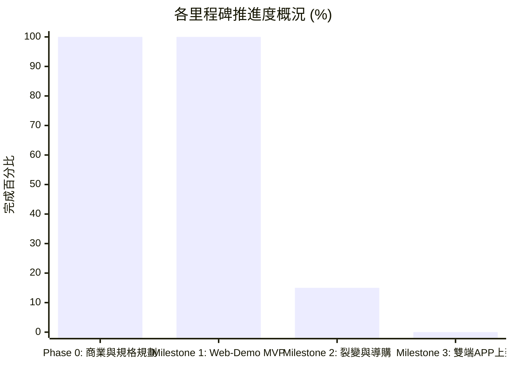

# FitMon 專案即時狀態與任務看板 (Project State & Kanban)

> **規則**：本檔案為專案的「即時黑板 (Single Source of Live Truth)」。每次對話啟動時 AI 必須讀取此檔以對齊狀態，每次討論產生決策或任務流轉時必須即時更新。

---

## 1. 專案元資料 (Metadata)

| 欄位 | 當前數值 | 說明 |
|---|---|---|
| **專案名稱** | FitMon (泛運動打卡社群 × 像素紙娃娃與運動科學) | 核心：雙軌紙娃娃、任務金幣、Meme 拍貼、開源科學動作庫 |
| **目前階段** | **Phase 1：Web Demo MVP 交付與實機體驗驗收期 (MVP Ready)** | 🚀 **【已完成 Sprint 1~3 完整可玩 Web Demo MVP】** |
| **當前版本** | `v2.4.0-mvp-playtest-backlog-logged` | 完成首輪 MVP 實機試玩驗收，收錄 13 項核心體驗與架構優化待辦清單 |
| **最後更新時間** | `2026-11-01 23:48 (Asia/Taipei)` | 每次討論結束必須更新時間戳 |
| **最後 Git Commit** | `e4c71de` | 與本地儲存庫保持同步 |
| **當前焦點 (Current Focus)** | 盤點並收斂首輪 MVP 試玩之 13 項優化待辦事項（待規劃優先序後分批迭代） |

---

## 2. 待辦事項動態看板 (Kanban Board)

### 🔴 進行中 (In Progress)
- [ ] **MVP-V2-PLANNING**：首輪 MVP 實機試玩反饋（13 大優化項目）優先序排程與規格細化

### 🟡 待辦清單：首輪 MVP 試玩反饋 13 項優化 (Playtest Feedback Backlog)

#### A. 運動打卡與數據體驗 (Workout & Analytics)
- [ ] **V2-01 [單日完整課表紀錄]**：每次健身應儲存為單日單次完整 Session 紀錄（含訓練時長、各動作名稱、每組重量/次數/休息時間明細），可於歷史紀錄展開檢視
- [ ] **V2-02 [跨 Tab 運動進行中懸浮提醒]**：運動專注模式期間若切換至其他 Tab，頂部常駐「運動計時 / 組間休息倒數」懸浮狀態條（Dynamic Island 風格），明確提示運動進行中並可一鍵返回
- [ ] **V2-06 [泛運動多元支援 & 獨立組間休息]**：課表支援為每個動作/器材獨立設定組間休息秒數；並擴充重訓以外之泛運動模式（有氧跑步/距離配速、徒手瑜珈、球類運動計時）
- [ ] **V2-09 [數據控進階趨勢圖表]**：於數據 Tab 增設視覺化趨勢圖表（訓練總容量折線圖、三大項 1RM 成長曲線、體重/體脂趨勢圖、肌群佔比圖）

#### B. 紙娃娃、商城試穿與自由房間佈置 (Paper-Doll, Shop & Room)
- [ ] **V2-05 [商城頂部固定試穿 ＋ 實體點陣縮圖 ＋ 購物車]**：上半部試穿鏡 `sticky` 固定不隨捲動消失；商品卡顯示裝備真實點陣圖案；支援點擊多件預覽試穿、滿意再加入購物車一次結帳購買
- [ ] **V2-13 [紙娃娃分部位插槽介面]**：更換造型時不再將所有飾品混在同一列表，明確切分 `[頭飾/髮型]`、`[上衣]`、`[下身]`、`[手持物]`、`[表情]` 獨立部位分頁與紙娃娃周圍裝備格
- [ ] **V2-08 [自由房間擺設槽位 ＋ 獨立衣櫃/佈置功能]**：打破「固定位置只能放深蹲架或街機」限制，改為通用自由擺設錨點（可任意替換器材、家具或留空），並將「個人換裝/房間佈置」獨立為專屬管理介面
- [ ] **V2-04 [寵物納入可選裝飾體系]**：寵物視為房間裝飾物件之一，可自由選擇放置、更換或收起不放

#### C. 社群串門子、防刷限額與迷因工坊 (Social, Anti-Abuse & Meme Studio)
- [ ] **V2-07 [好友列表、個人主頁 & 雙人同框串門子]**：新增好友列表與獨立玩家個人檔案版面；串門子進入好友/名人房間時，**「我的角色」也必須走進對方房間畫布中同框互動**
- [ ] **V2-12 [打賞與送水每日防刷上限]**：限制每日總打賞/送水次數上限，且針對同一名使用者每日限送固定次數（防洗幣與洗任務）
- [ ] **V2-03 [迷因拍貼工坊：自由拖曳貼圖 ＋ 自訂表情動作]**：支援在拍貼畫布上自由拖曳/縮放貼圖與角色位置，並可切換角色的拍照表情與動作姿勢

#### D. 音效與全域介面細節 (Audio & Global HUD)
- [ ] **V2-10 [8-Bit 背景音樂 BGM 循環播放]**：除現有按鈕/結算音效 (SFX) 外，補齊輕快復古 8-Bit 背景音樂 (BGM) 自動循環旋律與獨立開關
- [ ] **V2-11 [頂部 Header 大數值防爆版保護]**：當金幣、連勝等數值過長時自動縮寫（如 `12.5K`）並固定彈性寬度，防止右上角 `[⚙️]` 設定按鈕被擠出畫面外

#### E. 後續里程碑 (Future Milestones)
- [ ] **MILESTONE-2**：串接 Supabase 雲端資料庫與 OAuth 漸進式綁定
- [ ] **MILESTONE-3**：Capacitor 封裝 iOS / Android 雙端原生 App

### 🟢 最近已完成 (Recently Done)
- [x] **DONE-20261101-23**：完成首輪 MVP 實機試玩體驗，收錄使用者 13 項關鍵產品與 UX 細節待辦事項至看板 (TASK-018)
- [x] **DONE-20261101-22**：升級《楓之谷》風格二頭身 Q 版精細點陣角色與房間 ＋ 砍除 70% 介面雜亂文字 (TASK-017)
- [x] **DONE-20261101-21**：完成 `apps/web-demo` 完整可玩 Web Demo MVP（涵蓋 Sprint 1~3）(TASK-016)
- [x] **DONE-20261101-20**：確立 5 大 Tab 導覽列（加入商城 Tab）、頂部常駐 Header [⚙️]、名人認證特展、體力值 (Stamina) 防刷與消耗型道具 IAP 商業閉環 (TASK-014)
- [x] **DONE-20261101-19**：通過重大架構決策 [`ADR-0002`](adr/0002-app-shell-with-embedded-pixel-canvas.md)：從全螢幕遊戲引擎轉向「現代 App 外殼 ＋ 局部嵌入像素畫布」架構，確立畫布休眠機制 (TASK-013)
- [x] **DONE-20261101-18**：確立品牌名稱動態解耦 (Brand Decoupling) 與多國語系 (i18n: en / zh-TW) 架構，定案繁中像素字型選型與防爆版佈局規則 (TASK-012)
- [x] **DONE-20261101-17**：確立「批判性思維與非迎合溝通原則」寫入 `AGENT.md` 與 `collaboration_sop.md`，全面凍結程式碼開發 (TASK-011)
- [x] **DONE-20261101-16**：確立產品行為遙測與漏斗分析模組（Facade Pattern 支援 PostHog/GA4，零生理個資埋點原則）(TASK-010)
- [x] **DONE-20261101-15**：確立本機健康沙盒 (Local Biometrics Sandbox) 與 Apple Health / Google Health Connect 串接原則；數據 100% 留存本地，雲端僅驗證防作弊資產 (TASK-009)
- [x] **DONE-20261101-14**：納入 `free-exercise-db` 開源動作庫、雙軌圖解與玩中學每日科普問答 (TASK-008)
- [x] **DONE-20261101-13**：確立 Zero-PII 內容安全防火牆（站內純像素零風控、站外本地合照）、補齊課表模板、行事曆、PR 追蹤、休息日保護與離線同步，全系統收斂為 18 大模組 (TASK-007)
- [x] **DONE-20261101-12**：完成 MVP 前端工程落地藍圖與 Sprint WBS 分解 ([`fitmon_mvp_engineering_plan_v1.md`](file:///Users/yuchien/.gemini/antigravity-cli/brain/fe928b95-a5d1-439f-8ae3-9b7bc574f420/fitmon_mvp_engineering_plan_v1.md))
- [x] **DONE-20261101-11**：完成像素迷因拍貼工坊技術規格書 ([`fitmon_meme_studio_spec.md`](file:///Users/yuchien/.gemini/antigravity-cli/brain/fe928b95-a5d1-439f-8ae3-9b7bc574f420/fitmon_meme_studio_spec.md))
- [x] **DONE-20261101-10**：完成 PixiJS 2D 像素遊戲渲染器規格書 ([`fitmon_pixijs_renderer_spec.md`](file:///Users/yuchien/.gemini/antigravity-cli/brain/fe928b95-a5d1-439f-8ae3-9b7bc574f420/fitmon_pixijs_renderer_spec.md))
- [x] **DONE-20261101-09**：完成 Supabase 遊戲驅動資料庫綱要與原子打賞 RPC 函數 ([`supabase/migrations/20261101_init_fitmon_game_schema.sql`](../supabase/migrations/20261101_init_fitmon_game_schema.sql))
- [x] **DONE-20261101-08**：擴充 GDD 雙軌紙娃娃系統（納入 6 大房間裝潢卡槽與好友串門參觀），更新 [`fitmon_game_design_document_v1.md`](file:///Users/yuchien/.gemini/antigravity-cli/brain/fe928b95-a5d1-439f-8ae3-9b7bc574f420/fitmon_game_design_document_v1.md)
- [x] **DONE-20261101-07**：完成 GDD 遊戲企劃設計書初版
- [x] **DONE-20261101-06**：完成 Grill-me 戰略收斂訪談
- [x] **DONE-20261101-05**：在 `README.md` 與 `AGENT.md` 增設即時狀態看板
- [x] **DONE-20261101-04**：以 TypeScript 實作核心運動科學公式與疲勞衰減引擎 (`packages/engine`)
- [x] **DONE-20261101-03**：撰寫 ADR-0001 Web-First 技術選型評估
- [x] **DONE-20261101-02**：建立初始 8 大主題知識庫至 `wiki/*.md`
- [x] **DONE-20261101-01**：收錄原始 PRD 規格文件至 `raw/`

### ⏸️ 擱置 / 暫不考慮 (Parked / Post-MVP)
- **PARK-001**：外部補劑/品牌電商導購商務（俟社群人氣積累後再行考慮）
- **PARK-002**：複雜 RPG 怪物對戰與數值打怪數值（改採直觀任務與金幣制）

---

## 3. 階段里程碑完成度 (Milestone Tracker)

