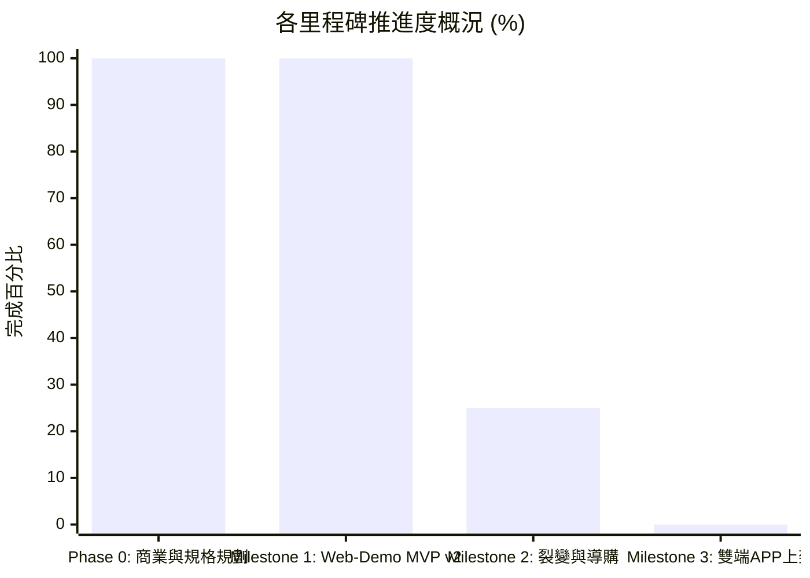

# FitMon 專案即時狀態與任務看板 (Project State & Kanban)

> **規則**：本檔案為專案的「即時黑板 (Single Source of Live Truth)」。每次對話啟動時 AI 必須讀取此檔以對齊狀態，每次討論產生決策或任務流轉時必須即時更新。

---

## 1. 專案元資料 (Metadata)

| 欄位 | 當前數值 | 說明 |
|---|---|---|
| **專案名稱** | FitMon (泛運動打卡社群 × 像素紙娃娃與運動科學) | 核心：雙軌紙娃娃、任務金幣、雙情境拍貼、開源科學動作庫、Tap Titans 冒險推圖 |
| **目前階段** | **Phase 1：Web Demo & Native iOS/Android 實機測試與打磨期** | 已合併冒險 PR #1–#3、資安第一批 PR #4、移除速記 [PR #5](https://github.com/yuchienw/Fitmon/pull/5)，以及 wiki 同步 [PR #6](https://github.com/yuchienw/Fitmon/pull/6)；上架時程暫不排定（等 App 做到 YuChien 滿意再談） |
| **當前版本** | `v2.9.4-analytics-queue-polish` | 文件不擅自升版。11/10 已在此版本之上合併暖日光戰場、健身房島爬塔與組隊檢視；11/13 再合併移除「速記」功能 |
| **最後更新時間** | `2026-11-13 10:20 (Asia/Taipei)` | 每次討論結束必須更新時間戳 |
| **最後 Git Commit** | `e5198c8` | 本次文件同步時的 main HEAD（[PR #5](https://github.com/yuchienw/Fitmon/pull/5) 合併 commit）。[PR #6](https://github.com/yuchienw/Fitmon/pull/6) 已於 2026-11-10 16:18（Asia/Taipei）合併（merge commit `de73747`） |
| **當前焦點 (Current Focus)** | 專注好用、好玩、修 bug（一輪約一週）；T1 第 1 階段（只改 Demo）已放行給工程；上架時程暫不排定 |

---

## 2. 待辦事項動態看板 (Kanban Board)

### 🔴 進行中 (In Progress)
- [ ] **TASK-NEW-PLAYER-LV1**：新玩家從 Lv.1 開始。
- [ ] **TASK-FLOOR-REPLAY-NO-FIRST-CLEAR**：已通關的樓層可以重打，但不給首通獎勵和掉落。
- [ ] **TASK-REMOVE-PAID-COOLDOWN-SKIP**：拿掉付費跳過冷卻。
- [ ] **TASK-D3-DAILY-CHECKIN-FIXED-XP**：D-3 運動規則採方案 B：每天打卡一次，固定給 XP（提案值 100 XP）；不指定項目、不處罰，保留每天打一次 Boss，也保留「我不舒服」按鈕和免責聲明。詳見 [`ADR-0003`](adr/0003-daily-checkin-fixed-xp.md)。
- [ ] **TASK-MIN-AGE-13-MINOR-PROTECTION**：最低使用年齡 13 歲以上，並加上未成年保護：不能加陌生人、不能聊天、內購要家長同意或設上限、轉蛋要限制、要有檢舉和封鎖。未成年「關閉付費轉蛋」不用另作決定，因為本來就沒有付費轉蛋（產品經理確認）。詳見 [`ADR-0004`](adr/0004-minimum-age-13-minor-protection.md)。
- [ ] **TASK-DOUBLE-COUPON-EARN-ONLY**：兩倍券只能在遊戲裡賺，不能用真錢買；除「本週動滿 N 天」寶箱掉落外，也能用金幣買。收入改靠真錢買斷外觀。詳見 [`ADR-0005`](adr/0005-double-coupon-earn-only-cosmetic-revenue.md)。
- [ ] **TASK-NO-REAL-MONEY-CURRENCY-OR-TICKETS**：遊戲幣不開放用真錢買；轉蛋券不用真錢賣；BCAA 只能在遊戲內取得或用金幣買，不用真錢賣。詳見 [`ADR-0005`](adr/0005-double-coupon-earn-only-cosmetic-revenue.md)。
- [ ] **TASK-KEEP-STAMINA-REMOVE-COMBO-FREEZE**：保留體力值和 BCAA；移除連擊冰凍卡。
- [ ] **TASK-COSMETIC-BUYOUT-CATALOG**：外觀買斷目錄照提案採用，價格 NT$30 到 90，含 NT$90 的季節組合；真錢買的外觀和金幣買的時裝分開。詳見 [`ADR-0005`](adr/0005-double-coupon-earn-only-cosmetic-revenue.md)。
- [ ] **TASK-T1-STAGE1-DEMO**：T1 第 1 階段（只改 Demo）已放行給工程。遊戲幣先用產品經理提的起始數字做進 Demo 試玩（打卡 70 幣、每日上限 90、兩倍券 40 幣、BCAA 10 幣、Boss 賞金 100 到 250）；這些數字仍是提案，YuChien 玩過後再調。
- [ ] **SEC-BATCH-2**：資安第二批修正與 Supabase（MILESTONE-2）一起做；測試外掛暫時保留，接雲端前再移除。
- [ ] **MVP-V2.9-ADVENTURE-PLAYTEST**：實機安裝至 iPhone（Xcode 執行安裝）與朋友測試新版 `[⚔️ 冒險]`、我的紀錄月/週切換與雙情境拍貼工坊分享至 IG/LINE

### 🟢 已完成：V2.9.4 課表動作隔離、成效分析月週切換與雙端防跑版 (Queue Isolation, Analytics & Web/Mobile Polish)
- [x] **TASK-029 [課表同器材多區塊獨立紀錄與 50/50 佈局]**：
  - **同器材獨立 `queueItemId` 隔離**：訓練序列中每個動作項目均賦予唯一 `id`，點擊「完成本組」時僅對當前選取之動作區塊累加組數，徹底修復同一器材在課表中重複設定時會同步增加組數的 bug；結算明細與新課表保存完整保留各區塊設定。
  - **建立課表 50/50 固定高度佈局**：彈窗鎖定 `h-[90vh]` 最大高度對半切分（上半部排程與細節微調、下半部開源動作庫搜尋庫）；課表標籤改為 6 大標準化下拉選項。
- [x] **TASK-030 [成效分析月瀏覽與週瀏覽切換引擎與防跑版]**：
  - **月瀏覽（1 號 ～ 月底）**：頂部加入 `< 上個月` / `下個月 >` 與 `[本月]` 快速返回按鈕，標籤精簡為 `月瀏覽` 與 `YYYY年M月`，7 欄日曆格以週日為起點排列。
  - **週瀏覽（週日 ～ 週六）**：頂部加入 `< 上週` / `下週 >` 與 `[本週]` 快速返回按鈕，週期精簡為 `MM/DD ～ MM/DD` 與 `週日～六`，徹底解決手機與 Web 版跑版折行問題。
  - **7 日柱狀圖與清單連動**：柱體加入 `max-w-[24px]`、`min-w-0` 與文字截斷保護，下方明細依當前月份或週別嚴格過濾，點選柱狀圖或日曆格可聚焦單日。
- [x] **TASK-031 [冒險雙軌、個人素質專頁與 Server 防作弊規範]**：（歷史已完成項；其中「每日 IAP 秒解冷卻」後已廢止，見下方註）
  - **單人冒險 vs 組隊冒險**：入口明確分流單人挑戰（1.0x HP，個人天梯）與隊長邀請組隊（1.8x HP 共享殘血進度，戰隊天梯）。
  - **「✨ 個人素質」獨立專頁**：展示配裝屬性（物攻/魔攻/輔助攻）、傷害區間預覽與生涯統計（總傷、尾刀、擊殺 Boss 數、出刀總數）。
  - **防作弊與每日 1 次秒解限制**：組間休息不足 30s 觸發刮痧懲罰（-95% 傷害且無掉寶）；所有防作弊運算皆由 Server 端作為唯一權威，零個資留存於本機。其中「每日 IAP 秒解冷卻次數嚴格限制最多 1 次」屬付費跳過冷卻，**已廢止**（YuChien 2026-11-10 15:08 D-4）；對應待辦見進行中的 `TASK-REMOVE-PAID-COOLDOWN-SKIP`。
- [x] **TASK-032 [系統設定主題選項文案精簡與 iOS 輸出同步]**：
  - 標籤由「外觀主題風格」精簡為「🎨 主題」，選項更新為「淺色」、「深色」、「跟隨系統」。
  - 底部導航中央冒險膠囊按鈕微擴寬（64px/68px，px-3），避免緊貼雙劍圖標。
  - 產出 iOS 生產建置並同步至 Capacitor 原生專案 (`npm run cap:sync`)，方便直接在 Xcode 部署至實體 iPhone 測試。

### 🟢 已完成：V2.9.2 雙情境拍貼分享工坊與 UI/UX Pro Max 升級 (Share Studio & Design System Polish)
- [x] **TASK-027 [雙情境拍貼分享工坊 (Meme & Share Studio)]**：（歷史已完成項）**是否保留：未確認**（待 YuChien 確認）。
  - **運動自拍打卡分享情境 (`workout_photo`)**：支援上傳真實運動自拍照，提供 4 款主流專業運動數據模板（底部橫條、海報大字、極簡毛玻璃、RPG戰鬥HUD）；點陣紙娃娃支援任意拖曳、360° 全角度旋轉滑軌 (`-180° ~ +180°`) 與鏡像水平翻轉；具備獨立 [數據 ON/OFF]、[我的娃 ON/OFF]、[浮水印 ON/OFF] 三重獨立開關。
  - **Boss 首通/討伐勝利結算情境 (`boss_victory`)**：鎖定官方戰鬥競技場背景，不可上傳個人照片，呈現純粹硬核的像素戰勝證書與稀有戰利品，避免個人照片破壞遊戲沈浸感。
  - **全面轉向純外部分享機制**：徹底移除內部單向社群貼文牆 (In-App Feed)，專注於輸出高品質圖片轉發至 Instagram 限時動態、Threads、LINE 戰隊群組與手機相簿下載，達成真正病毒裂變傳播。
- [x] **TASK-028 [UI/UX Pro Max 視覺與物理動效體系升級]**：
  - 導入運動健身無襯線字體 `Barlow Condensed` (`font-athletics` 700/800 傾斜數字與大容量標籤)。
  - 全面拔除 Emoji，換裝為 Lucide SVG 向量幾何圖標與專屬像素 SVG 徽章。
  - 建立極致觸覺反饋物理動效（彈跳縮放、深淺按壓位移、戰鬥震動）。

### 🟢 已完成：V2.9 遊戲化冒險與同儕督促系統 (Adventure RPG & Peer-Urging Completed)
- [x] **TASK-023 [冒險系統底層重構]**：底部導航列更名為 `[⚔️ 冒險]`，商城與衣櫃裝備注入物攻/魔攻/輔助屬性，擴充 6 大生活系 Boss 與關卡狀態機
- [x] **TASK-024 [Tap Titans 關卡推圖與手動戰鬥儀式]**：支援個人/戰隊雙軌關卡式推圖、殘血累積保存機制、手動出擊紙娃娃揮拳動效與暴擊紅字
- [x] **TASK-025 [2~4人戰隊同儕催促系統]**：實作高糖護盾弱點鎖定、全員到齊狂暴 Buff (1.5x)、一鍵「拿啞鈴敲他」、LINE/IG 像素討伐令卡片與「模擬隊友打卡破盾」體驗鈕
- [x] **TASK-026 [雙天梯排行榜與冷卻內購]**：（歷史已完成項）個人最高關卡/戰隊最高關卡/單次最高傷害三大天梯榜、12小時自然冷卻倒數仍為當時實作。其中「討伐券/內購秒重置機制」（付費跳過冷卻）**已廢止**（YuChien 2026-11-10 15:08 D-4）；對應待辦見進行中的 `TASK-REMOVE-PAID-COOLDOWN-SKIP`。

### 🟢 已完成：首輪 MVP 試玩反饋 18 項優化全數落地 (Playtest Feedback V2 Completed)

#### A. 運動打卡核心流程重構與數據體驗 (Workout Flow & Analytics)
- [x] **V2-15 [運動打卡核心流程重構：課表中心驅動]**：
  - **首屏為「課表管理中心」**：清楚分類 `[⭐ 我的最愛]`、`[📁 我的課表]`、`[🔗 引用他人]`、`[💡 官方推薦]`。
  - **建立/編輯課表流程**：支援分類（重訓/有氧/徒手）與關鍵字搜尋動作 ➔ 依序設定器材、目標組數、重量、次數、專屬組間休息秒數。
  - **3秒速記綁定個人課表**：**已廢止／已從程式移除**。YuChien 決定刪除「速記」功能；[PR #5](https://github.com/yuchienw/Fitmon/pull/5) 已於 2026-11-13 09:38（Asia/Taipei）合併（merge commit `e5198c8`；來源：幕僚長轉述，並經 GitHub 核實）。舊文「一鍵 3 秒速記完成」或「微調今日實際重量/組數後快速打卡」不再是現行功能。
  - **訓練專注模式與中途彈性**：執行課表時支援「中途替換器材/動作」以及「未完整做完課表也能提前照實結算」。
- [x] **V2-14 [動作視覺圖片 ＋ 鍵盤直輸重量次數 ＋ 完整組數明細]**：
  - 每個動作皆繪製專屬 48×48 點陣示意縮圖 (`ExerciseThumbnail.tsx`)，已完成組數列表清楚標示「動作圖示、動作名稱、重量/距離、次數、組間休息秒數」。
  - 重量 (kg/km) 與次數 (reps) 支援**直接點擊數字鍵盤輸入 (`<input type="number" />`)** 搭配 `±` 微調鈕。
- [x] **V2-01 [單日單次完整課表紀錄]**：每次健身儲存為單日單次獨立 `WorkoutSessionRecord`，於 `[👤 我的 -> 單日課表紀錄]` 點開 `SessionDetailModal` 可查看當日完整課表與每一組明細，並可另存為自訂課表。
- [x] **V2-02 [跨 Tab 運動進行中懸浮提醒]**：專注模式或組間休息期間切換至其他 Tab，頂部常駐「運動進行中 / 組間休息倒數」動態島懸浮條 (`TopHeader.tsx`)，並可一鍵返回 `[🏋️ 運動]`。
- [x] **V2-06 [泛運動多元支援 & 獨立組間休息]**：課表每個動作可設獨立休息秒數；並支援重訓器材、有氧耐力（跑步機、飛輪）與徒手核心（引體向上、棒式、流瑜珈）。
- [x] **V2-09 [數據控進階趨勢圖表]**：於 `[👤 我的 -> 數據趨勢圖]` 增設視覺化互動 SVG 折線圖與長條圖（單次訓練容量成長折線圖、三大項 PR 力量成長曲線、全身肌群組數分佈圖 + TDEE 計算機）。

#### B. 紙娃娃、商城試穿與自由房間佈置 (Paper-Doll, Shop & Room)
- [x] **V2-05 [商城頂部固定試穿 ＋ 實體點陣縮圖 ＋ 購物車]**：上半部試穿鏡 `sticky top-0` 固定不隨捲動消失；商品卡顯示裝備真實點陣圖案 (`ItemSpriteThumbnail.tsx`)；支援先試穿多件再加入購物車 (`cartItemIds`) 一次結帳並自動穿戴。
- [x] **V2-13 [紙娃娃分部位插槽介面]**：更換造型時明確切分 `[🧢 頭飾/髮型]`、`[😊 臉部/表情]`、`[👕 上衣]`、`[🩳 下身]`、`[🏋️ 手持裝備]` 5 大獨立部位分頁 (`WardrobeModal.tsx` & `ShopTab.tsx`)。
- [x] **V2-08 [自由房間擺設槽位 ＋ 獨立衣櫃/佈置功能]**：打破固定位置綁定特定器材限制（左側區 `slotLeft`、中央前景 `slotCenter`、右側區 `slotRight` 皆可自由放置深蹲架、街機、跑步機、啞鈴塔、植栽、任何寵物或選擇「收起/留空」），並提供獨立的 `WardrobeModal` 管理介面。
- [x] **V2-04 [寵物納入可選裝飾體系]**：赤柴、黑貓、機械壺鈴寵等皆納入房間自由擺設槽位，可自由選擇放置於左/中/右區、更換或收起不放。

#### C. 社群廣場三軌分流、雙人串門子與迷因工坊 (Social, Anti-Abuse & Meme Studio)（下列動態牆／打賞為歷史已完成項，後已廢除）
- [x] **V2-16 [社交動態三軌分流：公開 / 好友 / 我的貼文]**：（歷史已完成項）**已廢除**。YuChien 於 2026-11-10 15:04 親口確認站內公開動態牆已廢除（改成合照，已無打賞與發布拍立得）；15:08 決定不恢復公開動態牆，改走戰隊和站外分享。舊文 `[💬 社交]` 的 `[🌍 公開動態]`、`[👥 好友貼文]`、`[👤 我的貼文]` 分流不視為現行功能。
- [x] **V2-07 [好友列表、個人主頁 & 雙人同框串門子]**：新增好友列表與點擊查看特定玩家獨立個人版面 (`UserProfileModal.tsx`)；串門子時**「我的角色」也同時出現在對方房間畫布中並肩互動 (`👋 我來串門！`)**。
- [x] **V2-12 [打賞與送水每日防刷上限]**：（歷史已完成項）**打賞已廢除**（YuChien 2026-11-10 15:04；15:08 不恢復公開動態牆）。舊文「每日總打賞/送水 5 次、同一使用者每日限送 2 次」不視為現行功能。互贈能量水是否另保留，本次未另作決定。
- [x] **V2-03 [迷因拍貼工坊：自由拖曳貼圖 ＋ 自訂表情動作]**：支援在拍貼畫布上用滑鼠/手指直接拖曳移動「迷因貼圖框」與「角色站位」，並可自由切換 4 種表情（自信笑、咬牙汗、耍帥酷、練腿哭）與 4 種動作姿勢（彎舉、深蹲、歡呼、漫步）。

#### D. 全域介面分層架構與音效細節 (UI Hierarchy, Audio & HUD)
- [x] **V2-18 [五大 Tab 名稱精簡定調]**：統一將底部 5 大導覽列名稱改為兩字極簡詞彙：**`[🏠 房間]`**、**`[🏋️ 運動]`**、**`[🛒 商城]`**、**`[💬 社交]`**、**`[👤 我的]`**。
- [x] **V2-17 [一級版面極簡化 × 二級點開詳細頁 (Drill-Down Views)]**：主畫面清爽不雜亂，點擊課表詳情、單日歷史訓練紀錄 (`SessionDetailModal`)、好友個人檔案 (`UserProfileModal`)、紙娃娃衣櫃 (`WardrobeModal`) 皆推入獨立二級視窗呈現完整細節。
- [x] **V2-10 [8-Bit 背景音樂 BGM 循環播放]**：內建 Web Audio API Chiptune 輕快 8-Bit 背景音樂自動循環序列器 (`SoundManager.ts`)，於房間右上角 `[🎵 BGM]` 與設定彈窗皆可獨立開關。
- [x] **V2-11 [頂部 Header 大數值防爆版保護]**：當金幣、連勝等數值過長時自動縮寫 (`formatCompact`: `12.5K` / `1.2M`)，並鎖定右上角 `[⚙️]` 為 `shrink-0` 絕不擠出畫面外。

#### E. V2.8 手機實機體驗 7 大優化與雙端 App 封裝 (V2.8 Mobile Polish & Native Packaging)
- [x] **V2-19 [專注訓練中途新增動作]**：於專注訓練模式提供獨立的 **`[＋新增]`** 與 **`[替換]`** 雙按鈕（`addExerciseToActiveQueue` vs `swapActiveExercise`），可隨時把新動作排入今日序列而不覆蓋原動作。
- [x] **V2-20 [全域極簡無括號 UI 減字]**：全面剃除各分頁與彈窗的 `(...)` 括號贅字說明，將所有按鈕濃縮為 2~4 字極簡標籤，杜絕手機窄螢幕換行或 `...` 截斷。
- [x] **V2-21 [社交加好友情境模擬]**：（歷史已完成項）新增非好友玩家（如 `街頭健體 · Leo` 與認證名人），於「找健友」名冊與個人主頁提供即時互動 **`[＋ 加好友]` ➔ `[✓ 好友]`** 切換 (`toggleFriend`)。舊文「於動態牆」加好友的路徑隨站內公開動態牆 **已廢除**（YuChien 2026-11-10 15:04、15:08）。
- [x] **V2-22 [商城模擬內購儲值閉環]**：於 `[🛒 商城]` 新增第 4 分頁 **`[💎 儲值]`** 及道具 `NT$` 直購鈕，內建 Apple App Store / Google Play 沙盒模擬結帳彈窗 (`[一鍵模擬付款]`)。
- [x] **V2-23 [健身紀錄月曆檢視 & 週訓練量檢視]**：於 `[👤 我的 -> 月曆與紀錄]` 實作 **`📅 月曆檢視`**（28 日格狀熱力日曆＋每日容量標籤）與 **`📊 週訓練量`**（近 7 日長條圖＋週總組數/週總容量統計）。
- [x] **V2-24 [高反差肌肉紙娃娃體態階段]**：新增免費預設 **`赤膊健美體態 (top_bare_muscles)`** 上衣，並在 `[🏠 房間]`、衣櫃与 `[👤 我的]` 提供 **`🌱 菜鳥 / ⚡ 精實 / 🐻 巨巨 / 👑 泰坦`** 一鍵切換，立體呈現平坦肚皮 vs 3D 胸肌、六塊腹肌、斜方肌與寬肩反差。
- [x] **MILESTONE-3 [Capacitor iOS / Android 雙端原生 App 專案產出]**：完成 `@capacitor/ios` 與 `@capacitor/android` 建置（`apps/web-demo/ios` 與 `apps/web-demo/android`），並支援 iOS PWA 全螢幕主畫面安裝。

#### F. 後續里程碑 (Future Milestones)
- [ ] **MILESTONE-2**：串接 Supabase 雲端資料庫與 OAuth 漸進式綁定。資安第二批修正與此一併進行；測試外掛暫時保留，接雲端前再移除。

### 🟢 最近已完成 (Recently Done)
- [x] **DONE-20261113-35**：合併 [PR #5](https://github.com/yuchienw/Fitmon/pull/5) `feat(workout): 移除「速記」功能`（來源：幕僚長轉述 YuChien 於 2026-11-13 09:38 Asia/Taipei 指示合併；GitHub 核實已由 yuchienw 合併於 2026-11-13 09:38 Asia/Taipei，merge commit `e5198c8`）。速記功能已從程式移除，main HEAD 更新至該 commit。
- [x] **DONE-20261110-34**：合併 [PR #6](https://github.com/yuchienw/Fitmon/pull/6) `docs(wiki): 同步專案狀態至 11/10 並新增會議紀錄`（合併於 2026-11-10 16:18 Asia/Taipei，merge commit `de73747`）
- [x] **DONE-20261110-33**：合併 [PR #4](https://github.com/yuchienw/Fitmon/pull/4) `chore(security): 資安清單第一批（防作弊標記、機密忽略與 gitleaks、Actions 釘 SHA、CSP、Vite 6）`（合併於 2026-11-10 15:08 Asia/Taipei，merge commit `c82b17b`）
- [x] **DONE-20261110-32**：合併 [PR #3](https://github.com/yuchienw/Fitmon/pull/3) `fix(adventure): PR #2 設計驗收修正（站位、缺資料剪影、狀態膠囊、Sheet 層級、島色溫）`（合併於 2026-11-10 13:35 Asia/Taipei，merge commit `4d42d26`）
- [x] **DONE-20261110-31**：合併 [PR #2](https://github.com/yuchienw/Fitmon/pull/2) `feat(adventure): 冒險模式選單、健身房島爬塔與組隊檢視`（合併於 2026-11-10 12:12 Asia/Taipei，merge commit `a743494`）
- [x] **DONE-20261110-30**：合併 [PR #1](https://github.com/yuchienw/Fitmon/pull/1) `feat(adventure): 暖日光戰場與固定浮水印分享圖`（合併於 2026-11-10 09:25 Asia/Taipei，merge commit `3e497fe`）
- [x] **DONE-20261107-29**：升級拍貼工坊為雙情境模式（運動自拍+4模板數據+360°紙娃娃 vs 鎖定官方Boss首通勝利卡），全面轉向純外部社群分享 (TASK-027)
- [x] **DONE-20261107-28**：全面落地 UI/UX Pro Max 體系：Barlow Condensed 傾斜運動字體、Lucide SVG 向量圖標、3D 觸覺物理動效 (TASK-028)
- [x] **DONE-20261107-27**：建立 GitHub Actions 自動部署至 GitHub Pages 工作流程，調整 Vite 與 Web Manifest 為相對路徑 (TASK-022)
- [x] **DONE-20261103-26**：完成 V2.8 手機實機體驗 7 大優化（中途新增動作、極簡減字、加好友模擬、模擬內購、月曆/週檢視、高反差六塊肌紙娃娃）與 Capacitor iOS/Android 雙端 App 封裝 (TASK-021)
- [x] **DONE-20261103-25**：完成 V2.7 《楓之谷》級高清 2D 賽璐璐 Q 版引擎、專業運動解剖肌群圖庫與系統自適應溫暖亮色主題 (TASK-020)
- [x] **DONE-20261102-24**：全面完成首輪試玩反饋 18 項功能與架構升級 (`V2-01` ~ `V2-18`) 並通過 TypeScript 與 Vite 生產環境建置驗證 (TASK-019)
- [x] **DONE-20261101-23**：完成首輪 MVP 實機試玩體驗，收錄使用者 18 項關鍵產品與 UX 細節待辦事項至看板 (TASK-018)
- [x] **DONE-20261101-22**：升級《楓之谷》風格二頭身 Q 版精細點陣角色與房間 ＋ 砍除 70% 介面雜亂文字 (TASK-017)
- [x] **DONE-20261101-21**：完成 `apps/web-demo` 完整可玩 Web Demo MVP（涵蓋 Sprint 1~3）(TASK-016)
- [x] **DONE-20261101-20**：確立 5 大 Tab 導覽列（加入商城 Tab）、頂部常駐 Header [⚙️]、名人認證特展、體力值 (Stamina) 防刷與消耗型道具 IAP 商業閉環 (TASK-014)
- [x] **DONE-20261101-19**：通過重大架構決策 [`ADR-0002`](adr/0002-app-shell-with-embedded-pixel-canvas.md)：從全螢幕遊戲引擎轉向「現代 App 外殼 ＋ 局部嵌入像素畫布」架構，確立畫布休眠機制 (TASK-013)

### ⏸️ 擱置 / 暫不考慮 (Parked / Post-MVP)
- **PARK-001**：外部補劑/品牌電商導購商務（俟社群人氣積累後再行考慮）
- **PARK-002（已被取代，不再適用）**：原擱置項為「不做複雜 RPG 怪物對戰與數值打怪（改採直觀任務與金幣制）」。YuChien 於 2026-11-10 15:04（Asia/Taipei）親口確認遊戲模式改為冒險 RPG（Tap Titans 式冒險與 Boss），**取代此擱置方向**。現行規格以冒險 RPG 為準，本項不再視為有效擱置約束。
- **SCHEDULE-STORE-RELEASE**：上架時程暫不排定；等 App 做到 YuChien 滿意再談。

---

## 3. 階段里程碑完成度 (Milestone Tracker)

> 註：上圖「Milestone 3: 雙端APP上架」為 0%，且上架時程暫不排定。看板中已勾選的 MILESTONE-3 僅指 Capacitor 專案產出，不代表商店已上架。
