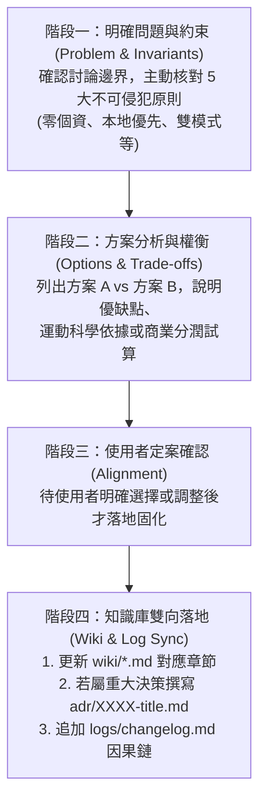

# 人機長期協作與持續溝通標準作業程序 (Human-AI Collaboration SOP)

> **目標**：解決 AI 跨對話「上下文失憶」、「進度斷層」與「討論發散」問題，使每一次互動皆具備明確的時間戳、版本、執行階段、待辦流轉與決策閉環。

---

## SOP-1：開局握手與狀態對齊 (Session Handshake Protocol)

### 觸發時機
每次開立新對話、重啟上下文，或使用者輸入「我們繼續」、「目前進度到哪」、「今天討論 X」時。

### AI 執行動作
1. 主動讀取 [`PROJECT_STATE.md`](file:///Users/yuchien/Project/Github/fitmon/llm-wiki/PROJECT_STATE.md)。
2. 回覆時**第一段一律輸出「狀態對齊摘要卡」**，格式如下：

```markdown
> 🎯 **【FitMon 狀態對齊卡】**
> - **時間 / 版本**：`YYYY-MM-DD` ｜ `v0.1.0-planning`
> - **當前階段**：`Phase 0 規劃期 (⚠️ 程式碼凍結)`
> - **進行中焦點**：`[TASK-XXX] 任務名稱`
> - **待辦下一項**：`[PLAN-XXX] 建議主題`
```

3. 讓使用者**一眼確認 AI 當前在同一個頻率上**，無須重覆交代專案背景。

---

## SOP-2：議題討論與決策收斂 (Issue Discussion & Convergence SOP)

當進行任何商業、數值、功能或架構討論時，遵循「**四階收斂法**」：



---

## SOP-3：待辦事項流轉與閉環 (Task Lifecycle SOP)

待辦事項統一由 [`PROJECT_STATE.md`](file:///Users/yuchien/Project/Github/fitmon/llm-wiki/PROJECT_STATE.md) 驅動，流轉規則如下：

1. **認領任務**：將項目自 `🟡 待討論清單 (Backlog)` 移至 `🔴 進行中 (In Progress)`，同一時間保持 1~2 項焦點，嚴禁多頭並進。
2. **產出交付**：完成討論、文件提煉或規範編寫。
3. **完成驗收 (Done)**：
   - 移入 `🟢 最近已完成 (Recently Done)`。
   - 更新進度完成百分比。
   - 執行 Git 提交，Commit 訊息必須指明 Task ID（例：`docs(plan): 完成 PLAN-001 補劑聯盟導購流程拆解`）。
4. **外部阻礙 (Blocked)**：若因缺少法規資訊、缺少競品數據暫時無法拍板，移至 `⏸️ 擱置區`，並清楚標註「等待事項（Waiting on...）」。

---

## SOP-4：對話結尾交接與存檔 (Session Wrap-up & Checkpoint SOP)

### 觸發時機
當一個主題討論告一段落，或使用者表示「今天先到這」、「幫我存檔並總結」時。

### AI 執行動作
1. **輸出本次總結**：
   - 本次拍板之核心結論（2~3 點）。
   - 產出/修改之文檔清單。
2. **維護狀態板**：更新 [`PROJECT_STATE.md`](file:///Users/yuchien/Project/Github/fitmon/llm-wiki/PROJECT_STATE.md) 之時間戳與 Kanban。
3. **執行 Git Commit**：將本次所有變更一併存檔固化。
4. **提供下次啟動入口**：給出 1~2 個建議的下次討論題目，讓下一次對話無縫開局。
