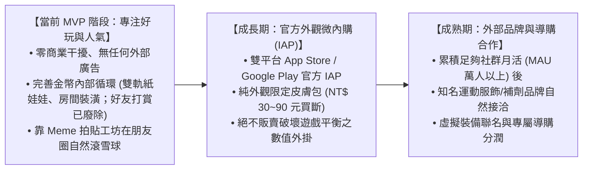

# 商業策略與長期變現路徑 (Business Strategy & Monetization)

> **鏈結索引**：[返回索引](00_INDEX.md) ｜ [遊戲機制](game_mechanics_and_science.md) ｜ [里程碑](roadmap.md)

---

## 1. 商業策略分期原則 (Phased Monetization Strategy)

基於**工程師背景與精益創業（Lean Startup）思維**，專案嚴格遵循「**好玩度與交友圈人氣為先，商業談判在後**」的節奏：

---

## 2. 內部循環經濟（MVP 核心焦點）

在初期無外部廠商介入時，系統透過健全的內部金幣閉環維持極佳留存：
1. **產出端**：每日運動打卡（舊文 +50；Demo 暫定值見第 3 節與機制頁，仍是提案）。~~發布拍立得 (+30)、打賞好友 (+20)~~ **已廢除**（YuChien 2026-11-10 15:04 親口確認站內公開動態牆、打賞與發布拍立得已廢除，改成合照；15:08 決定不恢復公開動態牆，改走戰隊和站外分享）。連續 7 天連擊大寶箱 (+200) 仍見舊文，是否沿用待對齊現行打卡規則。
2. **消耗端**：
   * **角色衣櫃**：各階運動服飾、頭帶、跑鞋（150 ~ 800 Coins）。
   * **房間裝潢**：木質跑步機、專業深蹲架、復古音響、伴隨柴犬/橘貓（300 ~ 2000 Coins）。
   * **社群互動**：~~打賞貼文 (10 Coins)~~ **已廢除**（同上，15:04／15:08）。贈送好友虛擬能量水 (20 Coins) 是否保留，本次文件未另作決定，不視為現行打賞功能。

---

## 3. 道具與內購變現體系 (IAP, Consumables & Cosmetic Buyouts)

> 決策來源：YuChien 2026-11-10 16:18、16:20，經幕僚長轉達。

**核心原則**
- 遊戲幣不能用真錢買。
- 真錢只買外觀，而且是買斷。
- 真錢外觀和金幣時裝是兩批不同的物品。
- 任何付費內容都沒有數值加成。

### 3.1 體力值 (Stamina)：保留
1. 每位玩家每日有 100 點體力，每小時恢復 10 點，或每日 00:00 補滿。每次打卡扣 50 點。
2. 運動紀錄永遠免費、沒有次數限制。體力只決定當次打卡會不會掉金幣和經驗。

### 3.2 消耗型道具
* 🥤 **BCAA 活力能量水**：立即恢復 50 點體力。遊戲內取得或用金幣買，不賣真錢（16:20）。
* ⚡ **雙倍金幣卡 (2x Booster)**：不用真錢賣。
  * 效果：24 小時內金幣獎勵 ×2.0，仍受每日賺幣上限限制。
  * 取得方式：可以用金幣買；「本週動滿 3 天寶箱」也會掉 1 張。天數只看累計，不用連續，中斷也不歸零。
  * N = 3 是教練和產品經理的提議。
  * 金幣售價待定。
* 🎲 **幸運像素扭蛋券 (Gacha Ticket)**：不用真錢賣，只在遊戲內取得。
  * 完全無法用錢取得的話，立法院研究認為不適用台灣「網路連線遊戲服務定型化契約應記載事項」第六點的機率揭露義務。來源：https://www.ly.gov.tw/Pages/ashx/File.ashx?FilePath=%7E%2FFile%2FAttach%2F243341%2FFile_19817810.pdf
  * 仍建議自願公開機率。
* ❌ **連擊冰凍卡 (Streak Freeze)**：已移除。現在不懲罰斷連，這張卡沒有用途。

### 3.3 外觀買斷 IAP 目錄（已採用）
規格是真錢直購、永久解鎖、沒有數值，屬於非消耗型商品。這批外觀和金幣商城的時裝分開，只能用真錢取得。

外觀買斷不得附贈金幣、券、XP——資安提出的必修規則，經產品經理轉達，待 YuChien 確認。

售價依據：
- 都在 Apple 台灣官方價格點上：https://www.apple.com/newsroom/pdfs/App-Store-Pricing-Update.pdf
- 都在 Google Play 台灣允許的 TWD 2–33,000 範圍內：https://play.google.com/supported-locations?hl=zh-TW

抽成依據：
- Apple Small Business Program：https://developer.apple.com/app-store/small-business-program/
- Google Play 服務費：https://support.google.com/googleplay/android-developer/answer/112622
- Apple 台灣標準抽成 26%（自 2026-10-31 起）：https://developer.apple.com/news/?id=w9mxlhek

表中「實收」只扣商店抽成，還沒算稅和扣繳。

| 品項 | 內容 | 售價 NT$ | 15% 後實收 | Apple 26% 後實收 |
|---|---|---:|---:|---:|
| 限定皮膚包 | 1 套限定像素服裝 | 30 | 25.5 | 22.2 |
| 合照／分享卡外框 | 2–3 款 9:16 外框，匯出到 IG／Threads | 30 | 25.5 | 22.2 |
| Boss 勝利卡框 | 1–2 款勝利分享卡外框 | 40 | 34.0 | 29.6 |
| 房間裝潢包 | 2–3 件房間家具 | 50 | 42.5 | 37.0 |
| 伴隨寵物 | 解鎖 1 隻寵物 | 60 | 51.0 | 44.4 |
| 季節限定組合 | 當季皮膚 1 套＋外框 1 款，限時上架、買斷後永久持有 | 90 | 76.5 | 66.6 |

### 3.4 未成年保護（待決）
- 最低年齡 13 歲。這是 App 自己的政策，台灣遊戲分級沒有 13+ 這一級。
- 未成年每月消費上限的金額還在等 YuChien 決定，也在等律師確認。
- 營運與收益的提議是 13–15 歲每月 NT$300、16–17 歲 NT$600。這是提議，不是法規。

---

## 4. 名人認證、品牌聯名裝備與 O2O 商業贊助 (Co-Branding & O2O Sponsorship)

1. **名人官方認證與專屬特展 (Verified Athlete Showcase)**：
   - 官方為簽約選手與健身名人量身訂製專屬 32×32 像素公仔與專屬冠軍榮譽陳列室。
   - 粉絲進入名人房間可「送能量水留言應援」以及「一鍵複製冠軍課表」。
   - 資料庫層內建即時封存與撤銷開關 (Kill-Switch)，規避公關違法風險。
2. **名人/品牌聯名限定裝備 (Event Drops & O2O Vouchers)**：
   - 贊助商冠名舉辦「限時打卡挑戰賽」（例：Red Bull 能量挑戰週），完成打卡領取限定像素衛衣或家具。
   - **虛實整合 (O2O)**：遊戲內解鎖虛擬道具同時獲發實體品牌折扣券代碼 (`real_world_reward_code`)，兼具宣傳曝光與電商導購轉化。
   - **純外觀守則**：聯名裝備嚴禁附加任何數值加成，守護運動自律公平性。
