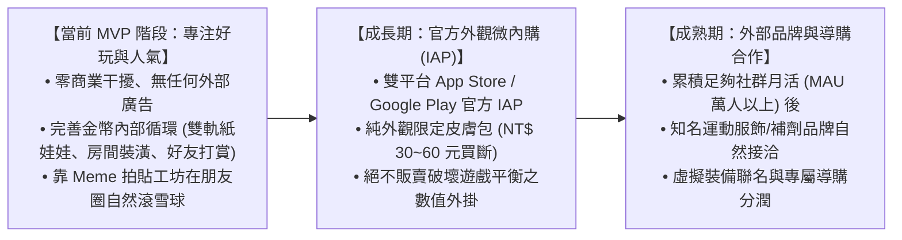

# 商業策略與長期變現路徑 (Business Strategy & Monetization)

> **鏈結索引**：[返回索引](00_INDEX.md) ｜ [遊戲機制](game_mechanics_and_science.md) ｜ [里程碑](roadmap.md)

---

## 1. 商業策略分期原則 (Phased Monetization Strategy)

基於**工程師背景與精益創業（Lean Startup）思維**，專案嚴格遵循「**好玩度與交友圈人氣為先，商業談判在後**」的節奏：

---

## 2. 內部循環經濟（MVP 核心焦點）

在初期無外部廠商介入時，系統透過健全的內部金幣閉環維持極佳留存：
1. **產出端**：每日運動打卡 (+50)、發布拍立得 (+30)、打賞好友 (+20)、連續 7 天連擊大寶箱 (+200)。
2. **消耗端**：
   * **角色衣櫃**：各階運動服飾、頭帶、跑鞋（150 ~ 800 Coins）。
   * **房間裝潢**：木質跑步機、專業深蹲架、復古音響、伴隨柴犬/橘貓（300 ~ 2000 Coins）。
   * **社群互動**：打賞貼文 (10 Coins)、贈送好友虛擬能量水 (20 Coins)。

---

## 3. 未來商業合作儲備庫（Post-MVP 待人氣積累後啟動）

* **純外觀微內購 (Micro-IAP)**：提供像素主題套裝（如黃金冠軍腰帶、復古 80 年代霓虹健美裝）。
* **補劑電商與裝備聯名**：當社群規模成型後，透過點擊虛擬能量水或補劑，直接導流至品牌官網享受折扣，賺取聯盟抽成（Affiliate）。
