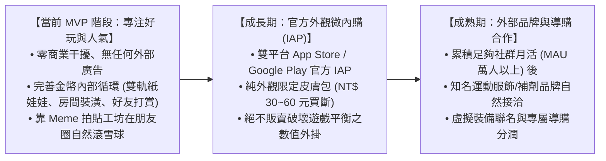

# 商業策略與長期變現路徑 (Business Strategy & Monetization)

> **鏈結索引**：[返回索引](00_INDEX.md) ｜ [遊戲機制](game_mechanics_and_science.md) ｜ [里程碑](roadmap.md)

---

## 1. 商業策略分期原則 (Phased Monetization Strategy)

基於**工程師背景與精益創業（Lean Startup）思維**，專案嚴格遵循「**好玩度與交友圈人氣為先，商業談判在後**」的節奏：

---

## 2. 內部循環經濟（MVP 核心焦點）

在初期無外部廠商介入時，系統透過健全的內部金幣閉環維持極佳留存：
1. **產出端**：每日運動打卡 (+50)、發布拍立得 (+30)、打賞好友 (+20)、連續 7 天連擊大寶箱 (+200)。
2. **消耗端**：
   * **角色衣櫃**：各階運動服飾、頭帶、跑鞋（150 ~ 800 Coins）。
   * **房間裝潢**：木質跑步機、專業深蹲架、復古音響、伴隨柴犬/橘貓（300 ~ 2000 Coins）。
   * **社群互動**：打賞貼文 (10 Coins)、贈送好友虛擬能量水 (20 Coins)。

---

## 3. 道具與金幣內購變現體系 (IAP & Consumables Revenue Engine)

為解決純外觀裝扮付費率偏低（2%~4%）的問題，系統確立**「裝備物件純外觀，消耗型道具影響數值與收益」**之經典 F2P 獲利模式：

### 3.1 體力值 (Stamina) 防刷與「雙軌分流原則」
1. **體力值 (Stamina)**：每位玩家每日擁有 100 點體力值（每小時自然恢復 10 點，或每日 00:00 自動補滿）。打卡單次訓練扣除 50 點，剛好滿足 1~2 次高質量訓練並領滿金幣。
2. **【防反噬金律】運動記錄永遠 100% 免費無限次**：
   * 體力耗盡時，使用者**依然可以無限次、完全免費地記錄訓練組數、重量、秒表與 PR**（絕不卡使用者的運動日誌！）。
   * 體力值僅控制「當次打卡是否掉落金幣與經驗值」，徹底解決手遊「沒體力就不給運動」的公關災難。

### 3.2 四大高頻復購之核心付費道具 (IAP Catalog)
* 🥤 **BCAA 活力能量水**：立即恢復 50 點體力值，讓當天超額訓練繼續獲取金幣與任務獎勵。
* ⚡ **雙倍金幣卡 (2x Booster)**：24 小時內所有打卡與任務的金幣獎勵翻倍，滿足狂熱訓練者的高效升級渴望。
* 🧊 **連擊冰凍卡 (Streak Freeze)**：忘記打卡時自動消耗保命，免除天數歸零之苦（厭惡損失心理，轉換率最高之明星商品）。
* 🎲 **幸運像素扭蛋券 (Gacha Ticket)**：抽取限定聯名裝飾、金色啞鈴或稀有伴隨寵物。

---

## 4. 名人認證、品牌聯名裝備與 O2O 商業贊助 (Co-Branding & O2O Sponsorship)

1. **名人官方認證與專屬特展 (Verified Athlete Showcase)**：
   - 官方為簽約選手與健身名人量身訂製專屬 32×32 像素公仔與專屬冠軍榮譽陳列室。
   - 粉絲進入名人房間可「送能量水留言應援」以及「一鍵複製冠軍課表」。
   - 資料庫層內建即時封存與撤銷開關 (Kill-Switch)，規避公關違法風險。
2. **名人/品牌聯名限定裝備 (Event Drops & O2O Vouchers)**：
   - 贊助商冠名舉辦「限時打卡挑戰賽」（例：Red Bull 能量挑戰週），完成打卡領取限定像素衛衣或家具。
   - **虛實整合 (O2O)**：遊戲內解鎖虛擬道具同時獲發實體品牌折扣券代碼 (`real_world_reward_code`)，兼具宣傳曝光與電商導購轉化。
   - **純外觀守則**：聯名裝備嚴禁附加任何數值加成，守護運動自律公平性。
