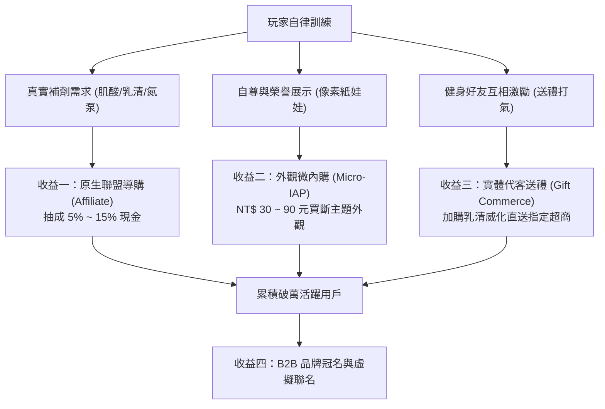

# 商業變現模型 (Monetization Framework)

> **鏈結索引**：[返回索引](file:///Users/yuchien/Project/Github/fitmon/llm-wiki/wiki/00_INDEX.md) ｜ [遊戲機制](file:///Users/yuchien/Project/Github/fitmon/llm-wiki/wiki/game_mechanics_and_science.md) ｜ [里程碑](file:///Users/yuchien/Project/Github/fitmon/llm-wiki/wiki/roadmap.md)

---

## 1. 商業化總體策略

FitMon 堅守「**數值公平、絕不販賣破壞遊戲平衡之數值外掛**」的原則，所有變現路徑均圍繞「真實補劑導購需求」與「健康自信的社交虛榮心」展開：

---

## 2. 四大變現收益維度詳解

| 收益模式 | 具體實施形式 | 定價 / 分潤比例 | 實施階段 |
|---|---|---|---|
| **原生聯盟導購 (Affiliate Commerce)** | 點擊虛擬肌酸或乳清補劑時，彈出「領取品牌專屬 9 折碼」外跳知名補劑電商（如 MyProtein、惡名昭彰、Spark Protein 等）。 | 每筆交易抽成 **5% ~ 15% 現金**。 | **V1.0 首發版本** |
| **外觀微內購 (Micro-IAP)** | 限定主題外觀包（賽博龐克重訓服、黃金槓鈴、復古健美皮帶），完全不販售數值加成。 | 新台幣 **30 ~ 90 元** (小額單品買斷)。 | **V1.0 首發版本** |
| **實體代客送禮 (Gift Commerce)** | 好友送禮時可勾選加購「真實乳清威化餅 / 能量棒直送好友指定超商（如 7-11/全家）」。 | 賺取實體商品批發與導購差價分潤。 | **V2.0 社交成熟期** |
| **品牌冠名贊助 (B2B Sponsorship)** | 與專業健身服飾或護具品牌（如 SBD、A7、VERVE）聯名推出虛擬像素同款裝飾。 | 每月固定刊登與特定裝備曝光贊助費用。 | **月活破萬用戶後** |

---

## 3. 與運動員道德一致的品牌信任度
- 拒絕侵入式廣告（如訓練中突然跳出 30 秒滿版影音廣告）。
- 聯盟導購只出現在玩家自主點擊補劑背包與結算時刻，將商業廣告無縫包裝為「遊戲道具真實化」之增值體驗。
