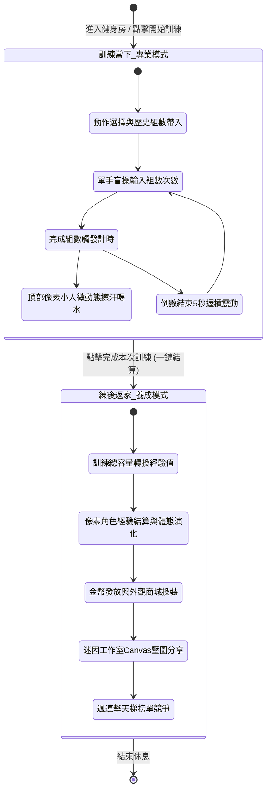

# 雙模式運行機制 (Dual-Mode Architecture)

> **鏈結索引**：[返回索引](file:///Users/yuchien/Project/Github/fitmon/llm-wiki/wiki/00_INDEX.md) ｜ [遊戲機制與數值](file:///Users/yuchien/Project/Github/fitmon/llm-wiki/wiki/game_mechanics_and_science.md) ｜ [迷因與社交](file:///Users/yuchien/Project/Github/fitmon/llm-wiki/wiki/meme_and_social.md)

---

## 1. 概念與核心原則

FitMon 的靈魂在於「在對的情境給予對的體驗」。使用者在健身房握槓時不需要遊戲彈窗，在回家洗完澡後需要強烈的成長與榮譽反饋。

---

## 2. 模式對比與實作規範

| 模組維度 | 訓練當下（專業模式） | 練後返家（養成模式） |
|---|---|---|
| **視覺風格** | 純黑背景 (`#000000` 或 `#0f172a`)，高對比大字體。 | 飽和像素 RPG 風格、色彩豐富的 HUD、裝備卡槽。 |
| **操作體驗** | 專注「單手盲操」，按鈕具備極大點擊熱區，歷史數據自動帶入。 | 點擊領取獎勵、滑動檢視換裝、拖曳卡牌、迷因調色。 |
| **音效與反饋** | 靜音或純震動提示（倒數結束震動），嚴禁吵鬧音效與干擾彈窗。 | 經典 8-bit / 16-bit 升級音效、收金幣清脆聲、體態突破特效。 |
| **微動態角色** | 頂部常駐迷你陪練像素人（組間倒數時播放喝水/擦汗/繫腰帶等微動畫）。 | 角色位於畫面中央主舞臺，可換裝紙娃娃、展示稱號與進化體態。 |
| **目標價值** | 守護專注心率、零輸入摩擦、專業課表記錄。 | 汗水兌換虛榮、多巴胺分泌、社交分享自豪感。 |

---

## 3. 專業模式下的關鍵 UI/UX 細節
1. **動作速查庫**：內建 40+ 常見自由重量（深蹲、臥推、硬舉、肩推）與機械式動作。
2. **單手快速調重**：提供「+1.25kg」、「+2.5kg」、「+5kg」快速增減按鈕，減少鍵盤呼出時間。
3. **組間倒數微動態**：
   - 倒數期間，上方像素小人處於「休息喝水」動畫。
   - 倒數剩餘 5 秒時，小人播放「起身握槓」預備動作，手機發出短促震動喚醒注意力。
