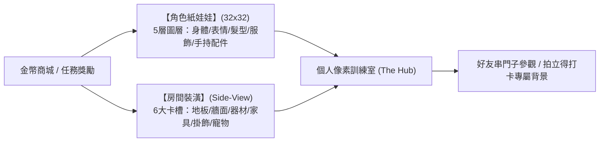

# 雙軌紙娃娃與雙模式運行機制 (Dual Customization & Experience)

> **鏈結索引**：[返回索引](00_INDEX.md) ｜ [遊戲機制與數值](game_mechanics_and_science.md) ｜ [迷因與社交](meme_and_social.md)

---

## 1. 雙軌紙娃娃系統：【角色裝扮】＋【房間裝潢】

FitMon 將經典紙娃娃（Paper Doll）機制延伸至**角色個體**與**專屬空間**雙重維度：

### 1.1 角色 5 層精靈規格 (32x32 Avatar Specs)
* **Layer 0 (身體 Base)**：膚色（白皙/健康/小麥/深黑）、體型輪廓。
* **Layer 1 (表情 Face)**：堅定、微笑、眨眼 (Wink)、咬牙流汗、力竭放空。
* **Layer 2 (髮型 Hair)**：短髮、馬尾、爆炸頭、吸汗頭巾、棒球帽。
* **Layer 3 (服飾 Outfit)**：運動背心、連帽衛衣、復古運動短褲、緊身機能褲。
* **Layer 4 (手持 Prop)**：金啞鈴、能量水瓶、毛巾、跑鞋、冠軍腰帶。

### 1.2 房間 6 大家具卡槽規格 (Room Decor Slots)
* **① 地板與地墊**：斑駁水泥地、專業減震橡膠墊、復古胡桃木拼花地板、日式榻榻米。
* **② 牆面風格**：灰白磚牆、清水模工業風、霓虹賽博龐克磚、榮譽錦旗牆。
* **③ 核心器材**：瑜伽墊+生鏽啞鈴 ➔ 復古原木跑步機、專業深蹲架 (Power Rack)、多功能引體向上架、拳擊沙袋。
* **④ 氛圍家具**：**復古卡帶音響**（可切換 8-bit BGM）、能量飲料小冰箱、水耕植栽、獎盃架。
* **⑤ 牆面裝飾**：「NO PAIN NO GAIN」動態霓虹燈、連續 30 天打卡限定錦旗、自嘲迷因海報。
* **⑥ 伴隨寵物**：在角落做伏地挺身的像素柴犬、沙袋旁睡覺的像素橘貓（當天運動打卡後喚醒！）。

---

## 2. 雙模式心流切換：主場景生活感 vs 運動專注打卡 (Tab 導覽分流)

依據 [ADR-0002](../adr/0002-app-shell-with-embedded-pixel-canvas.md)，雙模式分別承載於 App 外殼的底部 **Tab 1 (訓練室 Home)** 與 **Tab 2 (運動 Workout)**，透過 SPA 毫秒級無感切換：

| 模組維度 | 平時主畫面（Tab 1: 訓練室 Home） | 運動打卡當下（Tab 2: 運動 Workout） |
|---|---|---|
| **視覺呈現** | 上半部為嵌入式 2D 像素房間畫布，小人自主遊蕩於器材間，頭頂有情境對話氣泡；下半部為今日任務與連擊卡片。 | Web DOM 極簡黑底高對比介面、大字體碼表、課表模板選取、3 秒補登按鈕。 |
| **操作體驗** | 點擊氣泡輪播趣味台詞、自訂房間與衣櫃裝潢。 | 支援單手盲操、快速選填運動項目與時長，組間倒數計時。 |
| **音效反饋** | 輕快 8-bit BGM 循環（可由卡帶音響切換或一鍵靜音）。 | 專注無打擾，僅在倒數結束震動或發出清脆 Blip 音效。 |
| **結算儀式** | 享受裝飾房間、衣櫃試穿與好友串門子帶來的成就感。 | 達成時觸發「MISSION COMPLETE!」全螢幕暗下、金幣噴發與勝利號角。 |
| **資源消耗** | 局部 PixiJS 畫布渲染（切換離開時自動暫停 ticker）。 | 100% Web DOM 運作，CPU/GPU 零額外負荷，極致省電。 |

---

## 3. 專業模式下的關鍵 UI/UX 細節
1. **動作速查庫**：內建 40+ 常見自由重量（深蹲、臥推、硬舉、肩推）與機械式動作。
2. **單手快速調重**：提供「+1.25kg」、「+2.5kg」、「+5kg」快速增減按鈕，減少鍵盤呼出時間。
3. **組間倒數微動態**：
   - 倒數期間，上方像素小人處於「休息喝水」動畫。
   - 倒數剩餘 5 秒時，小人播放「起身握槓」預備動作，手機發出短促震動喚醒注意力。

---

## 4. 運動課表工坊與每週分化行事曆 (Routine Templates & Weekly Split)

規律訓練者的日常高度依賴分化排程，系統提供無縫的課表管理：
1. **個人課表模板庫 (My Templates)**：
   * 玩家可自由自訂模板（如「胸肩三頭 Push Day」、「腿部極限 Leg Day」、「5km 間歇跑」）。
   * **歷史數據自動預載**：套用模板時自動帶入上次訓練的公斤數與次數，無縫掌握漸進式超負荷。
   * **一鍵收納大神菜單**：在社群廣場看到大神的課表，點擊「複製為我的模板」即可直接套用開練。
2. **每週分化行事曆 (Weekly Split Calendar)**：
   * 自由排定週一至週日課表（如週一 Push、週二 Pull、週四 Legs）。
   * 當天打開 App，小人自主冒泡提醒：`「今天是週四 Leg Day 喔！」`，點擊開始運動直接預載今日課表。
3. **合法休息日 (Rest Day) 連擊保護**：
   * 健身科學講求超量恢復，行事曆排定的「休息日」自動免除當日打卡義務，**連擊 (Streak) 火焰依然安全維持**，小人在房間躺椅悠閒休息。
