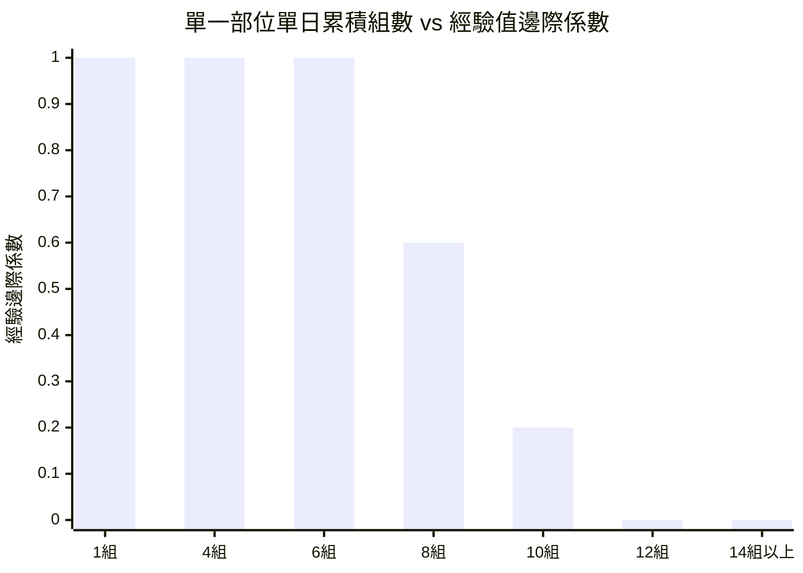

# 遊戲機制與運動科學數值引擎 (Game Mechanics & Exercise Science)

> **鏈結索引**：[返回索引](file:///Users/yuchien/Project/Github/fitmon/llm-wiki/wiki/00_INDEX.md) ｜ [雙模式架構](file:///Users/yuchien/Project/Github/fitmon/llm-wiki/wiki/dual_mode_experience.md) ｜ [商業模式](file:///Users/yuchien/Project/Github/fitmon/llm-wiki/wiki/business_model.md)

---

## 1. 經驗值結算核心公式 (Experience Engine)

FitMon 將運動科學中的「訓練容量（Volume = Weight × Reps）」升級為兼具中樞神經負荷與防刷機制的數值公式：

$$\text{Exp} = \sum_{i=1}^{N} \left( \text{Weight}_i \times \text{Reps}_i \right) \times \text{Multiplier}_{\text{exercise}} \times \text{DecayFactor}_{\text{fatigue}}(S_m)$$

其中：
- $\text{Weight}_i$：第 $i$ 組重量（以公斤 kg 計，自體重動作以預設基準計算）。
- $\text{Reps}_i$：第 $i$ 組有效次數。
- $\text{Multiplier}_{\text{exercise}}$：動作神經負荷加權係數。
- $\text{DecayFactor}_{\text{fatigue}}(S_m)$：針對該肌群 $m$ 累積組數 $S_m$ 的疲勞衰減係數。

---

## 2. 動作神經加權係數 (Neural Multiplier)

不同動作對全身神經系統與代謝壓力的消耗懸殊，數值引擎依複合程度給予不同暴擊倍率：

| 動作類別 | 代表動作 | 加權倍率 ($\text{Multiplier}$) | 運動科學考量 |
|---|---|---|---|
| **三大複合重量 (The Big 3)** | 槓鈴深蹲、傳統/相撲硬舉、槓鈴臥推 | **× 2.0 ～ × 2.5** | 大量肌群協同、中樞神經系統 (CNS) 負荷極高。 |
| **次級多關節複合** | 站姿肩推、引體向上、槓鈴划船、雙槓臂屈伸 | **× 1.4 ～ × 1.6** | 上肢核心鏈結多關節動作。 |
| **固定軌道/機械式** | 腿推機 (Leg Press)、滑輪下拉、胸推機 | **× 1.0** | 軌道固定，神經平衡代償需求較低，為基準線。 |
| **單關節孤立動作** | 啞鈴側平舉、二頭彎舉、三頭下壓、小腿提踵 | **× 0.8** | 局部泵感強但全身能量消耗低，避免玩家靠單手狂刷彎舉洗分。 |

---

## 3. 防作弊防刷：垃圾容量衰減演算法 (Fatigue & Junk Volume Decay)

為了防範玩家用 1kg 啞鈴狂做 100 組刷洗經驗值，數值引擎採用超量恢復理論設計組數邊際效益遞減曲線：

- **1 ～ 8 組**：$\text{DecayFactor} = 1.0$（黃金刺激區間，全額經驗結算）。
- **9 ～ 11 組**：$\text{DecayFactor} = 0.5 \rightarrow 0.2$（過度疲勞區間，組數效益驟減）。
- **12 組以上**：$\text{DecayFactor} = 0.0$（垃圾容量門檻，不再產生任何經驗值與金幣）。

---

## 4. 虛擬補劑 Buff 系統 (Supplements & Economy)

玩家可於每日訓練前或結算時使用補劑道具，提升遊戲樂趣並深度結合原生聯盟導購：

| 道具名稱 | 取得途徑 | 遊戲數值 Buff 效果 | 原生商業導購時機 |
|---|---|---|---|
| **食用肌酸 (Creatine)** | 金幣購買 / 簽到獎勵 | 角色每日總體力上限 $+1$ 組，解鎖額外極限打卡額度。 | 點擊背包肌酸時，展示知名電商 9 折專屬優惠碼。 |
| **乳清蛋白 (Whey Protein)** | 金幣購買 / 禮物兌換 | 訓練完成結算時飲用，當次結算經驗值與金幣額外 $+20\%$。 | 練後結算頁面彈出「喝一杯補充蛋白質」連結。 |
| **預釀氮泵 (Pre-Workout)** | 限量掉落 / 任務解鎖 | 限時 60 分鐘打卡倒數，動作經驗享 $30\%$ 機率觸發「神經暴擊」翻倍。 | 進入專業訓練模式前使用。 |

---

## 5. 像素角色體態演化樹 (Avatar Evolution)

像素小人將根據長期累積之不同動作大項分配，動態分化外觀特徵：
- **階段一：新手學徒 (Beginner)** —— 初始純白素體，手持小啞鈴。
- **階段二：維京巨力 (Powerlifter)** —— 深蹲/硬舉比例過半，厚實腰腹、巨碩背闊與護腕。
- **階段三：古典美學 (Aesthetic)** —— 肩推/臥推/引體向上比例高，倒三角體態、極低體脂線條。
- **階段四：重裝泰坦 (Iron Titan)** —— 週連擊超過 12 週，附帶金色燃燒蒸氣與全套舉重腰帶。
