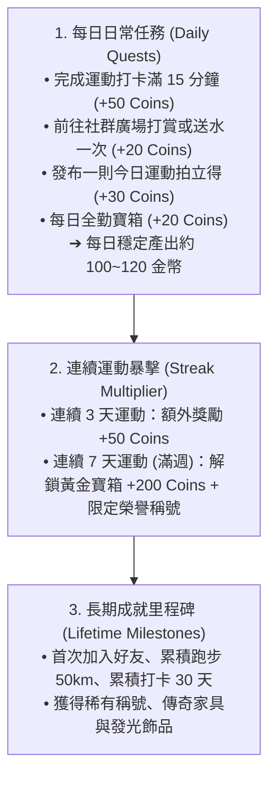

# 遊戲機制與任務數值引擎 (Game Mechanics & Quest Economy)

> **鏈結索引**：[返回索引](00_INDEX.md) ｜ [雙軌紙娃娃](dual_mode_experience.md) ｜ [社群與迷因](meme_and_social.md)

---

## 1. 核心激勵機制：三層任務體系 (The 3-Tier Quest System)

FitMon 摒棄繁瑣的 RPG 打怪升級與挫折感強烈的數值衰減，改採直觀明快的**「任務制 ＋ 連續運動 (Streak) ＋ 金幣 (Coins) 經濟」**：

---

## 2. 數值配置化原則 (Config-Driven Balance)

為了滿足未來進行數值模擬與動態熱調整，所有經濟常數完全與代碼邏輯解耦，集中維護於資料庫 `game_economy_config` 表中：

| 參數鍵名 (Key) | 初始基準值 (Baseline) | 說明 |
|---|---|---|
| `ftue_starter_coins` | `100` | 新手創角首次贈送起跑基金 |
| `daily_workout_coins` | `50` | 每日單次運動達成獎勵 |
| `daily_tip_reward_coins` | `20` | 每日打賞好友任務獎勵 |
| `daily_post_reward_coins` | `30` | 每日發布成果動態獎勵 |
| `streak_3d_bonus` | `50` | 連續運動 3 天額外獎勵 |
| `streak_7d_bonus` | `200` | 連續運動 7 天黃金寶箱獎勵 |
| `tip_single_amount` | `10` | 單次打賞貼文扣除之金幣 |
| `gift_energy_drink_cost` | `20` | 贈送好友虛擬能量水扣除之金幣 |

---

## 3. 街機風 VICTORY 勝利結算儀式 (Settlement Feedback)

完成運動打卡時，畫面觸發街機級別的全螢幕反饋：
1. **全螢幕視覺暗化**：中央彈出像素金色大字「**VICTORY! 任務達成**」。
2. **8-bit 街機音效**：播放短暫激昂的勝利號角（Fanfare）與金幣入袋跳動音效。
3. **連續打卡火焰**：點亮當前 Streak 火焰天數（如「🔥 連續運動 6 天達成！」）。
4. **自動產出拍立得**：直接生成當次運動成果卡片，引導玩家進入拍貼工坊或發布廣場。

---

## 4. 運動科學輔助加權（重訓進階模式備查）

針對重訓愛好者，系統底層仍保留神經負荷加權與垃圾容量防刷演算法，作為進階課表與疲勞分析的支撐模組：
* **多關節複合動作加權**：深蹲、硬舉、臥推享 $1.5 \sim 2.0\times$ 負荷加權。
* **單一部位超量衰減**：單一部位超過 8 組邊際效益遞減，超過 12 組判定為過度疲勞。

---

## 5. 像素角色體態演化樹 (Avatar Evolution)

像素小人將根據長期累積之不同動作大項分配，動態分化外觀特徵：
- **階段一：新手學徒 (Beginner)** —— 初始純白素體，手持小啞鈴。
- **階段二：維京巨力 (Powerlifter)** —— 深蹲/硬舉比例過半，厚實腰腹、巨碩背闊與護腕。
- **階段三：古典美學 (Aesthetic)** —— 肩推/臥推/引體向上比例高，倒三角體態、極低體脂線條。
- **階段四：重裝泰坦 (Iron Titan)** —— 週連擊超過 12 週，附帶金色燃燒蒸氣與全套舉重腰帶。

---

## 6. 個人最佳紀錄 (PR) 與榮譽館 (Personal Records & Trophy Hall)

運動愛好者核心驅動力在於「感受自己的進步」：
* **自動追蹤 1RM PR**：每次打卡若突破歷史最高重量或最快配速，即時彈出金色像素標記「**NEW PR! 突破極限**」。
* **榮譽獎盃櫃**：房間家具中的獎盃架可放置打破紀錄獲得的專屬獎盃與像素徽章，並能作為貼紙放置於 Meme 拍貼工坊。

---

## 7. 休息日保護與連擊防棄坑救援 (Rest Day & Streak Freeze)

解決習慣養成 App 最大棄坑痛點（生病、出差導致連續天數歸零）：
1. **排程休息日免打卡**：行事曆設定之休息日自動視為合法維持，不中斷連擊。
2. **連擊冰凍卡 (Streak Freeze)**：
   * 用戶可儲備最多 2 張冰凍卡（每週全勤贈送 1 張，或金幣商城購買儲備）。
   * 當日因加班或突發狀況漏打卡時，系統於午夜自動消耗 1 張冰凍卡凍結連擊，保住辛苦維持的成果！

---

## 8. 運動科學指引與無爭議科普講堂 (Evidence-Based Science & Safety Guard)

### 8.1 四大公認運動科學基石
1. **熱量平衡定律 (CICO)**：減脂依靠溫和熱量赤字 (300~500 kcal)，破除「晚上吃澱粉直接變脂肪」與「流汗多等於減肥」迷思。
2. **漸進式超負荷 (Progressive Overload)**：肌肥大依靠每週有效組數 (10~20 組) 與微幅增加容量，而非盲目借力做大重量。
3. **蛋白質與水分黃金律**：每日蛋白質攝取 1.6 ~ 2.2g / 每公斤體重，水分充足 (體重 × 35~40ml)，睡眠 7~8 小時保證肌肉合成。
4. **動作力學安全 (Joint Safety)**：維持脊椎中立 (Neutral Spine)、瓦式腹壓 (Bracing)，避免下背與關節代償受傷。

### 8.2 開源商業授權動作資料庫：`free-exercise-db`
* **資料庫來源**：採用全球知名開源項目 **`yuhonas/free-exercise-db`**。
* **商用授權**：**The Unlicense (Public Domain)**，100% 免費、合法商用無版權風險。
* **資料涵蓋**：800+ 款動作，包含器材分類、主要/次要肌群、分步指引、以及**起始與峰值收縮 2 階段動作分解圖**。

### 8.3 雙軌圖解與玩中學載體
1. **動作安全保命卡**：
   * 上方：32x32 像素小人示範動態。
   * 下方展開：`free-exercise-db` 高清解剖肌肉圖與動作分解圖。
   * 標註 **「3 大避坑要訣」**（如深蹲膝蓋對準腳尖、臥推沉肩夾背）。
2. **白板每日科普微便簽 (Daily Science Tip)**：
   * 個人訓練室小人每天在白板上貼一張科學金句便簽（如「你知道嗎？睡眠少於 6 小時，肌肉合成率降低 18%」）。
3. **破除迷思金幣小問答 (Myth-Buster Quiz)**：
   * 每日隨機 1 題破除迷思小測驗，答對現領 **+10 金幣**，邊玩邊學正確知識。

### 8.4 動作庫雙語分級在地化 (Tiered Exercise Translation)
* 鑑於 `free-exercise-db` 原始為全英文，為避免粗糙機翻導致健身名詞不專業，採取分級策略：
  * **Tier 1 (核心動作精準繁中化)**：前 60 個最常用王牌動作（深蹲、臥推、硬舉、划船、引體向上等）由專業教練術語逐一審定翻譯。
  * **Tier 2 (廣泛動作雙語標籤化)**：其餘冷門動作在繁中模式下顯示「英文原名 ＋ 中文部位標籤（如：胸、三頭、自重）」，確保不產生理解偏差。

---

## 9. 體力值 (Stamina) 防刷與消耗型道具數值機制

1. **體力值運作機制 (Stamina Engine)**：
   * 玩家初始體力上限為 100 點，每 1 小時自然恢復 10 點（或每日 00:00 自動補滿）。
   * 每次運動打卡消耗 50 點體力值。
   * **「記錄永久免費」防線**：體力耗盡時，運動記錄依然 100% 正常存入本地沙盒，僅暫停發放金幣與經驗，杜絕任何懲罰感。
2. **消耗型道具數值效果 (Consumable Effects)**：
   * **BCAA 活力水**：即刻補充 50 點體力值，重啟當日超量運動金幣掉落。
   * **雙倍金幣卡 (2x Booster)**：啟用後掛載計時器狀態，24 小時內金幣獎勵乘數設為 2.0x。
   * **連擊冰凍卡 (Streak Freeze)**：背包上限常備 2 張，當日未打卡自動消耗以保護 Streak。
   * **幸運扭蛋券**：於扭蛋機模組抽取限定家具與服飾。
3. **時裝風格賦予「物攻 / 魔攻 / 輔助」屬性（零數值課金原則）**：
   * **衣服與手持裝備**：100% 只能靠運動任務賺取的「金幣」在商城購買（或討伐 Boss 隨機掉落），絕不可用台幣直接購買數值裝（拒絕 Pay-to-Win）。
   * **依運動風格天然賦予戰鬥屬性**：
     * **🥊 物攻系裝備 (`phy`)**：重訓腰帶、健力服、斯巴達披風、啞鈴/金槓 ➔ 強化物理重擊。
     * **🪄 魔攻系裝備 (`mag`)**：綠光泵感寬T、慢跑束口褲、防風風衣 ➔ 強化高溫有氧魔法。
     * **🛡️ 輔助系裝備 (`support`)**：壓縮褲、乳清搖搖杯、毛巾 ➔ 提供全隊增益。
   * **消耗型道具 / 討伐挑戰券**：僅用於「重置 12 小時 Boss 出擊冷卻」或「加速體力恢復」，為健康變現之 IAP 來源。

---

## 10. V2.9 Tap Titans 關卡推圖、防作弊判定與 Boss 隱藏噴裝引擎

### 10.1 核心設計理念：不鼓勵盲目拼大重量，以「自律任務 ＋ 真實組間休息」為核心
1. **拒絕大重量內捲 (No Ego Lifting)**：
   * 每個人的體質、性別與訓練年資不同，若以訓練容量（總噸數）換算傷害，會導致初學者受挫或逞強受傷。
   * 因此，**基礎攻擊力 100% 取決於「今日是否完成課表任務」與「連續簽到天數 (Streak)」**。
2. **組間休息計時 ＝ 防亂按交差判定 (Rest-Timer Anti-Cheat)**：
   * 為防止玩家打開 App 亂填數字 3 秒交差（導致失去新鮮感與成就感），系統以**「專注模式與組間休息計時完整度」**作為真偽判定：
     * **✅ 完整組間休息 (`legit_rest`)**：老實跑完組間休息計時，享有 **100% 滿額技能傷害**，並開啟 **Boss 隱藏神裝掉寶資格**。
     * **🤥 3秒亂按作弊 (`cheated_fast`)**：未跑組間休息秒速跳過，觸發嚴厲懲罰——**傷害暴跌 -95%（僅打出 `-15 HP` 作弊刮痧拳 💨）**，且**掉寶率強制歸 0%**！
     * **🔒 今日尚未運動 (`none`)**：鎖定出擊按鈕，必須先完成運動打卡才能出拳。

### 10.2 依今日運動類型選擇連攜技能 (Sport-Type Skill Combos)
Boss 擁有固定的屬性弱點（如馬鈴薯怪弱物攻、珍奶巨魔弱魔攻），而玩家可依據當天實際執行的運動類型，在出擊時施放對應戰術技能與隊友打 Combo：
* **🏋️ 重訓課表 (`strength`) ➔ 施放【🔨 破甲重擊】**：造成高物理傷害，並為 Boss 掛上「破甲狀態（下一位隊友魔攻傷害 ×2.0 倍）」。
* **🏃 有氧心肺 (`cardio`) ➔ 施放【🔥 燃脂魔焰】**：造成高魔法傷害，若 Boss 身上有隊友留下的「破甲狀態」，立即觸發 **💥 2.0 倍連攜引爆**！
* **🧘 徒手核心 (`bodyweight`) ➔ 施放【🌪️ 聚氣暴擊陣】**：造成穩定暴擊傷害，並使該次出擊 **打落 Boss 隱藏神裝的機率直接翻倍 (×2.0)**！

### 10.3 幽默現代生活系 Boss 與隱藏掉落神裝 (`ADVENTURE_BOSS_CATALOG`)
採《Tap Titans》無限關卡推圖制（Stage 1 ➔ 2 ➔ 3...），**Boss 血條採殘血累積保存制（未秒殺不重置，自己與隊友可接力削血）**：

| 關卡循環 | Boss 名稱 | 固定弱點 | 專屬隱藏掉落神裝 (`hiddenLoot`) |
|---|---|---|---|
| **Stage 1** | **🥔 沙發馬鈴薯怪** | 🥊 弱物理 (2.0x) | `🛡️ 波浪洋芋片脆皮盾` (🥊 物攻 +45 · 稀有 25%) |
| **Stage 2** | **🧋 宵夜珍奶巨魔** | 🪄 弱魔法 (2.0x) | `🪄 黑糖珍珠暴風法杖` (🪄 魔攻 +55 · 史詩 20%) |
| **Stage 3** | **📱 熬夜低頭幽靈** | 🥊 弱物理 (1.8x) | `🥽 抗藍光覺醒護目鏡` (🥊 物攻 +60 · 史詩 18%) |
| **Stage 4** | **🧀 熔岩起司黏怪** | 🪄 弱魔法 (2.0x) | `🧣 熔岩莫札瑞拉披肩` (🪄 魔攻 +70 · 傳奇 15%) |
| **Stage 5** | **⏰ 賴床貪睡魔神** | 🥊 弱物理 (1.8x) | `🔨 晨間粉碎巨型鬧鐘錘` (🥊 物攻 +85 · 傳奇 12%) |
| **Stage 6** | **🍗 暴食炸雞領主** | ⚡ 物魔協同 (1.5x) | `👑 黃金脆皮霸王皇冠` (⚡ 雙攻 +100 · 神話 10%) |

### 10.4 雙軌冒險挑戰與個人戰鬥素質專頁 (Adventure Dual Tracks & Combat Stats Hub)
1. **雙軌冒險挑戰分流**：
   * **🗡️ 單人冒險**：Boss 血量為標準 1.0x，完全由玩家個人輸出消磨，累積個人冒險關卡進度與**個人天梯排行榜 (Solo Ladder)**，提供無朋友之玩家沉浸自我挑戰的舞台。
   * **🛡️ 組隊冒險**：Boss 血量為加乘 1.8x，同隊隊友共享同一隻怪的血量與關卡進度，累積**戰隊天梯排行榜 (Squad Ladder)**。隊長可透過邀請碼邀集好友共同輸出，杜絕自行編制多重分身。
2. **獨立「個人素質」專頁 (`combat_stats`)**：
   * 脫離戰鬥打怪場景，獨立設於冒險次級分頁中，包含：
     - **配裝素質總覽**：全身 5 格部位（髮型、表情、上衣、下身、手持配件）之物攻、魔攻、輔助攻、暴擊率加成。
     - **屬性傷害加成面板**：重訓（物攻加成）、有氧（魔攻加成）、徒手核心（輔助/暴擊加成）。
     - **戰力輸出區間預覽**：常規普通命中值 ～ 破甲/魔焰/暴擊之極限傷害天花板。
     - **生涯戰鬥數據總表**：生涯總輸出傷害（累計 Total Tonnage/Damage）、給予 Boss 最後一擊次數（撿尾刀次數）、累計擊敗 Boss 隻數、出刀總次數。
3. **尾刀戰報與稀有掉寶專屬分享**：
   * 給予 Boss 致命最後一擊的玩家在擊殺當下跳出**「尾刀勝利戰報卡」**。
   * 成功觸發隱藏神裝掉落時，彈出專屬**「稀有噴裝分享卡」**，供玩家一鍵轉發 IG 限動或 LINE 炫耀。

---

## 11. FitMon 核心數值平衡總表 (Game Balance Parameter Matrix)

未來持續擴充關卡與調整遊戲節奏時，所有核心參數集中於 `apps/web-demo/src/config/economyConfig.ts` 與 `catalogConfig.ts`：

### 11.1 體力與防作弊參數
| 參數項目 | 當前設定值 | 調校目的與影響 |
|---|---|---|
| 每日體力上限 (`maxStamina`) | `100 點` | 控制每日可獲金幣獎勵的運動組數上限 |
| 每組消耗體力 (`staminaPerSet`) | `5 點 / 組` | 每日首 20 組享金幣掉落；第 21 組起永久免費記錄但不掉幣 |
| 組間休息防作弊門檻 | `專注 ≥ 30秒` | 低於門檻視為亂按交差，觸發刮痧懲罰 |
| 作弊傷害與掉寶懲罰 | `傷害 -95% (固定 15 HP)` / `掉寶 0%` | 杜絕 3 秒假打卡，保護認真運動者的成就感 |
| 每日課金秒解出擊上限 | `最多 1 次 / 日` | **嚴防課金仔過度破壞天梯節奏**，其餘冷卻需靠真運動打卡或討伐券抵扣 |

### 11.2 金幣產出 (Faucet) 與商城消費物價 (Sink)
* **平衡目標**：規律運動玩家約 **2～3 天可購得一件普通新裝，7～10 天可存到一件傳奇時裝**。
* **單日運動產出**：每組掉落 (`5 幣`) ＋ 每日運動任務 (`50 幣`) ＋ 房間互動 (`15 幣`) ＋ 科普問答 (`15 幣`) ≈ **`80 ~ 150 幣 / 日`**。
* **Boss 通關賞金**：Stage 1 (`150 幣`) ➔ Stage 6 (`1,200 幣`)。
* **商城時裝物價**：普通 (`120~160 幣`)、稀有 (`200~220 幣`)、傳奇 (`350~380 幣`)。

### 11.3 攻擊傷害、裝備數值與倍率公式
* **基礎傷害公式**：$\text{BaseDMG} = 340 + (\text{已完成任務數} \times 60) + (\text{連續打卡天數} \times 25)$
* **裝備屬性加成**：$\text{GearDMG} = (\text{裝備總物攻} \times 4) + (\text{裝備總魔攻} \times 4)$
  * 初始免費裝：`+10 ~ +25` ｜ 商城稀有裝：`+25 ~ +35` ｜ 商城傳奇裝：`+60 ~ +80` ｜ Boss 隱藏裝：`+45 ~ +100`
* **關鍵乘數倍率**：
  * **Boss 屬性弱點克制**：`1.8x ~ 2.0x`
  * **隊友破甲＋魔焰連攜引爆**：`1.6x ~ 2.0x`
  * **戰隊全員真運動出勤狂暴**：`1.5x`
  * **關卡血量成長曲線**：每晉升 1 關，Boss 基礎血量 `× (1 + 0.25 × (Stage - 1))`；戰隊模式總血量額外 `× 1.8`。
* **出擊冷卻與重置**：每次出擊後冷卻 `12 小時`；消耗 `1 張討伐券` 或模擬內購 `NT$ 30` 可立即歸零冷卻（**每日限 1 次**）。
