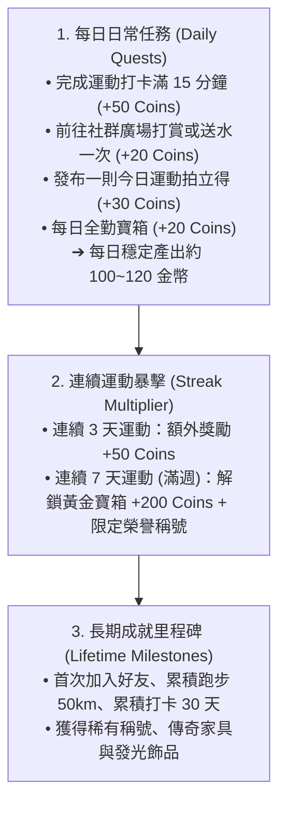

# 遊戲機制與任務數值引擎 (Game Mechanics & Quest Economy)

> **鏈結索引**：[返回索引](00_INDEX.md) ｜ [雙軌紙娃娃](dual_mode_experience.md) ｜ [社群與迷因](meme_and_social.md)

---

## 1. 核心激勵機制：三層任務體系 (The 3-Tier Quest System)

FitMon 摒棄繁瑣的 RPG 打怪升級與挫折感強烈的數值衰減，改採直觀明快的**「任務制 ＋ 連續運動 (Streak) ＋ 金幣 (Coins) 經濟」**：

---

## 2. 數值配置化原則 (Config-Driven Balance)

為了滿足未來進行數值模擬與動態熱調整，所有經濟常數完全與代碼邏輯解耦，集中維護於資料庫 `game_economy_config` 表中：

| 參數鍵名 (Key) | 初始基準值 (Baseline) | 說明 |
|---|---|---|
| `ftue_starter_coins` | `100` | 新手創角首次贈送起跑基金 |
| `daily_workout_coins` | `50` | 每日單次運動達成獎勵 |
| `daily_tip_reward_coins` | `20` | 每日打賞好友任務獎勵 |
| `daily_post_reward_coins` | `30` | 每日發布成果動態獎勵 |
| `streak_3d_bonus` | `50` | 連續運動 3 天額外獎勵 |
| `streak_7d_bonus` | `200` | 連續運動 7 天黃金寶箱獎勵 |
| `tip_single_amount` | `10` | 單次打賞貼文扣除之金幣 |
| `gift_energy_drink_cost` | `20` | 贈送好友虛擬能量水扣除之金幣 |

---

## 3. 街機風 VICTORY 勝利結算儀式 (Settlement Feedback)

完成運動打卡時，畫面觸發街機級別的全螢幕反饋：
1. **全螢幕視覺暗化**：中央彈出像素金色大字「**VICTORY! 任務達成**」。
2. **8-bit 街機音效**：播放短暫激昂的勝利號角（Fanfare）與金幣入袋跳動音效。
3. **連續打卡火焰**：點亮當前 Streak 火焰天數（如「🔥 連續運動 6 天達成！」）。
4. **自動產出拍立得**：直接生成當次運動成果卡片，引導玩家進入拍貼工坊或發布廣場。

---

## 4. 運動科學輔助加權（重訓進階模式備查）

針對重訓愛好者，系統底層仍保留神經負荷加權與垃圾容量防刷演算法，作為進階課表與疲勞分析的支撐模組：
* **多關節複合動作加權**：深蹲、硬舉、臥推享 $1.5 \sim 2.0\times$ 負荷加權。
* **單一部位超量衰減**：單一部位超過 8 組邊際效益遞減，超過 12 組判定為過度疲勞。

---

## 5. 像素角色體態演化樹 (Avatar Evolution)

像素小人將根據長期累積之不同動作大項分配，動態分化外觀特徵：
- **階段一：新手學徒 (Beginner)** —— 初始純白素體，手持小啞鈴。
- **階段二：維京巨力 (Powerlifter)** —— 深蹲/硬舉比例過半，厚實腰腹、巨碩背闊與護腕。
- **階段三：古典美學 (Aesthetic)** —— 肩推/臥推/引體向上比例高，倒三角體態、極低體脂線條。
- **階段四：重裝泰坦 (Iron Titan)** —— 週連擊超過 12 週，附帶金色燃燒蒸氣與全套舉重腰帶。
