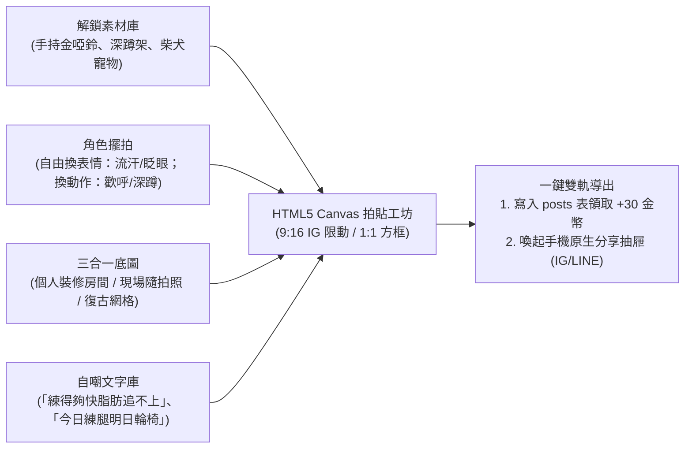

# 拍立得社群與迷因拍貼工坊 (Polaroid Plaza & Meme Studio)

> **鏈結索引**：[返回索引](file:///Users/yuchien/Project/Github/fitmon/llm-wiki/wiki/00_INDEX.md) ｜ [隱私原則](file:///Users/yuchien/Project/Github/fitmon/llm-wiki/wiki/product_vision_and_privacy.md) ｜ [雙軌紙娃娃](file:///Users/yuchien/Project/Github/fitmon/llm-wiki/wiki/dual_mode_experience.md)

---

## 1. 像素迷因拍貼工坊 (Pixel Meme Studio)

運動愛好者擁有極強烈的自嘲分享與成就炫耀心理。FitMon 將玩家用金幣解鎖的所有資產轉化為創意貼紙：

### 1.1 手勢編輯與操作規範
* 支援手機原生雙指捏合縮放 (Pinch-to-zoom)、旋轉與單指平移拖曳。
* 選中貼紙提供像素快捷邊框：`[❌ 刪除]`、`[🪞 水平翻轉]`、`[⬆️ 圖層置頂]`、`[🔄 旋轉縮放]`。

### 1.2 非遮蔽式宣傳 APP Logo 浮水印 (Non-Obstructive Watermark)
* **位置**：9:16 限動置於右下角邊緣（安全距離避開 IG 底層回覆框）；1:1 拍立得印刷於底部留白橫條右側，**保證 100% 不遮擋中央主角或隨拍照**。
* **樣式**：精緻 8-bit 圖標 ＋ `👾 FitMon · 像素運動日記` 字樣，80% 半透明微透底帶 1px 陰影，自帶優雅傳播種子。

---

## 2. 拍立得社群布告欄 (Pixel Polaroid Plaza)

社群動態擺脫冰冷的純文字列表，呈現為一張張充滿生活與遊戲質感的**「拍立得委託卡片」**：

* **頂部**：發布者 32x32 自訂小人、稱號與當前連續打卡火焰（🔥 Streak）。
* **中央**：運動成果數據（如「🏃‍♂️ 晨跑 5.2 km ｜ 32分」）或自選隨拍照，蓋有專屬像素印章（`STREAK ACHIEVED!`、`BEAST MODE`）。
* **底部互動**：
  * **[🥤 送能量水 (+20 Coins)]**：在貼文下為好友加油打氣。
  * **[🪙 打賞 10 金幣]**：直接給予作者金幣獎勵（由原子 RPC 處理扣款與累加）。
  * **[❤️ 點讚]**。

---

## 3. 好友串門子參觀機制 (Friend Gym Visit)

玩家在社群廣場點擊任何好友的名牌，可直接切換鏡頭**進入好友的個人專屬像素訓練室參觀**：
* 觀賞好友精心解鎖的地板、牆面、深蹲架與角落做伏地挺身的柴犬。
* 可以在好友房間留下「一瓶能量水」或在白板貼一張加油便簽，極致強化熟人交友圈的互動溫度。
