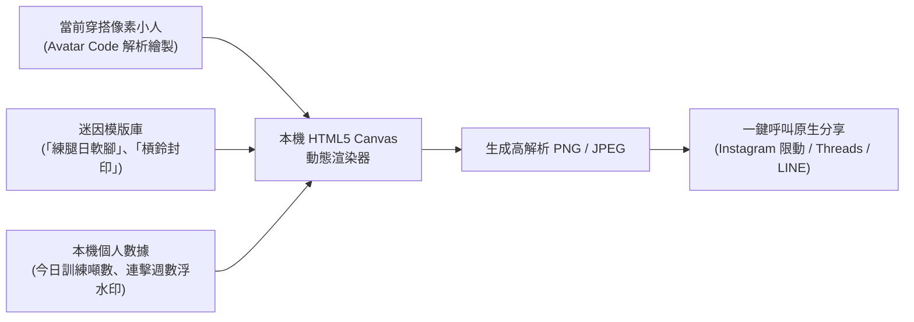

# 迷因工作室與社交機制 (Meme Studio & Zero-Graph Social)

> **鏈結索引**：[返回索引](file:///Users/yuchien/Project/Github/fitmon/llm-wiki/wiki/00_INDEX.md) ｜ [隱私原則](file:///Users/yuchien/Project/Github/fitmon/llm-wiki/wiki/product_vision_and_privacy.md) ｜ [商業模式](file:///Users/yuchien/Project/Github/fitmon/llm-wiki/wiki/business_model.md)

---

## 1. 本機迷因工作室 (Meme Studio)

健身族群具備極強的社交自嘲與成就展示心理（如「練腿日走樓梯軟腳」、「又被槓鈴壓在胸口」）。FitMon 透過 HTML5 Canvas 於手機本地直接合成迷因圖：

### 關鍵功能特點
1. **純本地離線壓圖**：完全不將照片上傳至伺服器，速度極快且絕無個資風險。
2. **連擊榮譽浮水印**：圖檔右下角動態壓上「🔥 連續 8 週達成契約」，塑造不可忽視的自律光環。
3. **無痛社群擴散**：產出圖片預設符合 9:16 Instagram Story 規範，自帶小字 FitMon 標籤帶動病毒式自然獲客。

---

## 2. 課表卡牌與秘笈工坊 (Routine Sharing)

摒棄複雜難讀的試算表，FitMon 將訓練菜單視為「武功秘笈卡牌」：
- **Deep Link / 專屬 QR Code 分享**：玩家將個人自訂課表打包成輕量 JSON。
- **等比例力量縮放 (Smart Weight Scaling)**：
  好友接收課表時，系統會比對雙方歷史 1RM 或平均力量基準，自動等比例轉換重量（例如作者做 100kg，系統自動為剛入門的好友換算為 50kg），使課表即插即用。

---

## 3. 無好友圖譜之送禮兌換代碼 (Zero-Graph Gifting)

為了徹底貫徹 [零個資隱私原則](file:///Users/yuchien/Project/Github/fitmon/llm-wiki/wiki/product_vision_and_privacy.md)，FitMon **不建立複雜且侵犯隱私的好友通訊錄圖譜**：
- 送禮方在遊戲內消耗金幣或購買禮物包後，由伺服器派發一組隨機一次性代碼（Gift Token）。
- 送禮方可將代碼透過通訊軟體（LINE/Discord/IG）傳給朋友。
- 收禮方於 FitMon 兌換代碼領取補劑或限定外觀。此過程伺服器完全無需知道「誰與誰是好友」。
