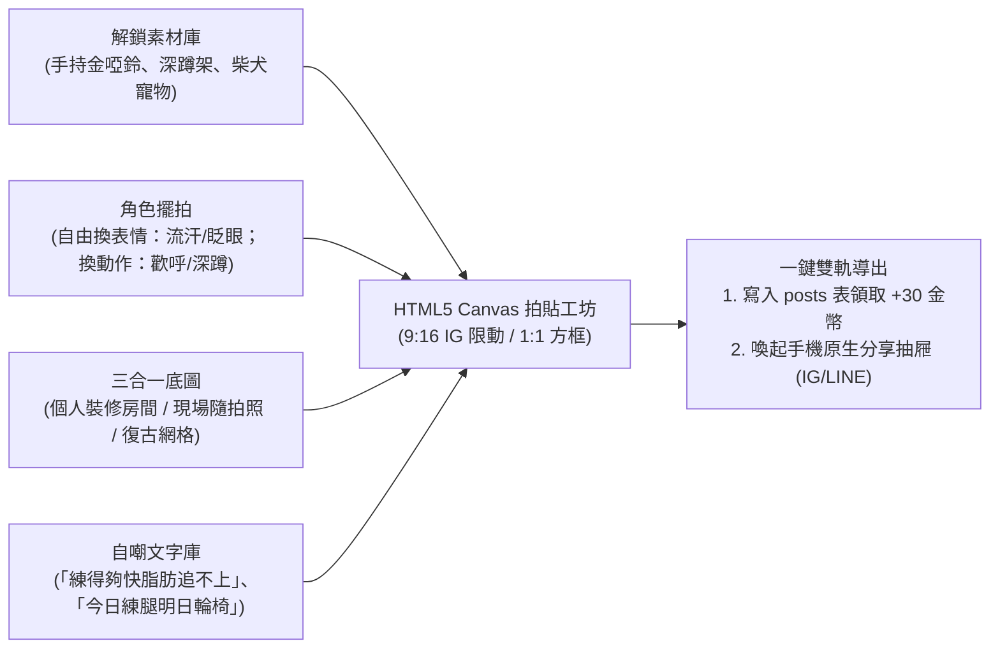

# 拍立得社群與迷因拍貼工坊 (Polaroid Plaza & Meme Studio)

> **鏈結索引**：[返回索引](00_INDEX.md) ｜ [隱私原則](product_vision_and_privacy.md) ｜ [雙軌紙娃娃](dual_mode_experience.md)

---

## 1. 像素迷因拍貼工坊 (Pixel Meme Studio)

運動愛好者擁有極強烈的自嘲分享與成就炫耀心理。FitMon 將玩家用金幣解鎖的所有資產轉化為創意貼紙：

### 1.1 手勢編輯與操作規範
* 支援手機原生雙指捏合縮放 (Pinch-to-zoom)、旋轉與單指平移拖曳。
* 選中貼紙提供像素快捷邊框：`[❌ 刪除]`、`[🪞 水平翻轉]`、`[⬆️ 圖層置頂]`、`[🔄 旋轉縮放]`。

### 1.2 非遮蔽式宣傳 APP Logo 浮水印 (Non-Obstructive Watermark)
* **位置**：9:16 限動置於右下角邊緣（安全距離避開 IG 底層回覆框）；1:1 拍立得印刷於底部留白橫條右側，**保證 100% 不遮擋中央主角或隨拍照**。
* **樣式**：精緻 8-bit 圖標 ＋ 動態品牌名稱字樣（由 `t('common.watermark')` 依當前語系與設定動態渲染，絕不硬編碼），80% 半透明微透底帶 1px 陰影，自帶優雅傳播種子。

### 1.3 迷因梗圖庫語系分流 (Locale-Aware Meme Vault)
* 健身梗圖具備高度在地文化屬性，迷因庫支援 `locales: ['zh-TW']` 與 `locales: ['en']` 標籤分流：
  * **繁中迷因**：收錄台灣/港澳健身圈共鳴自嘲（如「今日練腿，明日坐輪椅」、「教練說再一組，結果還有三組」）。
  * **英文迷因**：收錄歐美經典健身梗（如「Skipped leg day sends me to Jesus」、「One more rep was a lie」）。
* 玩家切換系統語系時，迷因庫自動載入對應文化語境之梗圖，杜絕死板直翻帶來的尷尬感。

---

## 2. 拍立得社群布告欄 (Pixel Polaroid Plaza)

社群動態擺脫冰冷的純文字列表，呈現為一張張充滿生活與遊戲質感的**「拍立得委託卡片」**：

* **頂部**：發布者 32x32 自訂小人、稱號與當前連續打卡火焰（🔥 Streak）。
* **中央**：100% 純像素運動成果卡片（小人外觀 ＋ 運動數據 ＋ 房間裝潢背景），蓋有專屬像素印章（`STREAK ACHIEVED!`、`BEAST MODE`、`NEW PR!`）。（※ 站內伺服器嚴禁上傳真人照片，徹底落實零風控零色情）。
* **底部互動**：
  * **[🥤 送能量水 (+20 Coins)]**：在貼文下為好友加油打氣。
  * **[🪙 打賞 10 金幣]**：直接給予作者金幣獎勵（由原子 RPC 處理扣款與累加）。
  * **[❤️ 點讚]**。

---

## 3. 好友串門子參觀機制 (Friend Gym Visit)

玩家在社群廣場點擊任何好友的名牌，可直接切換鏡頭**進入好友的個人專屬像素訓練室參觀**：
* 觀賞好友精心解鎖的地板、牆面、深蹲架與角落做伏地挺身的柴犬。
* 可以在好友房間留下「一瓶能量水」或在白板貼一張加油便簽，極致強化熟人交友圈的互動溫度。

---

## 4. 社群隱私控制與內容安全審查 (Privacy & Safe Moderation)

1. **發布範圍切換 (Audience Control)**：
   * 發布站內拍立得時，玩家可自由選擇「公開至全站廣場 🌐」或「僅好友可見 🔒」。
2. **UGC 安全檢舉與黑名單 (Report & Block)**：
   * 貼文右上角提供「🚩 檢舉違規」與「🚫 封鎖作者」功能。
   * 兼顧社群純淨度，並 **100% 符合 Apple App Store Guideline 1.2 對用戶生成內容的硬性審查規範**。

---

## 5. 名人與傳奇特展訓練室 (Celebrity Showcase & Legend Rooms)

1. **冷啟動種子房間 (Seed Legend Rooms)**：
   * 上線第一天預置官方傳奇特展室（如向阿諾致敬的金色健身房、李小龍武道室、官方柴犬教練示範室）。
   * 即使新用戶前幾天沒有真實好友，也能進入傳奇房間參觀、打賞能量水、一鍵複製新手經典菜單，杜絕冷啟動鬼城感。
2. **官方認證名人特展 (Verified Showcase)**：
   * 奧運選手、簽約運動員或知名教練享有 `👑 官方認證標章` 與客製 32×32 專屬形象。
   * **粉絲留言應援板**：粉絲贈送能量水時，即時於名人房間的彈幕看板滾動顯示應援留言。
   * **一鍵複製大神課表 (1-Tap Routine Copy)**：點擊選手白板上的訓練清單，一鍵直達「Tab 2: 運動」，自動帶入選手同款動作與組數。
3. **品牌聯名限定活動與 O2O 兌換**：
   * 贊助品牌舉辦「每週限時挑戰賽」，完成打卡空投限定像素家具，並於本地生成專屬實體電商折扣代碼 (`real_world_reward_code`)。
