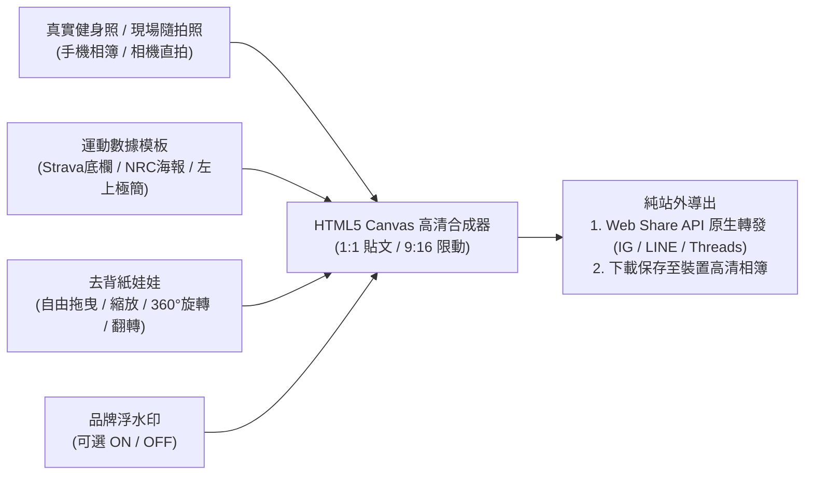

# 運動數據 × 娃合照分享與戰隊冒險公會 (Workout Share Studio & Squad Guild)

> **鏈結索引**：[返回索引](00_INDEX.md) ｜ [遊戲機制與任務數值](game_mechanics_and_science.md) ｜ [雙軌紙娃娃](dual_mode_experience.md) ｜ [隱私原則](product_vision_and_privacy.md)

---

## 1. 社交哲學重大決策：廢除站內動態牆，聚焦於「純站外分享」與「戰隊共鬥」

經過首輪與第二輪核心機制反覆驗證，FitMon 確立了明確的產品社交邊界：
* ❌ **廢除「站內動態牆 / 廣場滑貼文 / 站內發文打賞」**：傳統健身 App 站內動態維護成本極高、容易淪為死水鬼城，且玩家真正渴望的是在 **Instagram 限動、Threads、LINE** 等熟人社交圈展示成果。
* ✅ **聚焦於「雙軌真實互動」**：
  1. **站外分享**：專業運動數據 ＋ 自己的紙娃娃同框，以純站外轉發滿足炫耀與創意。
  2. **站內戰隊**：2~4 人組隊推圖、同儕組間休息稽核、拿啞鈴催促與破盾互賴。

---

## 2. 運動紀錄 × 紙娃娃合照合成系統 (Workout Share Studio)

運動愛好者擁有極強烈的成就炫耀與自嘲分享心理。FitMon 提供專業運動 APP（如 Strava / Nike Run Club）等級的合成器，讓使用者自由將**「真實運動照片」**與**「個人去背紙娃娃」**同框：

### 2.1 三大分享觸發機制：運動日常合照 vs Boss 最後一擊捷報 vs 歐皇稀有噴裝炫耀
為兼顧「個人日常自由發揮」與「遊戲特殊榮譽認證」，系統將三種分享機制完全獨立設計：

| 分享類型 | 觸發時機 | 介面與照片規範 | 畫面內容與操作方式 |
|---|---|---|---|
| **A. 運動完成合照 (`MemeStudioModal`)** | 每次訓練結算、首頁隨時點擊合照 | **✅ 開放上傳個人照片**（自拍照、器材照、跑步風景） | 自由調整介面：可切換 4 種運動數據模板、拖曳/縮放/360°旋轉紙娃娃，並獨立開關「數據 / 娃娃 / 浮水印」 |
| **B. Boss 最後一擊討伐戰報 (`FinalBlowVictoryModal`)** | **⚡ 僅限對 Boss 給出「最後一擊 (HP 歸零)」當下自動跳出**（平時不可隨時手動發） | **🔒 系統預先搭配好的完整成品圖**（不沿用合照調整介面、禁放個人照片） | 自動跳出詢問「是否分享戰報？」，直接呈現一張已經排版好的官方海報（含被斬殺 Boss、最後一擊終結者紙娃娃、全隊共同消磨血量貢獻榜與掉落神裝），一鍵儲存或轉發 IG/LINE |
| **C. 歐皇稀有噴裝炫耀卡 (`RareLootDropModal`)** | **🎁 揮拳觸發低機率（基礎 18%，約打 5~6 次才出 1 次）隱藏神裝掉落當下自動跳出**（或於寶物袋點擊已入手神裝曬裝） | **🔒 系統預先搭配好的 SSR 紫金寶物海報成品圖**（不沿用合照調整介面、禁放個人照片） | 因不是每個人揮拳都有機會打到，打中掉寶時自動跳出詢問「是否分享炫耀？」，呈現紫金光芒神裝展示台、掉率 18% SSR 印章、歐皇得主紙娃娃與裝備屬性加成卡 |

### 2.2 三大獨立圖層開關 (Layer Visibility Toggles)
畫布上方提供 3 顆一鍵切換按鈕，滿足不同使用者的審美與隱私需求：
1. **`[數據 ON/OFF]`**：可選擇顯示運動數據，或關閉數據變成純粹的「我與我的娃合照」。
2. **`[我的娃 ON/OFF]`**：可選擇讓紙娃娃在身邊陪練，或關閉娃娃輸出純淨專業的 Strava/NRC 風格運動數據照片。
3. **`[浮水印 ON/OFF]`**：自由開關右下角 `⚡ FitMon · Lv.X 玩家名` 品牌標籤；關閉時 100% 乾淨無多餘浮水印。

### 2.3 四大專業運動排版模板 (Share Templates)
1. **`經典底欄` (Strava-Style)**：底部暗色微漸層，橫向排列 3 格專業運動數據（容量/距離/熱量/時間），紙娃娃站於右側。
2. **`大字海報` (NRC-Style)**：左下方以粗體大字呈現核心主力數據（如 `5,400 KG` 或 `5.20 KM`），充滿運動競技爆發力。
3. **`左上極簡` (Corner Card)**：左上角半透明毛玻璃數據卡，完全不遮擋鏡中身材與肌肉線條。
4. **`RPG 戰報` (FitMon Battle HUD)**：四周環繞金色競技框，頂部顯示等級與連勝火焰，底部展示出拳戰力與訓練容量。

### 2.4 紙娃娃微調與物理控制 (Avatar Manipulation)
* **自由拖曳擺位**：單指在畫布上直接拖曳，將紙娃娃放置於肩膀、啞鈴旁、地板或鏡子邊緣。
* **大小無段縮放**：`0.6x ~ 2.4x` 滑桿調整比例。
* **360° 中心軸自由旋轉**：支援 `-180° ~ +180°` 滑桿及 `[-15°]`、`[0° 回正]`、`[+15°]` 快捷鍵，可斜躺或趴在器材上。
* **左右鏡像翻轉**：`[↔️ 翻轉]` 配合照片中人物的視線方向。
* **姿勢與表情切換**：支援 5 種動作（歡呼、彎舉、深蹲、站姿、散步）與 3 種表情（微笑、發力、耍帥）。

---

## 3. V2.9 冒險公會大廳：2~4 人戰隊共鬥、同儕督促與榮譽天梯

底部核心第 3 頁為 **`[⚔️ 冒險]`**，將原本無趣的單向滑動態，昇華為**「好友組隊推圖 ＋ 督促好友真運動破盾」**的核心遊戲玩法：

### 3.1 隊長邀請制與全隊同步討伐進度 (Captain Invite & Shared Boss HP)
1. **全隊共同消磨同一隻怪的血量（進度 100% 同步）**：
   * 同一隊伍裡的所有成員（1~4人），看到的「當前關卡 (Stage)」與「Boss 剩餘血量 (HP)」完全相同。
   * 隊友各自完成真實運動與組間休息後回來揮拳，都在共同消磨同一條 Boss 血條，直到某位隊友給出「最後一擊」將血量歸零，全隊共同推進至下一關！
2. **隊長邀請朋友加入固定隊伍（無單機式自由編隊/替換傭兵）**：
   * 不允許玩家自己隨意編制或替換 NPC 傭兵。
   * 組隊完全靠**隊長發送專屬邀請碼／邀請連結給現實朋友加入**（或輸入朋友邀請碼入隊），形成真實朋友間互相督促的固定小隊。

### 3.2 同儕督促與過關互賴系統 (Peer-Urging & Anti-Cheat Accountability)
> **設計核心**：讓「全隊能不能過關、能不能拿到隱藏神裝」掌握在朋友今天有沒有認真去運動，催生最強的同儕督促動力！

1. **🛡️ 弱點護盾鎖定卡關 (Elemental Shield Lock)**：
   * 當隊伍中負責對應屬性的隊友今日尚未運動打卡時，Boss 畫面會醒目亮起 **「🛡️ 弱點護盾鎖定中！等待隊友運動出拳破盾！」**，促使隊友立刻去催他運動。
2. **🔥 全員真實出勤狂暴加成 (Full Attendance Berserk)**：
   * 當全隊所有成員當日皆完成「真實組間休息運動」，立即啟動 **「⚡ 全員狂暴：全隊傷害 ×1.5 倍」**。
3. **🔔 一鍵「拿啞鈴敲他」＋ 📲 LINE 緊急討伐召集令**：
   * 針對今日未運動的隊友：
     * **`[🔔 拿啞鈴敲他]`**：觸發卡片彈跳震動、哐噹街機音效與系統催促通知。
     * **`[📲 LINE 討伐令]`**：一鍵複製印有 Boss 殘血、本關隱藏神裝預覽與 `#拯救全隊就差你` 的討伐令文字與專屬遊戲連結，傳送至 LINE 群組。
4. **🚨 戰隊透明組間休息日誌 ＋「抓包作弊」機制**：
   * 點擊隊友頭像可開啟詳情彈窗，直接公開每位成員當日的組間休息完整度（如：`✅ 胸背重訓 8組 · 組間計時完整 38分鐘` vs `🤥 耗時 5 秒狂按 6 組深蹲 · 疑似空氣健身`）。
   * 若有隊友未跑組間休息亂按交差，隊友頭像旁會亮起 **`[🚨 抓包作弊（沒收傷害罰他重練）]`** 按鈕，點擊後沒收其傷害，朋友間互動張力拉滿！

### 3.3 三大即時榮譽天梯榜 (Live Honor Ladders)
於 `[🏆 榮譽天梯]` 分頁即時記錄並排行：
1. **👤 個人關卡榜 (`solo_stage`)**：比拼個人最高通關關卡 (Max Stage) 與連續打卡天數 (Streak)。
2. **🛡️ 戰隊推圖榜 (`squad_stage`)**：比拼各小隊合力推進之最高關卡與全隊真實出勤率。
3. **💥 最高傷害榜 (`max_damage`)**：記錄單次出擊（含屬性弱點克制與隊友技能 Combo 引爆）所打出的歷史最高爆發傷害。

---

## 4. 好友檔案名片與同框串門 (Friend Profile & Co-Presence)

玩家點擊任何好友/名人名片時，可彈出 `UserProfileModal` 進行交流：
* **同框串門功能**：點擊好友名片，即時在小房間中看見**「我的紙娃娃」與「好友的紙娃娃」同框出現在同一個房間裡**。
* **查看三項 PR 展覽館**：查看好友個人最佳深蹲/臥推/硬舉/跑步成績。
* **一鍵複製/引用課表**：看見好友練得好，點擊「另存課表」直接將其簽名訓練菜單收錄至自己的課表中照著練！
