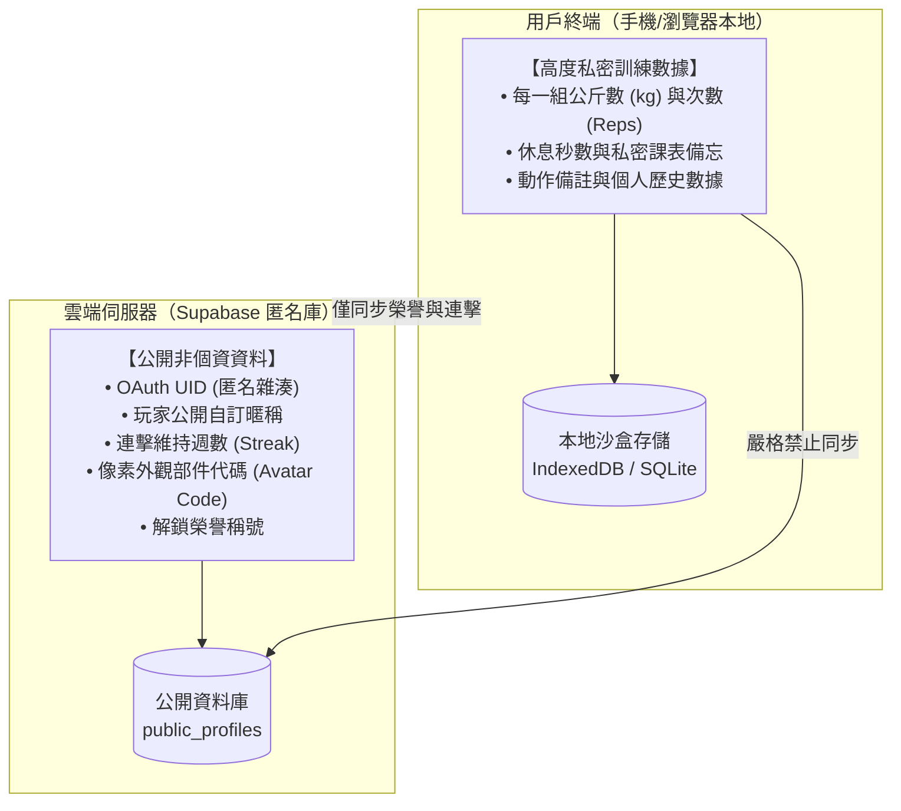

# 產品定位與零個資隱私原則 (Product Vision & Zero-PII)

> **鏈結索引**：[返回索引](file:///Users/yuchien/Project/Github/fitmon/llm-wiki/wiki/00_INDEX.md) ｜ [雙模式架構](file:///Users/yuchien/Project/Github/fitmon/llm-wiki/wiki/dual_mode_experience.md) ｜ [技術架構](file:///Users/yuchien/Project/Github/fitmon/llm-wiki/wiki/tech_architecture.md)

---

## 1. 核心產品定位

FitMon 旨在打破健身領域的兩大極端困境：
1. **傳統健身工具太嚴肅無趣**：如強記型試算表或純數據記錄軟體，缺乏即時成就反饋，新手與大眾難以長期維持自律動能。
2. **既有遊戲化健身 App 缺乏專業度**：常流於幼稚小品或過多花俏彈窗干擾，專業健美、健力或規律重訓者因輸入效率低下而迅速棄坑。

**FitMon 的解決方案**：
- **物理分流雙體驗**：訓練當下是極簡無干擾的專業重訓表記錄器；練後返家則一鍵將汗水容量轉換為像素 RPG 的數值多巴胺。
- **運動科學底蘊**：引入動作神經負荷加權與垃圾容量衰減機制，兼顧專業認同與遊戲樂趣。

---

## 2. 零個資儲存原則 (Zero-PII Architecture)

FitMon 將隱私視為第一等公民，實行嚴格的 **Zero-PII（Zero Personally Identifiable Information）** 原則：

### 2.1 絕不收集之項目
- ❌ 自然人真實姓名
- ❌ 手機電話號碼
- ❌ 裝置通訊錄名單
- ❌ 信用卡與金融帳戶敏感號碼

### 2.2 身分認證與帳號匿名化
- 僅支援第三方身分供應商：**Apple ID（搭配 Private Relay 隱藏郵件）** 與 **Google Sign-In**。
- 伺服器端唯一保留的關聯標識為不可逆之 OAuth 匿名 UID（UUID）。

### 2.3 本地與雲端物理隔離架構

**隱私安全防禦效益**：
即便雲端資料庫遭遇脫庫攻擊（Database Breach），攻擊者只能取得抽象的暱稱、連擊天數與外觀代碼，完全不包含任何法律定義之自然人個人資料或私密生理訓練足跡。
