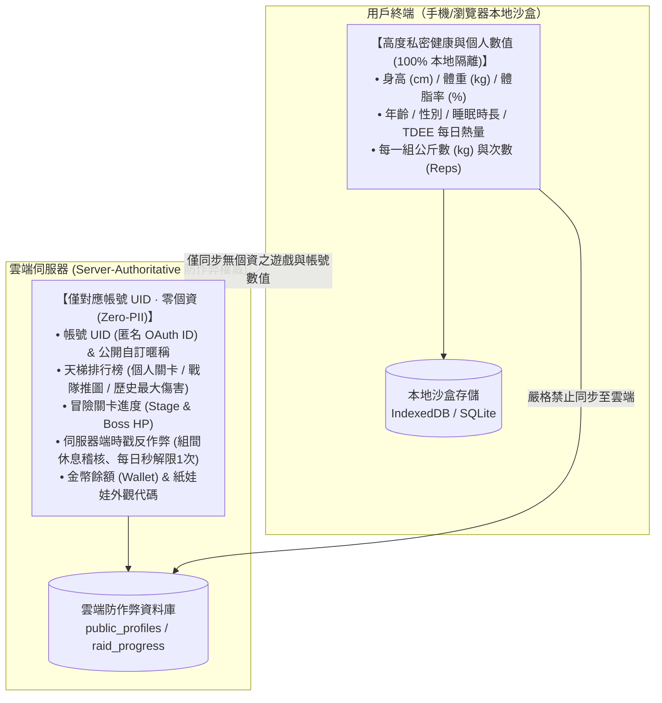

# 產品定位與零個資隱私原則 (Product Vision & Zero-PII)

> **鏈結索引**：[返回索引](00_INDEX.md) ｜ [雙模式架構](dual_mode_experience.md) ｜ [技術架構](tech_architecture.md)

---

## 1. 核心產品定位

FitMon 旨在打破泛運動與健身領域的兩大極端困境：
1. **傳統運動記錄工具太嚴肅無趣**：如強記型試算表或純數據記錄軟體，缺乏即時成就反饋，新手與大眾難以長期維持自律動能。
2. **既有遊戲化健身 App 缺乏專業度且幼稚**：常流於繁瑣的花俏彈窗或過度複雜的數值打怪，常規訓練者因操作效率低下而迅速棄坑。

**FitMon 的解決方案**：
- **受眾定位：泛運動愛好者**：涵蓋戶外/跑步機跑步、徒手自重訓練、重訓器械、CrossFit、瑜伽與皮拉提斯等多樣化運動型態。
- **生活感像素遊戲體驗**：以「經典 2D 像素訓練室」為核心舞台，小人在房間裡自主走動鍛鍊；以「連續運動任務制」與「金幣經濟」驅動長期習慣。
- **終極定位定調 (Fitness + Paper Doll + Social)**：非封閉式 RPG 戰鬥打怪遊戲，而是「**專業運動打卡 × 復古像素雙軌紙娃娃 × 朋友圈病毒社群**」的自律習慣養成軟體。
- **朋友圈口碑自然裂變**：以「像素拍立得布告欄」與「Meme 拍貼工坊」為媒介，讓玩家用自己的數位替身 (Digital Twin) 製作搞笑自嘲梗圖，引爆 Threads、IG 與 FB 社群自發傳播。
- **全球雙語系出發**：首發原生支援繁體中文（台灣/港澳市場）與英文（全球健身社群），所有界面字串與運動庫完整在地化。
- **品牌代號彈性 (Brand Decoupling)**：「FitMon」為現階段工程開發代號，產品正式發布名稱保留動態調整空間，全站字串 100% 抽離硬編碼。

---

## 2. 漸進式無感帳號體驗與隱私原則 (Progressive Onboarding & Privacy)

FitMon 實行極致絲滑的體驗路徑：
- **極速免註冊試玩**：首次打開遊戲無需輸入任何帳號密碼，黑底淡入 8-bit 音樂響起，直接捏臉、自訂角色與房間、開始記錄運動並賺取金幣（暫存於客戶端本地沙盒）。
- **漸進式無感綁定 (Progressive Sign-in)**：當玩家觸發「發布動態至公開廣場」、「加好友」、「打賞金幣」等網路社交動作時，引導一鍵綁定 Apple / Google / Email。
- **本地至雲端無損合併**：綁定成功後，本地試玩的金幣、裝扮與運動紀錄自動在背景無縫遷移至 Supabase 雲端，絕無數據遺失。
- **隱私安全承諾**：絕不索取自然人真實姓名、通訊錄名單或手機號碼，資料庫僅保留匿名 OAuth UID。

### 2.3 本地與雲端物理隔離架構

---

## 3. Zero-PII 內容安全防火牆 (Zero-PII Content Firewall)

針對社群 UGC（使用者自製內容）普遍面臨的高昂色情、裸露、廣告風控與個資風險，FitMon 確立**「站內純像素零風控，站外本地合圖秀身材」**的最高架構防火牆：

1. **站內生態（100% 純淨無毒、零審核成本）**：
   * 站內動態廣場與好友圈**嚴禁且不提供任何真人照片上傳至雲端伺服器之功能**。
   * 貼文內容一律為純像素視覺：`自訂 32x32 像素小人 ＋ 運動數據 ＋ 像素裝潢房間 ＋ 官方經典自嘲梗詞`。
   * **效益**：零色情裸露風險、零人臉個資外洩風險、省下高昂第三方 AI 圖像審核 API 成本，資料庫只存輕量 JSON，傳輸極速且營運成本趨近於 0。
2. **站外裂變（本機無痕合成，滿足 IG 炫耀心理）**：
   * 在「Meme 拍貼工坊」中，玩家可自由選取本機相簿中的健身或飲食照片。
   * **照片 100% 留在玩家手機前端記憶體中，絕不上傳雲端伺服器**。
   * Canvas 在本地合成小人與宣傳浮水印後，一鍵直發至玩家自己的 Instagram 限動或 Threads，由 Meta 自身演算法負責圖片審查，FitMon 伺服器完全不沾鍋！
3. **本機健康數據沙盒 (Local Biometrics Sandbox)**：
   * 年齡、身高、體重、體脂率、睡眠時長、飲水量、BMR/TDEE 計算與過往狀態曲線圖表，**100% 儲存於使用者終端設備本地（IndexedDB / SQLite）**。
   * 支援串接 iOS Apple Health (HealthKit) 與 Android Google Health Connect，數據讀取後僅供本機儀表板展示，**絕對不上傳雲端，雲端伺服器完全零存儲、零知曉**！
4. **雲端唯一防作弊職責 (Server-Authoritative Economy)**：
   * 雲端唯一保管並驗證的僅有：**玩家錢包金幣餘額 (Wallet Ledger)、已解鎖道具庫存 (Inventory)、以及純像素社群動態與打賞明細**，徹底杜絕本機竄改作弊，同時捍衛極致個人隱私。

**隱私安全防禦效益**：
即便雲端資料庫遭遇脫庫攻擊（Database Breach），攻擊者只能取得抽象的暱稱、連擊天數與外觀代碼，完全不包含任何法律定義之自然人個人資料或私密生理訓練足跡。
