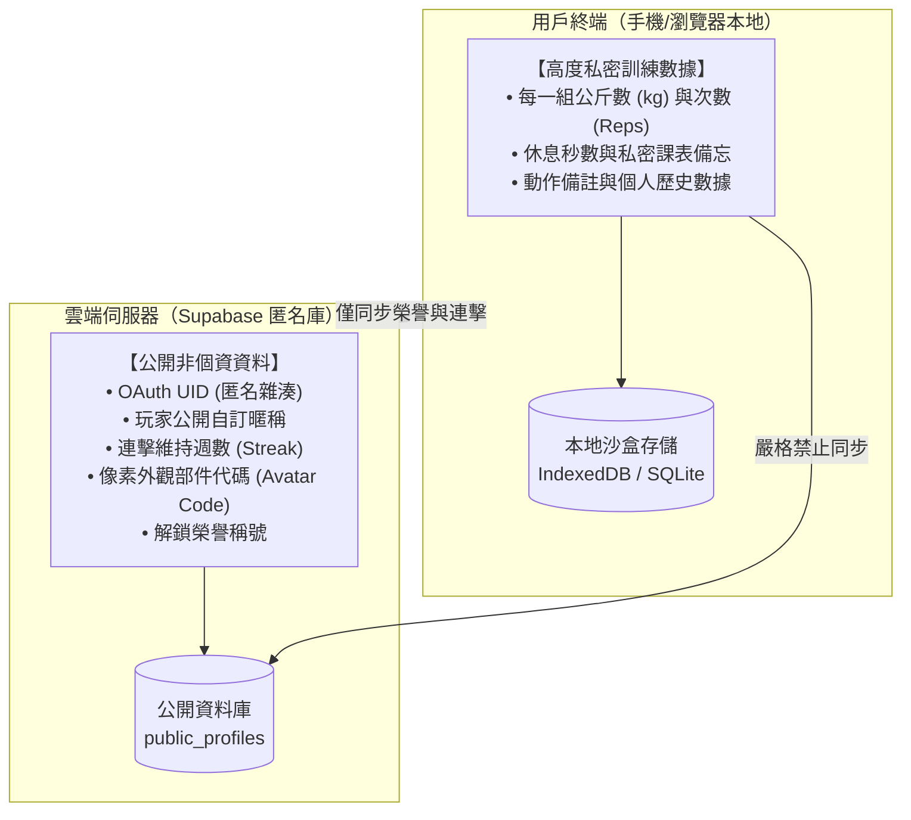

# 產品定位與零個資隱私原則 (Product Vision & Zero-PII)

> **鏈結索引**：[返回索引](00_INDEX.md) ｜ [雙模式架構](dual_mode_experience.md) ｜ [技術架構](tech_architecture.md)

---

## 1. 核心產品定位

FitMon 旨在打破泛運動與健身領域的兩大極端困境：
1. **傳統運動記錄工具太嚴肅無趣**：如強記型試算表或純數據記錄軟體，缺乏即時成就反饋，新手與大眾難以長期維持自律動能。
2. **既有遊戲化健身 App 缺乏專業度且幼稚**：常流於繁瑣的花俏彈窗或過度複雜的數值打怪，常規訓練者因操作效率低下而迅速棄坑。

**FitMon 的解決方案**：
- **受眾定位：泛運動愛好者**：涵蓋戶外/跑步機跑步、徒手自重訓練、重訓器械、CrossFit、瑜伽與皮拉提斯等多樣化運動型態。
- **生活感像素遊戲體驗**：以「經典 2D 像素訓練室」為核心舞台，小人在房間裡自主走動鍛鍊；以「連續運動任務制」與「金幣經濟」驅動長期習慣。
- **朋友圈口碑自然裂變**：以「像素拍立得布告欄」與「Meme 拍貼工坊」為媒介，讓玩家用自己的角色與已解鎖道具製作搞笑自嘲梗圖，引爆 IG 限動與社群分享。

---

## 2. 漸進式無感帳號體驗與隱私原則 (Progressive Onboarding & Privacy)

FitMon 實行極致絲滑的體驗路徑：
- **極速免註冊試玩**：首次打開遊戲無需輸入任何帳號密碼，黑底淡入 8-bit 音樂響起，直接捏臉、自訂角色與房間、開始記錄運動並賺取金幣（暫存於客戶端本地沙盒）。
- **漸進式無感綁定 (Progressive Sign-in)**：當玩家觸發「發布動態至公開廣場」、「加好友」、「打賞金幣」等網路社交動作時，引導一鍵綁定 Apple / Google / Email。
- **本地至雲端無損合併**：綁定成功後，本地試玩的金幣、裝扮與運動紀錄自動在背景無縫遷移至 Supabase 雲端，絕無數據遺失。
- **隱私安全承諾**：絕不索取自然人真實姓名、通訊錄名單或手機號碼，資料庫僅保留匿名 OAuth UID。

### 2.3 本地與雲端物理隔離架構

**隱私安全防禦效益**：
即便雲端資料庫遭遇脫庫攻擊（Database Breach），攻擊者只能取得抽象的暱稱、連擊天數與外觀代碼，完全不包含任何法律定義之自然人個人資料或私密生理訓練足跡。
