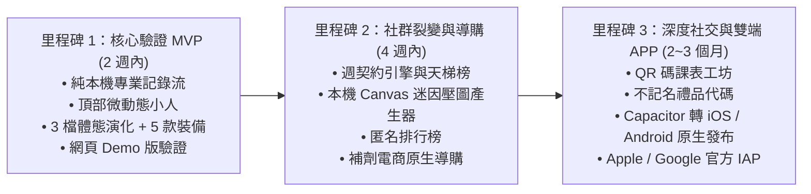

# 開發里程碑與落地藍圖 (Roadmap & Milestones)

> **鏈結索引**：[返回索引](file:///Users/yuchien/Project/Github/fitmon/llm-wiki/wiki/00_INDEX.md) ｜ [技術架構](file:///Users/yuchien/Project/Github/fitmon/llm-wiki/wiki/tech_architecture.md) ｜ [演進記錄](file:///Users/yuchien/Project/Github/fitmon/llm-wiki/logs/changelog.md)

---

## 總體發展時程

---

## 各階段產出與檢核標準 (Deliverables & Exit Criteria)

### 里程碑 1：核心驗證 MVP（2 週內）——【當前執行階段】
- **目標**：打造可直接在瀏覽器操作的 Web-First 網頁 Demo，驗證連續使用 7 天的流暢度與專業體驗。
- **具體交付物**：
  1. `apps/web-demo`：行動裝置模擬視口之網頁應用。
  2. 專業模式：黑底大字單手盲操 UI、40+ 動作庫快速選填、歷史組數自動預載、組間倒數計時器。
  3. 像素小人微動態：組間倒數時之喝水、擦汗、握槓循環動畫。
  4. 養成模式：練後一鍵容量結算、數值引擎公式計算經驗值、初始 3 檔體態演化、5 款像素裝備試穿。
- **驗證指標**：單組記錄耗時 $< 3$ 秒，結算成長感明確。

### 里程碑 2：社群裂變與導購（4 週內）
- **目標**：完成病毒式社交傳播閉環與初步商業變現跑通。
- **具體交付物**：
  1. HTML5 Canvas 迷因工作室（支援 9:16 IG 限動排版、浮水印印製）。
  2. 週契約打卡系統（每週 2~5 天承諾與維持判定）。
  3. 虛擬肌酸/乳清補劑之品牌專屬導購外跳按鈕。
  4. Supabase 匿名公用資料庫串接（公開排行榜）。

### 里程碑 3：深度社交與商業閉環（第 2～3 個月）
- **目標**：雙平台原生 App 商店上架與社群課表互通。
- **具體交付物**：
  1. 將 Web 代碼透過 Capacitor 打包編譯為 iOS (.ipa) 與 Android (.apk / .aab)。
  2. 整合原生觸覺反饋（Haptics）與系統原生分享卡。
  3. 上架 Apple App Store 與 Google Play，接入官方應用程式內購（IAP）。
  4. 課表卡牌 DeepLink 匯入與等比例力量縮放。
