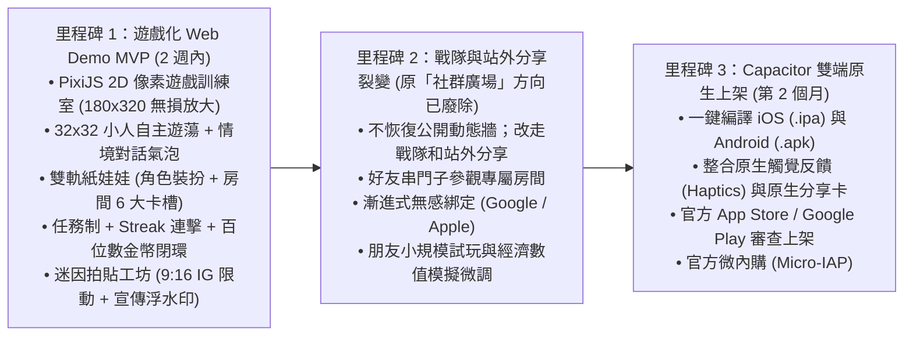

# 開發里程碑與落地藍圖 (Roadmap & Milestones)

> **鏈結索引**：[返回索引](00_INDEX.md) ｜ [技術架構](tech_architecture.md) ｜ [演進記錄](../logs/changelog.md)

---

## 總體發展時程

---

## 各階段產出與檢核標準 (Deliverables & Exit Criteria)

### 里程碑 1：遊戲化 Web Demo MVP（2 週內）——【當前執行階段】
- **目標**：打造具有**「純正遊戲引擎質感」**的 Web-First 像素養成應用，發給朋友手機瀏覽器秒開試玩。
- **具體交付物**：
  1. `apps/web-demo`：行動裝置視口優先之 React + PixiJS 混合架構。
  2. **PixiJS 遊戲畫布**：180x320 虛擬解析度、近鄰採樣無損放大、2D 正視橫切面房間、小人自主遊蕩與使用器材、情境對話氣泡輪播。
  3. **雙軌紙娃娃**：32x32 角色 5 層精靈換裝 ＋ 房間 6 大家具卡槽自訂。
  4. **任務與金幣閉環**：每日任務打卡、連續運動 Streak 點火、街機勝利結算與金幣噴發。
  5. **Meme 拍貼工坊**：三合一底圖、貼紙手勢旋轉縮放、自嘲梗庫、右下角貼邊宣傳 Logo 浮水印、匯出 9:16 / 1:1 高清圖。
  6. **聲音系統**：8-bit 輕快 BGM（創角點擊 START 無感啟動）＋ 街機 SFX，支援一鍵靜音。
- **檢核標準**：手機瀏覽器 1 秒內載入、小人動作流暢 60 FPS、做出一張 Meme 圖發給朋友能引起笑點與詢問！

### 里程碑 2：戰隊與站外分享裂變（3～4 週內）
- **目標**：串接 Supabase 雲端資料庫，跑通戰隊互動與站外自然增長。
- **方向更正**：舊標題「社群廣場與朋友圈裂變」以及下列第 1、2 項 **已廢除**，不列為現行交付物。YuChien 於 2026-11-10 15:04（Asia/Taipei）親口確認站內公開動態牆、打賞與發布拍立得已廢除，改成合照；15:08 決定不恢復公開動態牆，改走戰隊和站外分享。
- **具體交付物**：
  1. ~~拍立得動態布告欄（公開廣場與好友圈雙軌）~~ **已廢除**（同上，15:04／15:08）。
  2. ~~原子打賞金幣與互贈能量水（PostgreSQL RPC 交易保證）~~ **打賞已廢除**（15:04）。互贈能量水是否另保留，本次未另作決定。
  3. 好友串門子參觀對方的專屬裝潢房間。
  4. 漸進式綁定機制（LocalStorage 本地進度無損合併至 Supabase Auth）。
  5. 數值模擬腳本：透過模擬 1,000 位玩家打卡，微調 `game_economy_config` 產銷平衡。

### 里程碑 3：Capacitor 雙端原生上架（第 2 個月）
- **目標**：封裝為原生手機應用，登上 Apple App Store 與 Google Play。
- **具體交付物**：
  1. 由 AI 引導使用 Capacitor 封裝生成 Xcode 與 Android Studio 專案。
  2. 調用手機底層震動馬達（Haptics）與系統原生分享抽屜。
  3. 雙端商店發布上架與官方純外觀微內購（Micro-IAP）。
