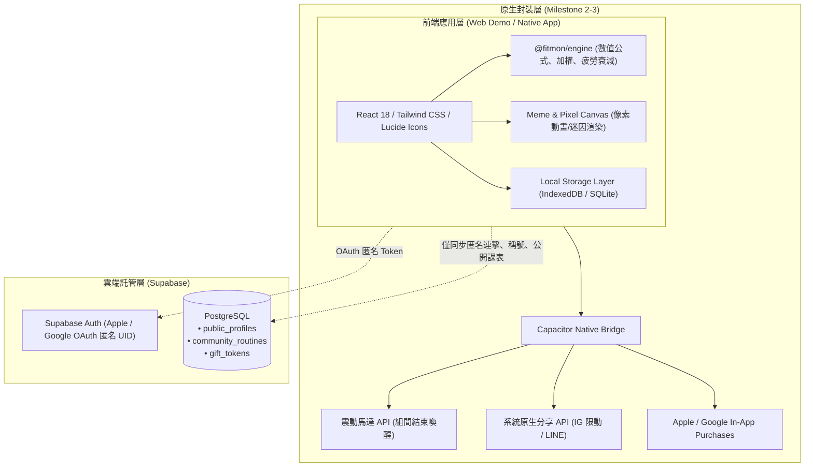

# 系統技術架構與數據儲存 (System Architecture & Storage)

> **鏈結索引**：[返回索引](file:///Users/yuchien/Project/Github/fitmon/llm-wiki/wiki/00_INDEX.md) ｜ [架構決策 ADR-0001](file:///Users/yuchien/Project/Github/fitmon/llm-wiki/adr/0001-web-first-demo-to-mobile-cross-platform-architecture.md) ｜ [里程碑](file:///Users/yuchien/Project/Github/fitmon/llm-wiki/wiki/roadmap.md)

---

## 1. 總體分層架構 (Local-First + Zero-PII Cloud)



---

## 2. 本地數據庫架構 (Local-First Schema)

所有訓練詳情保存在使用者本地終端：
- **`exercises`**：動作庫（ID, 名稱, 肌群, 複合/孤立, 預設加權倍率）。
- **`workout_sessions`**：訓練場次記錄（時間戳、消耗時長、總訓練量、總結算經驗值）。
- **`workout_sets`**：每一組詳情（動作 ID, 第幾組, 重量 kg, 次數 reps, RPE 自覺強度）。
- **`user_inventory`**：本機持有的道具（肌酸數量、乳清蛋白、已裝備像素皮膚代碼）。

---

## 3. 雲端資料庫綱要 (Supabase Zero-PII Schema)

雲端資料庫僅儲存絕不包含個人識別資料（PII）的公開排行與社群資料：

```sql
-- 玩家公開榮譽表 (完全無個人可識別身分資料)
create table public_profiles (
  id uuid primary key references auth.users(id),    -- OAuth 匿名 UID
  nickname text not null,                           -- 玩家隨意輸入的公開暱稱
  streak_weeks int default 0,                       -- 連擊維持週數
  contract_days_per_week int not null,              -- 週契約天數 (2-5)
  avatar_code text not null,                        -- 外觀部件代碼 (例: "b2:h01:t04:belt02")
  title text default '健身新秀',                     -- 解鎖稱號
  updated_at timestamp with time zone default now()
);

-- 公開課表秘笈工坊 (社群共享)
create table community_routines (
  id uuid primary key default gen_random_uuid(),
  author_id uuid references public_profiles(id),
  title text not null,                              -- 課表標題
  routine_json jsonb not null,                      -- 動作序列與組次結構
  downloads_count int default 0,
  created_at timestamp with time zone default now()
);

-- 社交送禮兌換代碼表 (無好友關聯圖譜)
create table gift_tokens (
  token text primary key,                           -- 隨機生成的兌換代碼
  item_type text not null,                          -- 補劑或裝扮類型
  created_by uuid references public_profiles(id),
  is_redeemed boolean default false,
  created_at timestamp with time zone default now()
);
```

---

## 4. Web-First Demo 轉 Android & iOS APP 落地路徑

為滿足「先有網頁 Demo 確認，成熟後直接轉雙平台 App」之需求，技術路徑採 **React + Vite + Capacitor**（詳見 [ADR-0001](file:///Users/yuchien/Project/Github/fitmon/llm-wiki/adr/0001-web-first-demo-to-mobile-cross-platform-architecture.md)）：
1. **網頁 Demo 階段**：以行動裝置視口（Mobile-First Viewport）開發，透過標準瀏覽器即可分享給利害關係人與測試者體驗。
2. **本機儲存抽象**：儲存層設計為抽象介面（`IStorageProvider`），網頁版使用 `IndexedDB`，轉為 App 時自動切換為原生高效率之 `SQLite`。
3. **原生封裝階段**：透過 `@capacitor/core` 與 `@capacitor/cli` 加入 `ios/` 與 `android/` 資料夾，完全不重寫前端代碼，直接呼叫原生震動、分享與 StoreKit / Google Play Billing。
