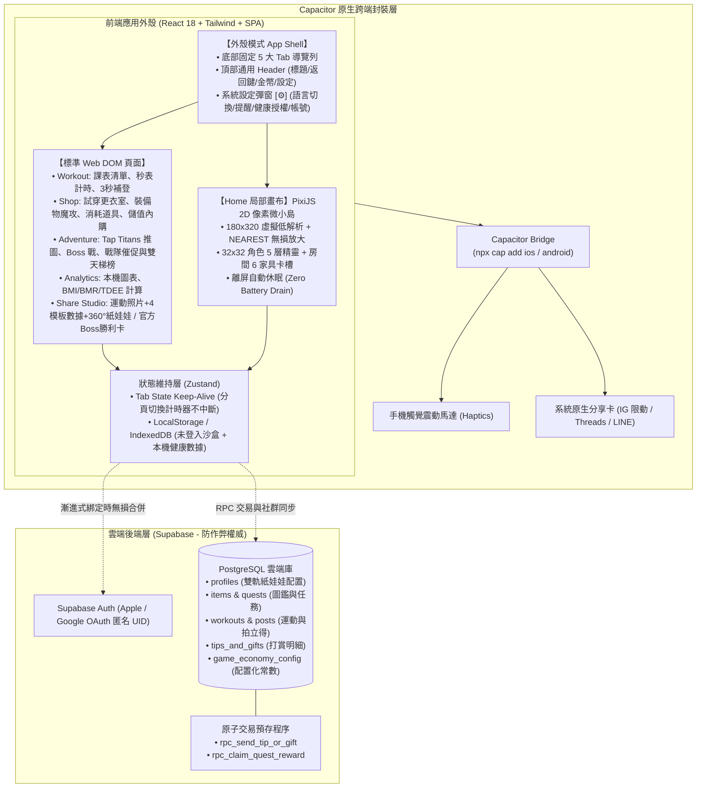

# 系統技術架構與數據儲存 (System Architecture & Tech Stack)

> **鏈結索引**：[返回索引](00_INDEX.md) ｜ [架構決策 ADR-0001](../adr/0001-web-first-demo-to-mobile-cross-platform-architecture.md) ｜ [架構決策 ADR-0002 (App 外殼與嵌入式畫布)](../adr/0002-app-shell-with-embedded-pixel-canvas.md) ｜ [資料庫遷移腳本](../../supabase/migrations/20261101_init_fitmon_game_schema.sql)

---

## 1. 總體技術棧：現代 App 外殼 ＋ 局部嵌入像素畫布 (ADR-0002)

根據 [ADR-0002](../adr/0002-app-shell-with-embedded-pixel-canvas.md)，系統放棄全螢幕封閉遊戲引擎路線，回歸最成熟的「**現代手機 App 外殼架構 (App Shell)**」，並在首頁局部嵌入 2D 像素遊戲小島：

```
+-------------------------------------------------------------+
| 📱 上方頂部導覽列 (Top Header)                               |
| [◀ 返回] (二級頁面才出現)   【分頁標題】     [🪙 1,250 金幣] [⚙️] |
+-------------------------------------------------------------+
|                                                             |
| 內容滾動區 (Main Content Area - SPA 毫秒瞬間切換，保持狀態):  |
|                                                             |
| 【Tab 1: 訓練室 (Home)】                                     |
|  ┌────────────────────────────────────────────────────────┐ |
|  │ 👾 局部像素遊戲小島 (Embedded Pixel Canvas Widget)         │ |
|  │    (小人自主巡邏/跑步機/深蹲/摸狗/情境氣泡/家具佈局)     │ |
|  └────────────────────────────────────────────────────────┘ |
|  • 今日任務卡片 (Daily Quests)                              |
|  • 連擊火焰 🔥 7 天 (Streak Card)                            |
|                                                             |
| 【Tab 2: 運動與課表 (Workout)】                              |
|  • 課表模板庫 (推/拉/腿)、秒表計時器、3 秒極速補登 (Web DOM) |
|                                                             |
| 【Tab 3: 金幣商城 (Shop)】                                    |
|  • 雙軌換裝更衣鏡、消耗型道具 (體力水/雙倍卡/冰凍卡)、扭蛋機  |
|                                                             |
| 【Tab 4: 冒險與戰隊 (Plaza / Adventure)】                      |
|  • Tap Titans 關卡推圖、生活 Boss 戰、2~4人戰隊同儕催促、雙天梯榜 |
|  • 拍貼分享工坊（運動自拍×4款數據模板×360°紙娃娃 / 官方Boss勝利卡）|
|                                                             |
| 【Tab 5: 本機數據與個人 (Analytics & Profile)】              |
|  • 100% 本機 IndexedDB 體重/體脂/睡眠/TDEE 趨勢曲線圖 (DOM)  |
|                                                             |
+-------------------------------------------------------------+
| 📱 底部固定導覽列 (Bottom Navigation Bar)                    |
|   [🏠 房間]    [🏋️ 運動]    [🛒 商城]    [⚔️ 冒險]    [👤 我的]  |
+-------------------------------------------------------------+
```

### 1.1 分層架構圖與視覺雙軌設計
- **遊戲房間與角色視覺（《楓之谷》級 HD 2D 賽璐璐 Q 版引擎）**：捨棄粗糙的 8-Bit 馬賽克方塊，改採 `960×600` 高解析度抗鋸齒 Canvas，以圓潤貝茲曲線、暖深棕漫畫描邊 (`#2b1d16`) 與漸層光影繪製二頭身 Q 版紙娃娃（5 大部位插槽）與 3 大自由擺設傢俱/寵物槽位。
- **運動動作資料庫視覺（專業運動科學解剖圖解 × `free-exercise-db` 真人圖庫）**：運動打卡與課表庫採用醫療/運動科學級 SVG 紅/橘主次働肌群高亮解剖圖解，並結合開源 `yuhonas/free-exercise-db` 真人起始與頂峰收縮示範照片。
- **溫暖明亮日常主視覺（System-Aware Warm Theme）**：預設跟隨手機系統深淺色（若無法偵測則預設為**溫暖燕麥奶白亮色版 `.theme-light`**），深色版則採用**柔和暖炭焙深色 `.theme-dark`**，徹底屏除冰冷暗黑賽博科技感。


---

## 2. 視口、導覽與渲染規格 (Viewport, Navigation & Canvas Lifecycle)

1. **SPA 毫秒級無感切換 (No Full-Page Reload)**：
   - 底部 4 個主 Tab 切換為單頁內部切換，**零跳頁白屏、零重新載入**。
   - 僅在遠端拉取新社群動態時使用局部骨架屏 (Skeleton UI)。
2. **嵌入式像素畫布生命週期 (Smart Canvas Hibernation)**：
   - 畫布僅在「Tab 1: 訓練室」掛載並渲染。
   - 當使用者切換至「運動」、「社群」或「數據」Tab 時，PixiJS 的 `ticker` 自動暫停，CPU/GPU 佔用率直接歸零，手機完全不發燙。
3. **低解析像素顆粒無損採樣**：
   - 局部畫布內部保持 `180 x 320` 邏輯解析度，全域採用 `NEAREST` 近鄰採樣，無縫融入現代深色 App 外殼中。

---

## 3. 雲端資料庫綱要 (Supabase Schema 摘要)

完整 DDL 位於 [`supabase/migrations/20261101_init_fitmon_game_schema.sql`](../../supabase/migrations/20261101_init_fitmon_game_schema.sql)：

1. **`profiles`**：儲存 `avatar_config (JSONB)`、`room_config (JSONB)`、金幣餘額與 Streak 天數。
2. **`items`**：包含角色外觀（`avatar_*`）與房間家具（`room_*`）的統一圖鑑，標註金幣價格與 PixiJS 素材 Key。
3. **`quests` & `user_daily_quests`**：定義日常任務、打卡連擊暴擊與玩家每日進度。
4. **`posts` (已停用 / 轉為外部社群分享)**：原規劃儲存內部動態牆貼文，自 V2.9 起徹底轉為「純外部社群分享 (Instagram Stories / Threads / LINE)」，雲端不儲存玩家自拍照片，維持 100% 零個資 (Zero-PII) 與零 UGC 風控成本。
5. **`routine_templates` & `user_workout_schedules`**：自訂課表模板、每週分化排程與休息日標記。
6. **`tips_and_gifts`**：記錄打賞金額與能量水互贈，由資料庫交易保證防刷。
7. **`game_economy_config`**：數值配置表，支持未來動態模擬熱更新。

---

## 4. Local-First 離線優先同步與智慧推播 (Offline-First & Reminders)

1. **地下室無訊號離線打卡 (Offline-First Sync)**：
   * 在 B1/B2 地下室健身房無收訊環境下，打卡、碼表與換裝依然 100% 順暢存於本地 IndexedDB。
   * 手機重新偵測連網（`online` 事件）時，系統在背景默默批次同步至 Supabase，完全不產生阻礙彈窗。
2. **智慧溫和習慣提醒 (Smart Reminder)**：
   * 玩家可自訂每日提醒時段（如晚上 8:00）。
   * 當日尚未打卡時，小人或柴犬發出一則幽默短通知；當日已完成則自動靜音，絕不嘮叨。

---

## 5. 本機健康沙盒與系統健康串接 (Local Biometrics & HealthKit / Health Connect)

1. **本機審視儀表板 (Local Analytics Charts)**：
   * 包含年齡、身高、體重、體脂率、睡眠時長、飲水量、歷史訓練總容量 (Tonnage)。
   * 本機自動計算 BMI、BMR（Mifflin-St Jeor 公式）與動態 TDEE（依當週運動頻率乘上活動係數給予熱量建議）。
   * 支援 7 天、30 天、90 天平滑趨勢線與柱狀圖，**100% 留存在終端設備 IndexedDB，嚴禁上傳雲端**。
2. **Apple Health 與 Google 健康串接**：
   * 透過 Capacitor 官方外掛（`@capawesome-team/capacitor-health`）在用戶授權下自動讀取 Apple Watch / Android 手機之體重、睡眠與步數。
   * 資料直存本機沙盒，提供最無痛的數據輸入體驗。
3. **雲端防作弊唯一職責 (Server-Authoritative Anti-Cheat & Zero-PII Ledger)**：
   * **伺服器端核心驗證**：未來所有防止作弊機制（包括：**運動組間休息真偽檢查、出拳冷卻驗證、每日課金秒解限 1 次、天梯排行榜排名判定、冒險關卡進度與血量結算**）均全數由雲端後端（Supabase / Serverless RPC）作為唯一權威（Server-Authoritative）執行校驗，客戶端僅作樂觀 UI 渲染，嚴防透過竄改客戶端記憶體或本機時間作弊。
   * **零個資（Zero-PII）帳號映射規範**：
     - 雲端資料庫僅儲存與遊戲帳號唯一對應之匿名識別碼（OAuth UID / Account ID）。
     - 身高、體重、體脂率、年齡、生理數值等私密健康個資 100% 留存在本地裝置沙盒，**嚴禁上傳至伺服器**。
     - 雲端僅記錄：帳號 UID、自訂暱稱、天梯進度（Stage）、戰鬥數據（歷史最大傷害、尾刀次數、擊殺數）、錢包金幣與外觀代碼，完全不包含任何個資。

---

## 6. 產品行為遙測與漏斗分析模組 (Product Telemetry & Funnel Analytics)

1. **零個資匿名埋點原則 (Zero-PII Telemetry Guardrail)**：
   * 遙測數據**嚴禁包含任何生理私密數據**（身高、體重、體脂、睡眠、飲食照片 100% 留存在本地沙盒，不得上傳）。
   * 僅搜集**匿名化產品體驗指標**：D1/D7/D30 留存率、核心功能漏斗轉化（首頁 ➔ 運動打卡 ➔ 迷因合成 ➔ 分享至 IG）、最受歡迎家具/服飾道具、平均單次訓練時長。
2. **統一外觀模式架構 (Facade Pattern)**：
   * 前端封裝統一 `analytics.ts` 抽象接口（如 `analytics.track(eventName, properties)`）。
   * 底層相容支援 **PostHog**（首選：留存熱力圖、漏斗轉化分析、100 萬次/月免費額度）、**Google Analytics 4 (GA4)** 或內部數據表，業務代碼與分析供應商完全解耦。
3. **跨端支援**：
   * Web-Demo 階段透過 Web SDK 監聽使用者操作；Capacitor 雙端打包後自動切換至原生相容模式，確保數據完整不中斷。

---

## 7. 多國語系 (i18n)、品牌解耦與像素字型架構 (Multi-Language & Brand Decoupling)

1. **品牌名稱動態解耦 (Brand Decoupling)**：
   * 專案代碼內部使用 `FitMon` 作為 Codename，但**所有面向使用者的名稱全面抽離硬編碼**。
   * 前端由全域設定檔（`APP_CONFIG.brandName`）與語系檔（`locales/{lang}.json` 中的 `common.brandName`）統一注入。
   * 浮水印、版權聲明、社群分享標題與 App Title 皆由設定檔即時驅動，未來更名或註冊商標時 **0 代碼重構、1 秒全站置換**。
2. **多語系架構 (i18n Core Engine)**：
   * 採用 `i18next` ＋ `react-i18next`。
   * 首發支援：**英文 (`en-US`, 預設/Fallback)** 與 **繁體中文 (`zh-TW`)**。
   * 自動偵測系統語系 (`navigator.language`)，並在設定中提供手動切換開關。
3. **繁中/英文統一開源像素字型 (Pixel Font Strategy)**：
   * 採用 MIT 開源之 **`Fusion Pixel Font` (融合像素體)** 或 **`Cubic 11` (俐方體 11 號)**。
   * 具備完整繁體中文（台灣常用字集）與 ASCII 英數支援，統一 12px 點陣規格，杜絕缺字破圖或豆腐塊（`□`）。
4. **低解析度畫布防爆版佈局規則 (Anti-Overflow Layout)**：
   * 在 180×320 虛擬像素畫布中，嚴禁按鈕與彈窗使用固定寬度（Fixed px）。
   * 一律採用彈性容器（Flex/Grid + `flex-wrap`），並針對長度較長之英文詞彙預留多行折行或動態間距，避免畫面擠壓出界。
