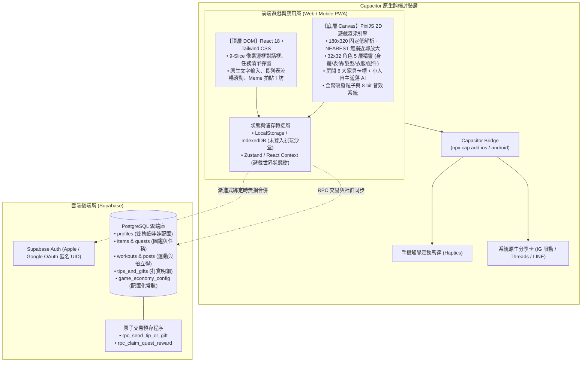

# 系統技術架構與數據儲存 (System Architecture & Tech Stack)

> **鏈結索引**：[返回索引](file:///Users/yuchien/Project/Github/fitmon/llm-wiki/wiki/00_INDEX.md) ｜ [架構決策 ADR-0001](file:///Users/yuchien/Project/Github/fitmon/llm-wiki/adr/0001-web-first-demo-to-mobile-cross-platform-architecture.md) ｜ [資料庫遷移腳本](file:///Users/yuchien/Project/Github/fitmon/supabase/migrations/20261101_init_fitmon_game_schema.sql)

---

## 1. 總體技術棧與分層架構 (React + PixiJS + Supabase + Capacitor)

針對 Web 全端工程師背景，系統採用「**Web-First 遊戲化 ➔ 一鍵跨端 Native**」架構：

---

## 2. 視口與渲染規格 (Viewport & Rendering)

* **虛擬畫布**：`180 x 320` 經典手持 9:16 像素解析度。
* **放大採樣**：全域使用 `PIXI.SCALE_MODES.NEAREST`，保證在現代高解析螢幕（Retina）上擁有純粹方塊顆粒感，無模糊、極致省電。
* **圖集預載**：所有角色部件與家具打包為 Spritesheet Atlas，單次請求載入完畢，換裝秒切零延遲。

---

## 3. 雲端資料庫綱要 (Supabase Schema 摘要)

完整 DDL 位於 [`supabase/migrations/20261101_init_fitmon_game_schema.sql`](file:///Users/yuchien/Project/Github/fitmon/supabase/migrations/20261101_init_fitmon_game_schema.sql)：

1. **`profiles`**：儲存 `avatar_config (JSONB)`、`room_config (JSONB)`、金幣餘額與 Streak 天數。
2. **`items`**：包含角色外觀（`avatar_*`）與房間家具（`room_*`）的統一圖鑑，標註金幣價格與 PixiJS 素材 Key。
3. **`quests` & `user_daily_quests`**：定義日常任務、打卡連擊暴擊與玩家每日進度。
4. **`posts`**：儲存拍立得運動成果、自嘲短評、隨拍照 URL 與發文當下的角色/房間外觀快照。
5. **`tips_and_gifts`**：記錄打賞金額與能量水互贈，由資料庫交易保證防刷。
6. **`game_economy_config`**：數值配置表，支持未來動態模擬熱更新。
